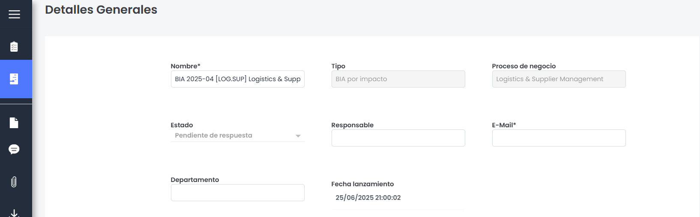

# Detalles Generales

La sección de **Detalles generales** agrupa los campos básicos de configuración e identificación de la encuesta. Su comportamiento varía en función del tipo de acceso (interno o externo) y del modelo de encuesta configurado.

* **Nombre**: Permite definir el nombre identificativo de la encuesta. Editable en encuestas internas y de solo lectura en accesos externos. Es un campo obligatorio.
* **Tipo**:  Indica el tipo de Modelo en base al cual se ha realizado la encuesta. No es editable.
* **Estado**: este campo solo se muestra si el modelo de encuesta tiene estados configurados. Su comportamiento depende del tipo de acceso y del tipo de estado definido:

  * **Acceso externo:** tanto para estados automáticos como manuales, el campo se muestra en modo solo lectura.
  * **Acceso interno**:

    * Si el estado es automático, se muestra como solo lectura y refleja el estado actual de la encuesta (actualizable desde la cabecera).
    * Si el estado es manual, el campo es editable y permite seleccionar cualquier estado disponible.
* **Proceso de negocio**: Muestra el proceso de negocio evaluado en la encuesta. No es editable.
* **Responsable**:

  * **Acceso externo**: siempre visible y no editable.
  * **Acceso interno**:

    * Si la encuesta no tiene estados, o el estado actual no define un responsable, el campo aparece vacío y editable.
    * Si el estado define un responsable, se completa automáticamente y sigue siendo editable. No es un campo obligatorio.
* **E-mail**:

  * **Acceso externo**: siempre visible y no editable.
  * **Acceso interno**:

    * Si no hay responsable, el campo aparece vacío y editable.
    * Si hay responsable, se completa automáticamente con su dirección y no es editable.
* **Departamento**: campo de texto, siempre visible y editable.
* **Fecha de lanzamiento**: campo de fecha, no editable. Muestra la fecha de creación de la encuesta.
* **Fecha fin de publicación**: solo se muestra si la encuesta fue generada a partir de una publicación.

Además, en encuestas de tipo *BIA por Impacto*, también se mostrarán los siguientes campos si han sido configurados en el modelo. No son editables :

* **Objetivo principal:** Informa al usuario sobre el objetivo principal de la encuesta o el BIA.
* **Objetivo individuales:** Informa al usuario sobre aquellos objetivos mas específicos por los que es necesario realizar la encuesta o el BIA
* **Requisitos adicionales:** Informa al usuario sobre aquellas necesidades adicionales a la hora de completar la encuesta.
* **Tipos de impacto en el negocio:** Permite al usuario visualizar los criterios establecidos a la hora de completar el BIA, que pueden servir de ayuda para completar la encuesta.
* **Valor criticidad:** Informa a los usuarios sobre la distribución de los impactos en forma de gráfica.

Esta sección incluye un botón **“Guardar”**, ubicado al final del formulario, que permite varlidar y guardar los cambios realizados en esta pantalla.
