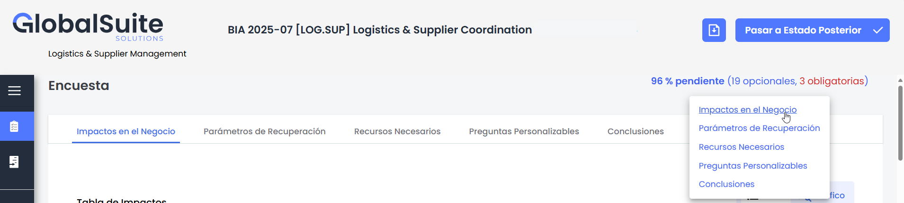
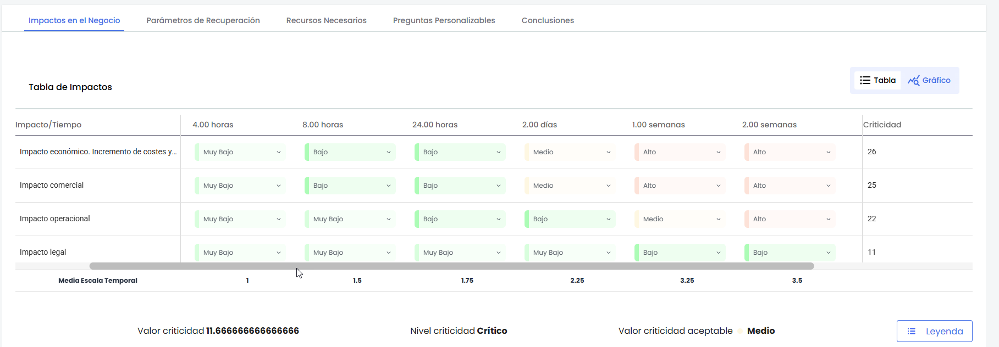
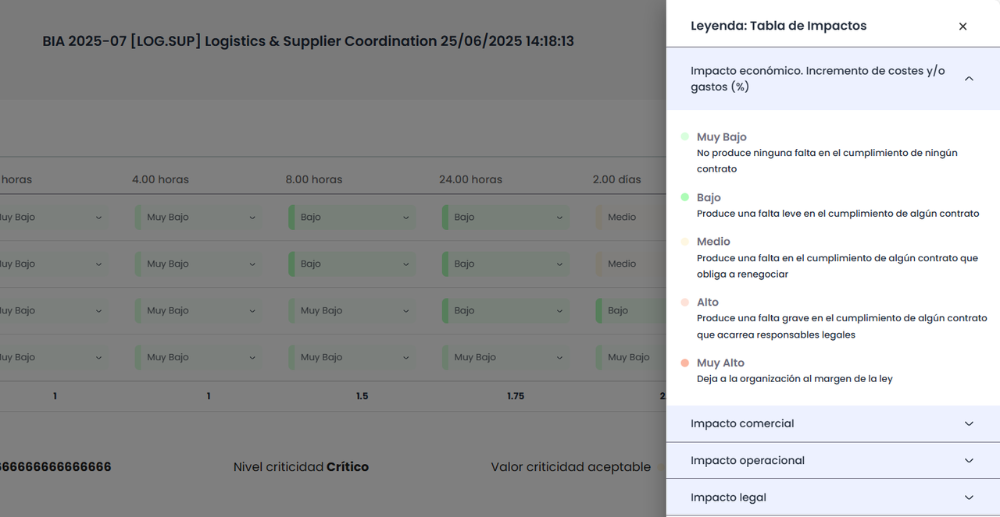
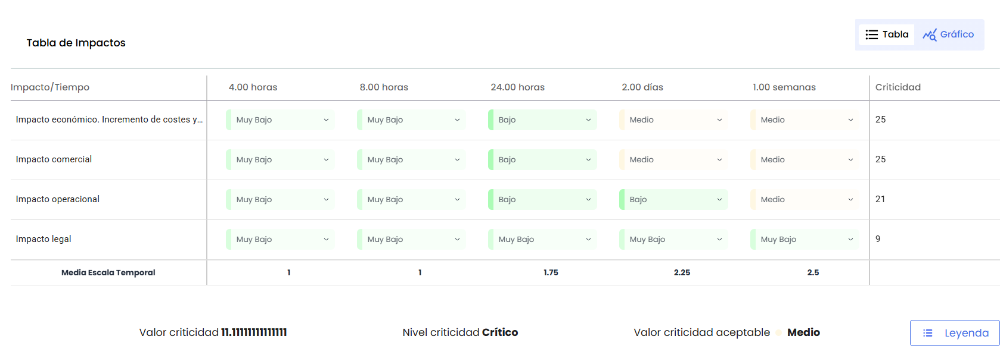
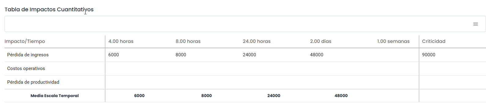
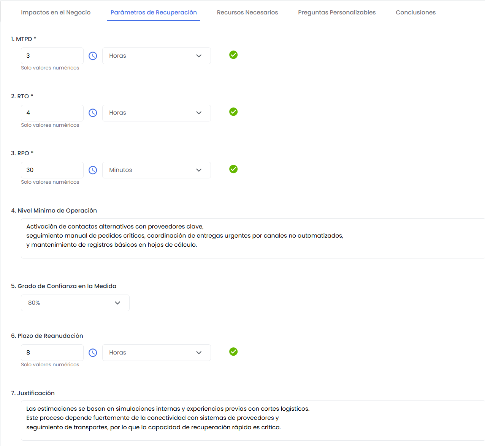
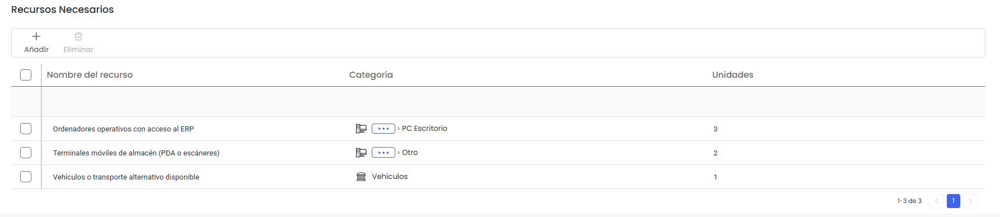
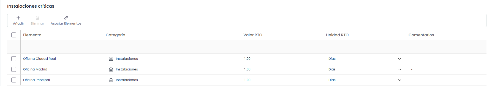
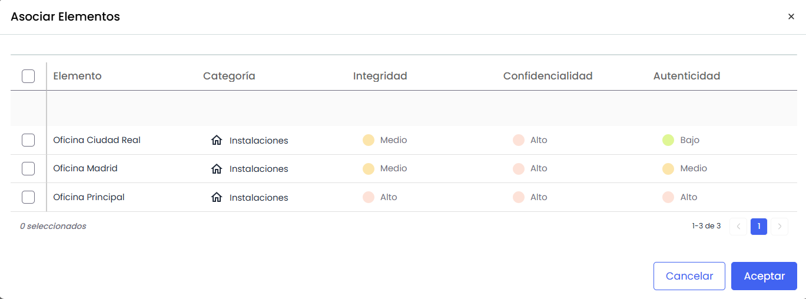
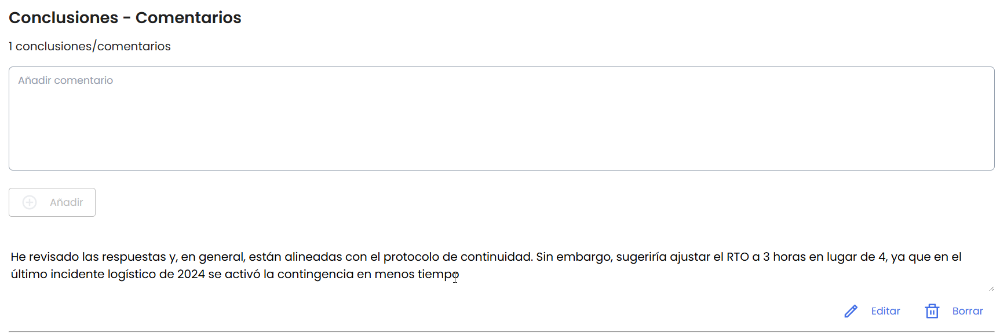

# Encuesta

## Encabezado

La cabecera de la encuesta proporciona al usuario información clave sobre el formulario que está completando, junto con acciones disponibles relacionadas con su progreso. Está compuesta por los siguientes elementos:

* **Porcentaje pendiente**  
  Indica el porcentaje total de preguntas de la encuesta que aún no han sido contestadas, distinguiendo además cuántas de ellas son opcionales u obligatorias.

  El formato es:  
  **“X% pendiente (Y opcionales, Z obligatorias)”**  
  Por ejemplo: **“54% pendiente (8 opcionales, 2 obligatorias)”**

  * **X**: porcentaje total de preguntas sin responder.
  * **Y**: número de preguntas opcionales sin responder.
  * **Z**: número de preguntas obligatorias sin responder.

  Al colocar el cursor sobre este porcentaje, se muestra una lista indicando las pestañas del formulario en las que todavía hay preguntas pendientes, permitiendo acceder rápidamente a ellas.

  En encuestas con tablas, estas se consideran contestadas cuando:

  * **Tablas de impactos**: se ha valorado al menos un impacto.
  * **Resto de tablas**: se ha registrado al menos una entrada.
* **Botones de flujo de encuesta**: en función del estado actual y de la configuración del flujo definido para la encuesta, pueden mostrarse uno o varios botones de acción.


Más información sobre el funcionamiento del [Flujo de encuestas y creación o modificación del BIA](https://help.globalsuitesolutions.com/es/globalsuite/v1/flujo-de-encuestas-y-consolidacion)


La cabecera permanece visible de forma permanente mientras se navega entre los distintos bloques del formulario.

## Navegación por pestañas

Las encuestas BIA están organizadas por pestañas, cada una correspondiente a un bloque del formulario configurado previamente en **Administración > BIAS >** [**Bloques del formulario**](https://help.globalsuitesolutions.com/es/globalsuite/v1/configuracion-bia#ConfiguraciónBIA-Bloquesdelformulario)**.**

Las pestañas de la encuesta se generan únicamente para aquellos bloques que contengan al menos un campo visible o una pregunta personalizada visible, y se ordenan según el valor indicado en la columna *Índice* de cada bloque.


Los campos mostrados en la sección \*\*Detalles generales\*\* (como \*Nombre\*, \*Fecha\*, \*Responsable\* o \*Departamento\*) no se tienen en cuenta para determinar si un bloque debe mostrarse como pestaña.


Los nombres y el orden de las pestañas se actualizan dinámicamente según la configuración vigente de los bloques del formulario. Cualquier cambio realizado en los bloques —ya sea de nombre u orden— se aplica tanto a las encuestas nuevas como a las ya existentes.

## Evaluación de impactos

Dentro de la pestaña **Impactos en el Negocio** de las encuestas de tipo *BIA por Impacto*, se permite registrar la valoración del impacto en el negocio ante distintos escalones de interrupción.

Según la configuración de los **Tipos de Impacto** en el apartado **Ajustes > Continuidad de Negocio**, se mostrarán una o varias tablas para evaluar:

* **Impactos cualitativos**: valoración basada en niveles predefinidos.

  Estas tablas presentan los tipos de impacto definidos por la organización y permiten introducir evaluaciones para distintos horizontes temporales.

  A continuación se describen los elementos clave de estas tablas:

  * **Tabla de evaluación**: permite registrar los valores por cada tipo de impacto.

    
  * **Botón “Leyenda”**: visible si en el modelo de encuesta está activada la opción *Mostrar Tabla de Impactos*. Al pulsarlo, se muestran los niveles de impacto junto con su definición y color asignado.

    
  * **Visualización gráfica**: disponible mediante el icono correspondiente, muestra una representación visual de las valoraciones introducidas.

    
* **Impactos cuantitativos**: valoración mediante la introducción de valores numéricos

  

Para cada tabla se calcula un **valor de criticidad del proceso**, basado en la información introducida y en el criterio definido en **Ajustes > Continuidad de Negocio** (Acumulado, Máximo, Mínimo, Media o Media Ponderada). En el caso de las tablas cualitativas, se determina además un **nivel de criticidad** a partir del valor obtenido, según la escala configurada.

## **Parámetros de Recuperación**

Permite el usuario definir puntos más genéricos a la hora de establecer un BIA, como pueden ser los siguientes:

* **MTPD** (Tiempo máximo de inactividad)**:** Permite definir el tiempo máximo de parada del servicio . Para que el campo sea correcto, se debe ingresar valor y unidades y presionar “Confirmar”
* **RTO:** Permite establecer el tiempo objetivo de recuperación de los procesos. Para que el campo sea correcto, se debe ingresar valor y unidades y presionar “Confirmar”
* **RPO:** Permite establecer el punto objetivo de recuperación de la información de un proceso. Para que el campo sea correcto, se debe ingresar valor y unidades y presionar “Confirmar”
* **Nivel Mínimo de operación:** Posibilita identificar los niveles mínimos necesarios para la prestación de los servicios.
* **Grado de Confianza:** Posibilita indicar el grado de confianza del usuario con respecto al MTPD definido.
* **Plazo de Reanudación:** Permite definir la escala temporal de recuperación de los recursos necesarios para soportar el servicio o proceso de negocio.
* **Justificación:** Campo texto para justificar el plazo identificado en el apartado anterior.

## **Recursos Necesarios**

Se podrán identificar los recursos necesarios para garantizar la recuperación del proceso evaluado en caso de interrupción.

Los recursos pueden incluir elementos de todas la categorías configuradas en GlobalSuite como personal, tecnología, ubicaciones, proveedores, equipos, entre otros

## **Preguntas personalizables**

En la Encuesta de BIA aparecerán las preguntas incluidas en el modelo configurado en el apartado de 'Ajustes/Modelos de Encuestas'. Estas preguntas pueden ser de distintos tipos: 'Texto', 'Select', 'Tabla' ó 'Tabla de Elementos'.

* Tabla de elementos:

Para las preguntas tipo 'Tabla de Elementos' se pueden incluir elementos del Inventario (Análisis/Inventario) con el botón 'Relacionar Elementos'. Al pulsarlo, se abre una ventana emergente donde aparece el listado de los elementos con las categorías configuradas para la pregunta, permitiéndose la selección de aquellos elementos que se quieran incorporar a la pregunta, y añadiéndolos a través del botón 'Asociar Elementos'.

También se pueden incorporar nuevos elementos pulsando el botón 'Crear Elemento'. Estos elementos aparecerán en color rojo para indicar que no se trata de elementos del Inventario.

Para todos los elementos incorporados en la pregunta tipo 'Tabla de Elementos' se permite especificar el instante de recuperación en caso de desastre, utilizando los campos 'Valor RTO' y 'Unidad RTO', además de poder añadir un comentario para cada elemento.

## Conclusiones y comentarios

En las encuestas de tipo *BIA por Impacto* que tengan habilitada la sección **“Conclusiones - Comentarios”**, se mostrará una tabla con ese título dentro de la pestaña configurada en el modelo de encuesta.

Esta sección incluye:

* Una **leyenda superior** que muestra la cantidad total de comentarios añadidos.
* Un **campo de texto libre** para introducir comentarios. Este campo admite hasta **500 caracteres** e incluye un contador visible justo debajo.
* Un botón **“Añadir”** para registrar el comentario ingresado. Este botón solo se activa si el campo contiene texto.

Los comentarios se listan en orden ascendente, mostrando primero el comentario más reciente.

