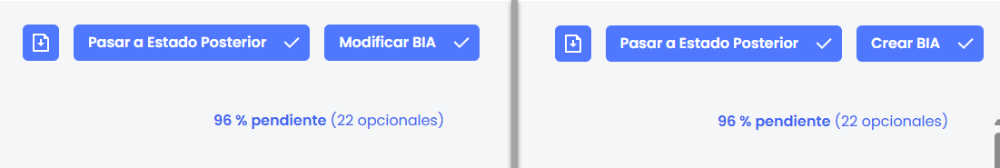

# Flujo de encuestas y creación o modificación del BIA

Las encuestas pueden incluir funcionalidades relacionadas con su ciclo de vida, como el uso de botones de acción para gestionar los distintos estados (cuando están configurados), y la posibilidad de crear o modificar un Análisis de Impacto en el Negocio (BIA) a partir de las respuestas registradas.

## **Botones de flujo**

Según la configuración del flujo de estados definida en el modelo de encuesta y el estado actual en que se encuentra, pueden mostrarse uno o más botones de acción disponibles para el usuario.

En encuestas que no tienen estados configurados, se mostrará siempre el botón “Finalizar” como única opción de cierre.

En cambio, cuando la encuesta cuenta con un flujo de estados definidos, podrán aparecer los botones “Pasar a estado anterior” o “Pasar a estado posterior”, en función de las transiciones permitidas. La opción de retroceso solo estará disponible si ha sido activada expresamente en el modelo de encuesta.

Adicionalmente, si los estados son de tipo manual, su gestión no se realiza desde la propia encuesta, sino a través del apartado Publicaciones en el gestor de encuestas.

## **Crear o Modificar BIA**

* El botón “Crear BIA” aparece únicamente cuando la encuesta no tiene un BIA asociado previamente o fue generada a partir de un BIA consolidado. Este botón no se muestra en accesos externos.
* El botón “Modificar BIA” se muestra cuando ya existe un BIA individual vinculado a la encuesta, ya sea porque se generó desde un BIA individual o porque ya se consolidó anteriormente. Tampoco está disponible en accesos externos.


\*\*Importante\*\*: Las acciones \*\*“Crear BIA”\*\* y \*\*“Modificar BIA”\*\* son \*\*irreversibles\*\*. Una vez ejecutadas, no es posible deshacer la consolidación realizada desde la encuesta.

