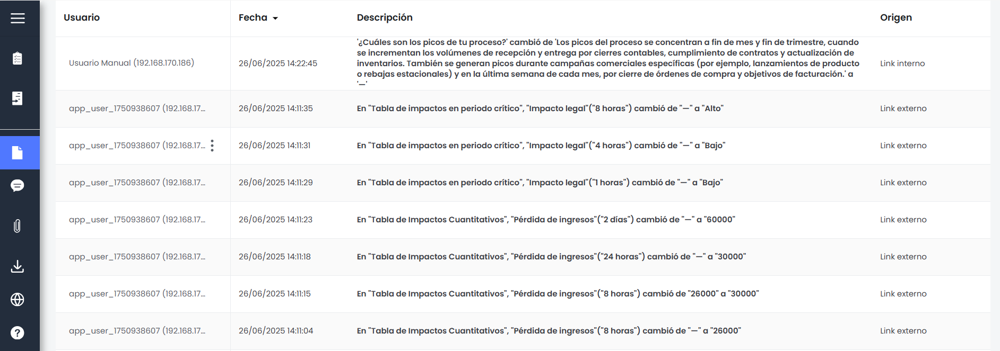
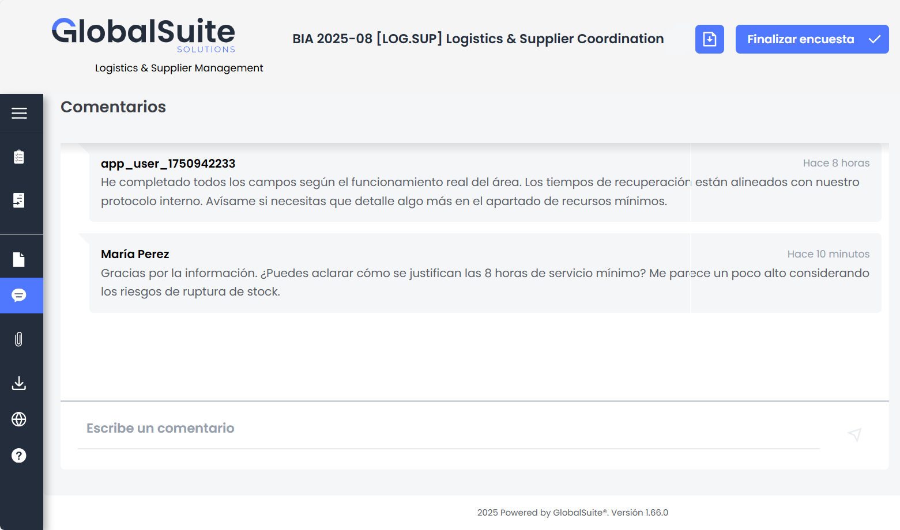
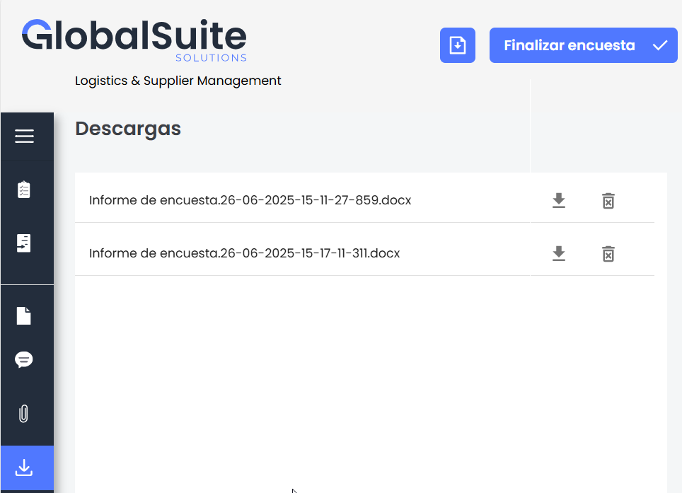

# Seguimientos, comentarios y archivos adjuntos

## Seguimiento Encuesta

La sección **Seguimiento** muestra un historial detallado de las acciones realizadas sobre la encuesta. Cada fila de la tabla representa una modificación o evento registrado automáticamente por el sistema, lo que permite llevar un control de los cambios realizados a lo largo del tiempo.

Los campos incluidos en esta tabla son:

* **Usuario**: muestra el identificador del usuario que realizó la acción, junto con su dirección IP, en el mismo formato utilizado en otros módulos de la plataforma.
* **Fecha**: indica la fecha y hora exacta en la que se realizó la acción. Se presenta ordenada por defecto de forma descendente (más reciente primero), aunque puede reordenarse manualmente desde el encabezado.
* **Descripción**: especifica en lenguaje natural la acción realizada. Por ejemplo:

  *Se ha añadido una respuesta en la tabla "¿Cuáles son los días de la semana críticos en el proceso?"*

  Esta descripción se adapta al contexto del cambio, indicando claramente qué pregunta o campo fue afectado.
* **Origen**: permite identificar si la acción se originó desde un acceso interno o externo a la encuesta. Se muestran las etiquetas **Link interno** o **Link externo** según corresponda.

Además, la tabla incluye controles en la parte superior para ordenar o filtrar los registros mostrados, lo que facilita el análisis en formularios con gran cantidad de actividad registrada.

## Comentarios

La encuesta BIA incluye una sección de **Comentarios** que permite la comunicación directa entre los participantes de la encuesta. A través de este espacio, los usuarios pueden dejar mensajes, aclaraciones, observaciones o solicitar información adicional relacionada con el contenido de la encuesta.

Cada comentario muestra:

* El nombre del usuario o identificador que lo escribió.
* El contenido del mensaje.
* El tiempo transcurrido desde su publicación.

Los comentarios se presentan en orden cronológico y permanecen visibles para todos los usuarios con acceso a la encuesta.  
Al final del apartado se incluye un campo habilitado para **escribir nuevos comentarios** y enviarlos en tiempo real.

## Archivos adjuntos

En esta sección se muestran los archivos adjuntos asociados a la encuesta. Estos documentos pueden servir como referencia para facilitar la cumplimentación de la encuesta, incluyendo guías, criterios, ejemplos o definiciones relevantes.

Los archivos pueden haberse añadido desde dos lugares distintos:

* **Ajustes>** [**Modelo de Encuestas**](https://help.globalsuitesolutions.com/es/globalsuite/v1/modelo-encuesta-bia-por-impacto)**:** se adjuntan documentos que se mostrarán en todas las encuestas creadas a partir de ese modelo.
* **Gestión > Encuestas>**[**Configuración de encuestas**](https://help.globalsuitesolutions.com/es/globalsuite/v1/encuestas-bia-configuracion): se adjuntan documentos específica para las encuestas creadas a partir de esa configuracióm,

Cada archivo se muestra con su nombre, una breve descripción y un icono de descarga. Esta sección permite consultar fácilmente toda la documentación de apoyo disponible para el usuario que responde la encuesta.

## Descargas

Desde la encuesta, el usuario puede generar un informe descargable con todo el contenido completado hasta el momento. Para ello, debe presionar el botón de **Descarga** ubicado en la parte superior derecha de la pantalla.

Al hacerlo, el sistema iniciará la **generación del informe** con los datos actuales de la encuesta. Este proceso puede tardar unos segundos, dependiendo del volumen de información.

Se mostrará un mensaje de confirmación indicando que la generación del informe ha comenzado correctamente.

Una vez generado, el informe estará disponible en el apartado **Descargas** (accesible desde el menú lateral izquierdo). Allí se listarán los documentos disponibles para descarga, indicando el nombre del archivo, el formato y la fecha de generación. Desde esta vista también se podrá eliminar o volver a descargar cualquier informe generado previamente.
