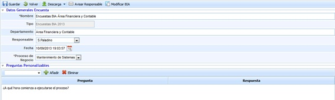
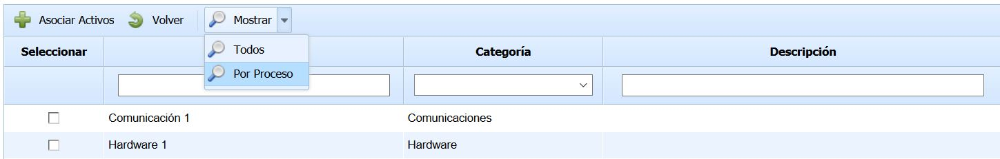
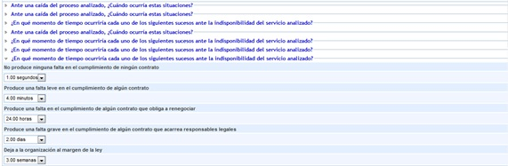
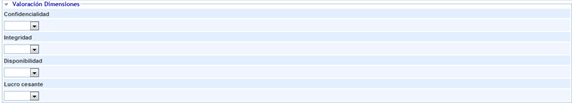
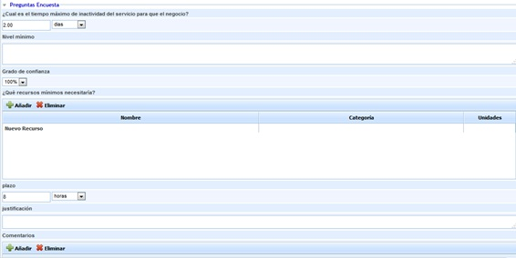
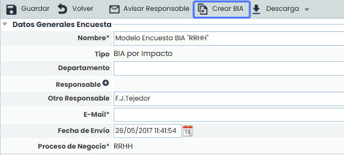
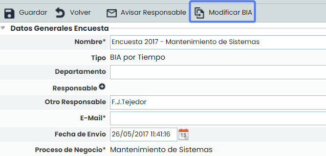

# Encuestas BIA Tiempo

## Datos Generales Encuesta

Permite definir la siguiente información:

* **Nombre:** Permite definir el nombre identificativo de la encuesta.
* **Tipo:** Indica en Modelo en base al cual se ha realizado la encuesta.
* **Departamento:** Permite identificar el nombre del Departamento sobre el cual se han obtenido los resultados de la encuesta.
* **Responsable:** Ofrece la posibilidad de identificar el responsable de la encuesta.
* **Fecha:** Posibilita establecer la fecha de realización de la encuesta.
* **Proceso de Negocio:** Permite definir el proceso de negocio evaluado en la encuesta.

## Preguntas personalizables

En la Encuesta de BIA aparecerán las preguntas incluidas en el modelo configurado en el apartado de 'Ajustes/Modelos de Encuestas'. Estas preguntas pueden ser de distintos tipos: 'Texto', 'Select', 'Tabla' o 'Tabla de Elementos'.

En las preguntas tipo 'Tabla' se pueden añadir registros pulsando el botón 'Nuevo' y con el botón 'Eliminar' quitar los que se deseen, además de editar cada una de los campos haciendo doble click.

Para las preguntas tipo 'Tabla de Elementos' se pueden incluir elementos del Inventario (Análisis/Inventario) con el botón 'Relacionar Elementos'. Al pulsarlo, se abre una ventana emergente donde aparece el listado de los elementos con las categorías configuradas para la pregunta, permitiéndose la selección de aquellos elementos que se quieran incorporar a la pregunta, y añadiéndolos a través del botón 'Asociar Elementos'.

Si el proceso se encuentra en el árbol de dependencias con elementos asociados, en la tabla de elementos aparecen por defecto los elementos que se encuentren asociados en dicho árbol de dependencias. Si, por el contrario, el proceso no se encuentra en el árbol de dependencias, en la tabla de elementos se muestran todos los elementos del inventario. Independientemente de los elementos mostrados en la carga inicial, a través del botón 'Mostrar' se permite visualizar todos los elementos del inventario (opción 'Todos') o sólo los elementos asociados al proceso (opción 'Por Proceso').

También se pueden incorporar nuevos elementos pulsando el botón 'Crear Elemento'. Estos elementos aparecerán en color rojo para indicar que no se trata de elementos del Inventario.

Para todos los elementos incorporados en la pregunta tipo 'Tabla de Elementos' se permite especificar el instante de recuperación en caso de desastre, utilizando los campos 'Valor RTO' y 'Unidad RTO', además de poder añadir un comentario para cada elemento.

## Listado de Preguntas Encuesta

Por cada una de las preguntas definidas en el apartado ‘Ajustes/Gestión de Encuestas’, permite fijar todas y cada una de las respuestas planteadas por el responsable y departamento entrevistado.

## Valoración dimensiones

Ofrece la posibilidad de valorar las dimensiones establecidas para el BIA

## Preguntas Encuesta

Permite el usuario definir puntos más genéricos a la hora de establecer un BIA, como pueden ser los siguientes:

* **Tiempo máximo de inactividad:** Permite definir el tiempo máximo de parada del servicio (MTPD).
* **Nivel Mínimo:** Posibilita identificar los niveles mínimos necesarios para la prestación de los servicios.
* **Grado de Confianza:** Posibilita indicar el grado de confianza del usuario con respecto al MTPD definido.
* **Recursos mínimos necesarios:** Ofrece la posibilidad de identificar los recursos necesarios para prestar el servicio.
* **Plazo:** Permite definir la escala temporal de recuperación de los recursos necesarios para soportar el servicio o proceso de negocio.
* **Justificación:** Campo texto para justificar el plazo identificado en el apartado anterior.
* **Comentarios:** Permite incluir cualquier comentario adicional en relación a la entrevista.


\*\*NOTA:\*\* Los resultados de la encuesta pueden ser descargados en formato editable .xlsx. Para ello se ha de pulsar sobre el botón ‘Descarga’, disponible en la parte superior e inferior de la ficha de la encuesta.


## Seguimiento Encuesta

Permite realizar un seguimiento de la encuesta, pudiendo realizar cualquier comentarios u observación sobre la misma.

En las encuestas publicadas, y completadas de forma anónima (a través de link), es posible enviar el seguimiento al responsable de la publicación para notificarle. Para ello, es necesario seleccionar el seguimiento deseado y pulsar "Enviar a Responsable".

## Consolidación Encuestas BIA

Una vez que la encuesta se encuentra contestada, ya sea mediante la publicación de la encuesta o mediante el registro directo en la opción de gestionar encuestas, se pueden consolidar los datos de la encuesta creada.

Para ello, ingrese en la encuesta que quiere consolidar y en la barra de herramientas superior aparece el botón **“Crear BIA”**, si la encuesta no tiene un BIA asociado, o el botón **“Modificar BIA”**, si ya tiene un BIA asociado. Pulsando el botón se genera un BIA asociado a la encuesta o se actualiza el BIA ya existente, si ya se generó.

