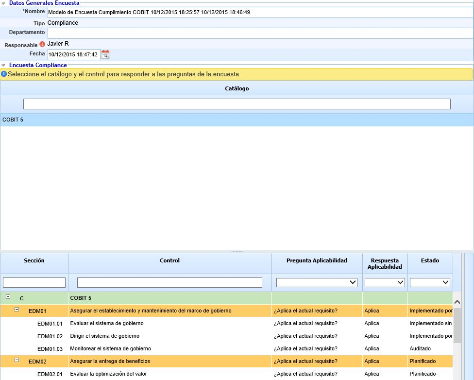

# Encuestas Compliance

## **Datos generales Encuesta**

Permite definir la siguiente información:

* **Nombre:** Permite definir el nombre identificativo de la encuesta.

* **Tipo:** Indica en tipo de encuesta.

* **Departamento:** Permite identificar el nombre del Departamento sobre el cual se han obtenido los resultados de la encuesta.

* **Responsable:** Ofrece la posibilidad de identificar el responsable de la encuesta.

* **Fecha:** Posibilita establecer la fecha de realización de la encuesta.

**Encuesta Compliance**

El presente apartado permite visualizar los catálogos de cumplimiento sobre los que se ha realizado la encuesta. Seleccionando cada uno de ellos, se accede a la respuesta de cada una de las preguntas de la encuestas.

## **Seguimiento Encuesta**

Permite llevar un registro de las acciones realizadas sobre la encuesta con la información del Responsable, Fecha, Descripción y Origen.
