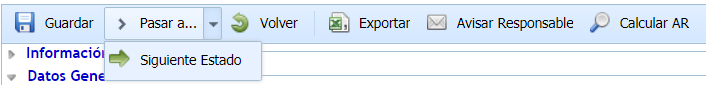
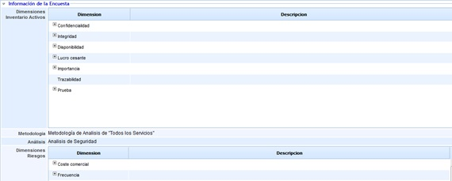
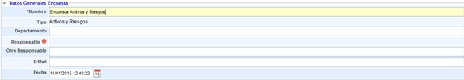
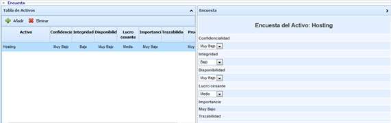
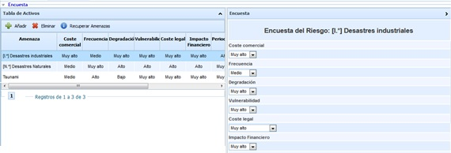
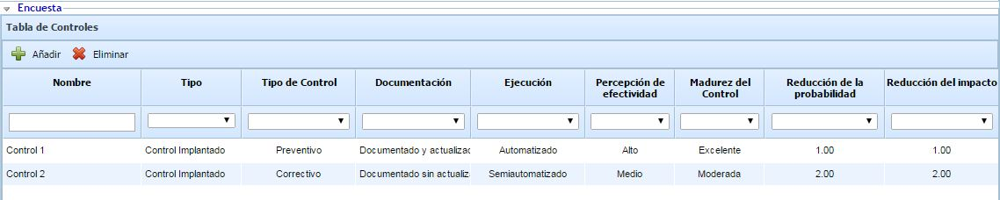
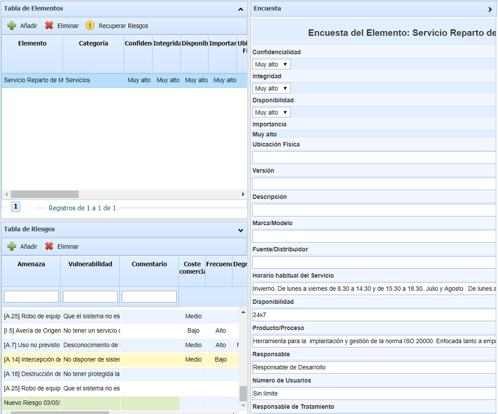
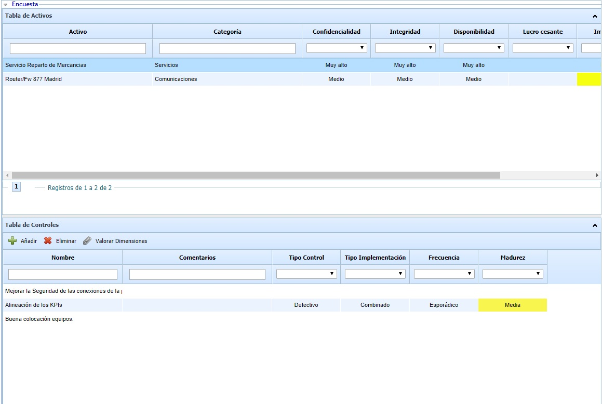
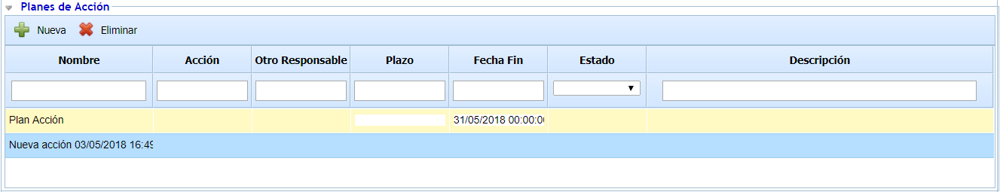
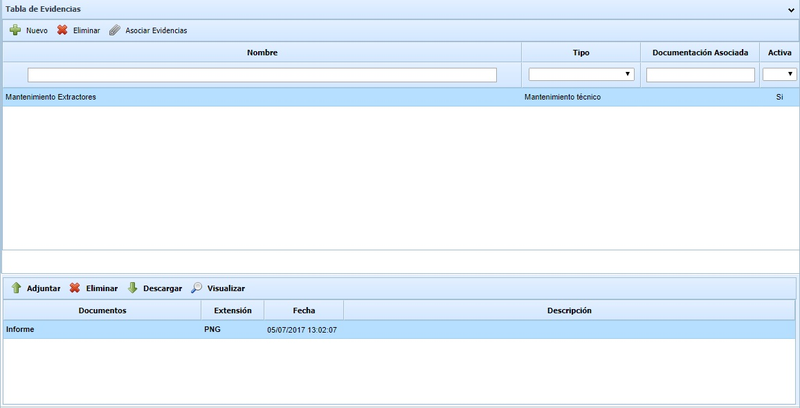

# Encuestas Elementos, Riesgos y Controles

## Página inicial de la encuesta

Cuando se accede a una encuesta, la primera pantalla que aparece es la de onboarding, donde se puede ver la información

En caso de que se haya creado la encuesta a través de una Publicación, el mensaje informativo podrá ser sustituido por el que se indique en el apartado Comentarios de la publicación, para

## Menú de la encuesta

**Acciones de la encuesta**

Dependiendo de la configuración y el modelo de encuesta utilizado, la encuesta mostrará diversos botones en la cabecera del formulario:

* **Guardar:** Permite almacenar los cambios realizados en la encuesta. Al pulsarlo, se realiza la comprobación de que todas las dimensiones marcadas como obligatorias en el modelo estén completadas.
* **Pasar a:**

  * **Estado anterior:** Permite pasar la encuesta al estado inmediatamente anterior configurado, y asignarla al responsable de dicho estado. Este botón sólo aparece si el estado está configurado como "Vuelta atrás" a Sí.
  * **Estado siguiente:** Permite pasar la encuesta al estado inmediatamente posterior configurado, y asignarla al responsable de dicho estado. Este botón sólo aparece si el estado está configurado como "Automático" a Sí.
* **Finalizar:** Este botón aparece cuando no se tienen estados configurados, o se está en el último estado del flujo, y no se tiene activada la posibilidad de "Consolidar en último estado".
* **Finalizar sin Consolidar:** Este botón aparece cuando se está en el último estado del flujo, y está marcada la configuración de "Consolidar en último estado" en el modelo de encuesta. Este botón permite finalizar la encuesta sin aplicar los cambios al análisis de riesgos.
* **Finalizar y Consolidar:** Este botón aparece cuando se está en el último estado del flujo, y está marcada la configuración de "Consolidar en último estado" en el modelo de encuesta. Al pulsarlo, la encuesta se finaliza, y toda la información creada o modificada en la encuesta se aplica en el análisis de riesgos.
* **Consolidar:** Este botón aparece cuando ya se ha finalizado una encuesta (se ha pulsado el botón "Finalizar sin Consolidar"), y está marcada la configuración de "Consolidar en último estado" en el modelo de encuesta. Al pulsarlo, toda la información creada o modificada en la encuesta se aplica en el análisis de riesgos.
* **Volver:** Permite salir de la encuesta, y volver al listado general de encuestas.
* **Exportar:** Al pulsar este botón, se genera y descarga un informe en formato .xlsx con toda la información de la encuesta respecto a elementos, riesgos y controles y sus evaluaciones en un momento dado.
* **Avisar Responsable:** Permite enviar una alerta o recordatorio mediante correo electrónico al responsable asignado a la encuesta.
* **Calcular AR**: Este botón permite calcular las dimensiones automáticas de la metodología, a partir de las dimensiones manuales. Este botón sólo aparecerá si así se ha configurado en el modelo de encuesta. En caso contrario, las dimensiones se actualizarán directamente tras cada cambio de las manuales.

## Información de la encuesta

El presente apartado permite al usuario visualizar las metodologías y dimensiones (Inventario, Análisis Riesgos y/o Gestión de Controles) en base a las cuales se realizará la encuesta de Elementos, Riesgos y/o Controles.

## Datos generales encuesta

Permite definir la siguiente información:

* **Nombre:** Permite definir el nombre identificativo de la encuesta.
* **Tipo:** Indica en Modelo en base al cual se ha realizado la encuesta.
* **Departamento:** Permite identificar el nombre del Departamento sobre el cual se han obtenido los resultados de la encuesta.
* **Responsable:** Ofrece la posibilidad de identificar el responsable de la encuesta del listado de empleados.
* **Otro responsable:** Permite identificar un responsable que no esté dado de alta en la herramienta. Este campo no aparecerá cuando la configuración de la encuesta tenga estados y responsables para cada uno, ya que se introducirán automáticamente.
* **Email:** Ofrece la posibilidad de incluir la dirección de correo para que el responsable sea notificado de cualquier modificación.
* **Fecha:** Posibilita establecer la fecha de realización de la encuesta.

**Encuesta**

La presente opción permite al usuario valorar los elementos, riesgos y controles que se han seleccionado en el apartado 'Gestión/Configurar Encuestas'. La herramienta ofrece la posibilidad de valorar los siguientes parámetros:

*Nota: En función del tipo de encuesta (Elementos, Riesgos, Controles), aparecerán unas u otras tablas en la encuesta.*

## Tabla Elementos

La tabla de elementos permite valorar las dimensiones de los elementos que se han seleccionado en el apartado de 'Gestión/Configurar Encuestas'. Para ello se debe seleccionar el elemento deseado de la tabla situada en la izquierda y valorar las dimensiones establecidas en la tabla derecha. Si el usuario desea incluir en la encuesta elementos que no se encuentran en la tabla, puede insertar nuevos elementos pulsando sobre el botón 'Añadir' situado sobre la tabla de elementos.


\*\*NOTA:\*\* Si la encuesta ha sido configurada con el formato "Tabla", no aparecerán las preguntas de la parte derecha realizándose la valoración directamente sobre la tabla de elementos.


## Tabla Riesgos

La tabla de riesgos permite valorar los riesgos de los elementos seleccionados en la tabla de elementos (superior) y que hayan sido definidos en el apartado de 'Gestión/Configurar Encuestas'. Para ello se debe seleccionar el elemento deseado de la tabla superior, seleccionar el riesgo deseado en la tabla situada en la izquierda y valorar las dimensiones establecidas en la tabla derecha. Si el usuario desea incluir en la encuesta riesgos que no se encuentran en la tabla, puede insertar nuevos elementos pulsando sobre el botón 'Añadir' situado sobre la tabla de riesgos. En el caso de querer utilizar el catálogo de riesgos parametrizado en la herramienta, debe pulsar sobre el botón 'Recuperar amenazas' ubicado en la tabla de elementos para seleccionar los riesgos que desee del catálogo.


\*\*NOTA:\*\* Si la encuesta ha sido configurada con el formato "Tabla", no aparecerán las preguntas de la parte derecha realizándose la valoración directamente sobre la tabla de riesgos.


## Tabla de Controles

En función de si se trata de una encuesta de sólo controles o una encuesta de riesgos y controles, la tabla de controles se muestra de una forma u otra.

Para el caso de una encuesta de sólo controles, la tabla se muestra de la siguiente forma:

La tabla de controles permite valorar las dimensiones de los controles que se han seleccionado en el apartado de 'Gestión/Configurar Encuestas'. Para ello se deben realizar las modificaciones correspondientes sobre la tabla de controles. Si el usuario desea incluir en la encuesta controles que no se encuentran en la tabla, puede insertar nuevos elementos pulsando sobre el botón 'Añadir' situado sobre la tabla de controles.

Para el caso de una encuesta de riesgos y controles, la tabla se muestra de la siguiente forma:

Para acceder a la tabla de controles es necesario seleccionar previamente los riesgos identificados. Para ello se debe seleccionar el elemento deseado de la tabla superior, seleccionar el riesgo deseado en la tabla situada en la izquierda y valorar los controles en la tabla que aparece en la parte derecha. Si el usuario desea incluir en la encuesta controles que no se encuentran en la tabla, puede insertar nuevos elementos pulsando sobre el botón 'Añadir' situado sobre la tabla de controles. Estos controles aparecerán en color verde, indicando que son controles incorporados en la encuesta. De manera adicional, los elementos, riesgos o controles que hayan sido modificados en la encuesta, aparecerán resaltados en color amarillo. Además, también se resaltará en color amarillo la entidad superior. Por ejemplo, si se modifica un riesgo, también se resaltará el elemento al que pertenece, lo cual facilita identificar los cambios realizados sobre la encuesta.

Para el caso de una encuesta de elementos y controles, la tabla se muestra de la siguiente forma:

Para acceder a la tabla de controles es necesario seleccionar en la tabla superior el elemento del cual se van a identificar o evaluar controles. Para incluir nuevos controles (identificados con fondo verde) se deberá pulsar el botón "Añadir", mientras que si se quiere desasociar un control de un elemento se deberá pulsar "Eliminar". Para valorar las dimensiones de los controles, se debe seleccionar un control y pulsar "Valorar Dimensiones".

También, si se han incluido Acciones de los controles en la encuesta, al seleccionar un control, se cargará en la tabla inferior las acciones asociadas al mismo, pudiendo crear nuevas acciones o modificar las existentes.

Además, si se han incluido Evidencias de los controles en la encuesta, al seleccionar un control, se cargará en la tabla inferior las Evidencias asociadas, pudiendo crear nuevas Evidencias asociadas al control, reutilizar una de las que ya están en la encuesta, o incorporar archivos adjuntos a las mismas.

## Seguimiento encuesta

Permite realizar un seguimiento de la encuesta, pudiendo realizar cualquier comentarios u observación sobre la misma. Los cambios que se realizan en una encuesta quedan registrados automáticamente.

En las encuestas publicadas, y completadas de forma anónima (a través de link), es posible enviar el seguimiento al responsable de la publicación para notificarle. Para ello, es necesario seleccionar el seguimiento deseado y pulsar "Enviar a Responsable".
