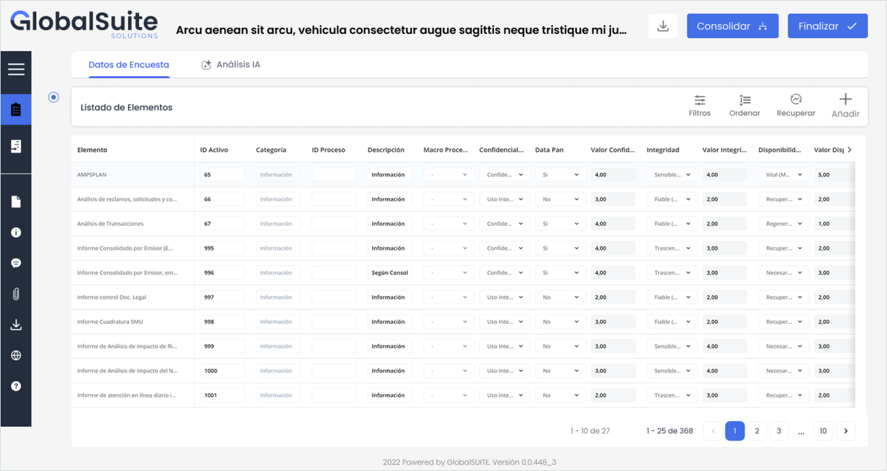
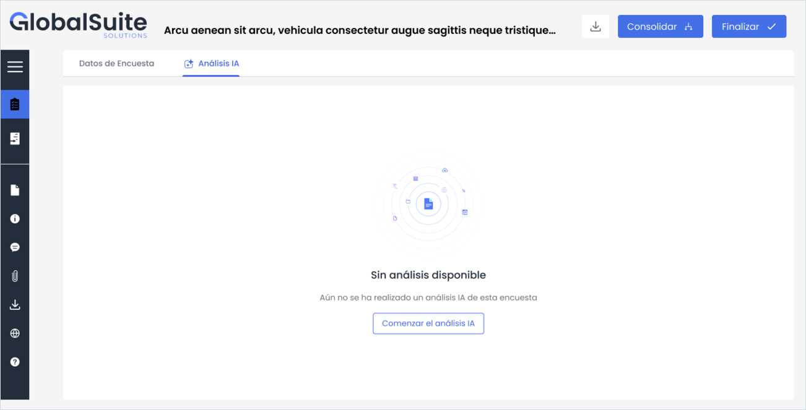
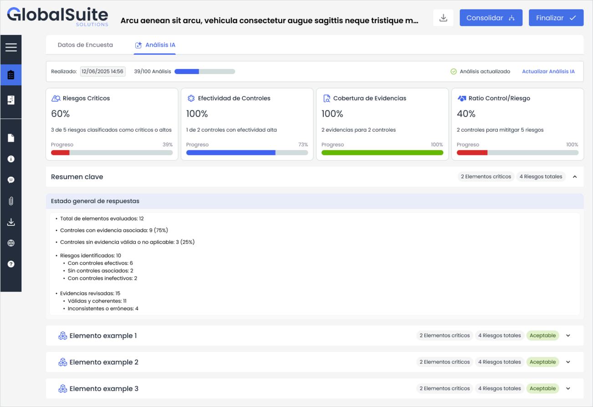
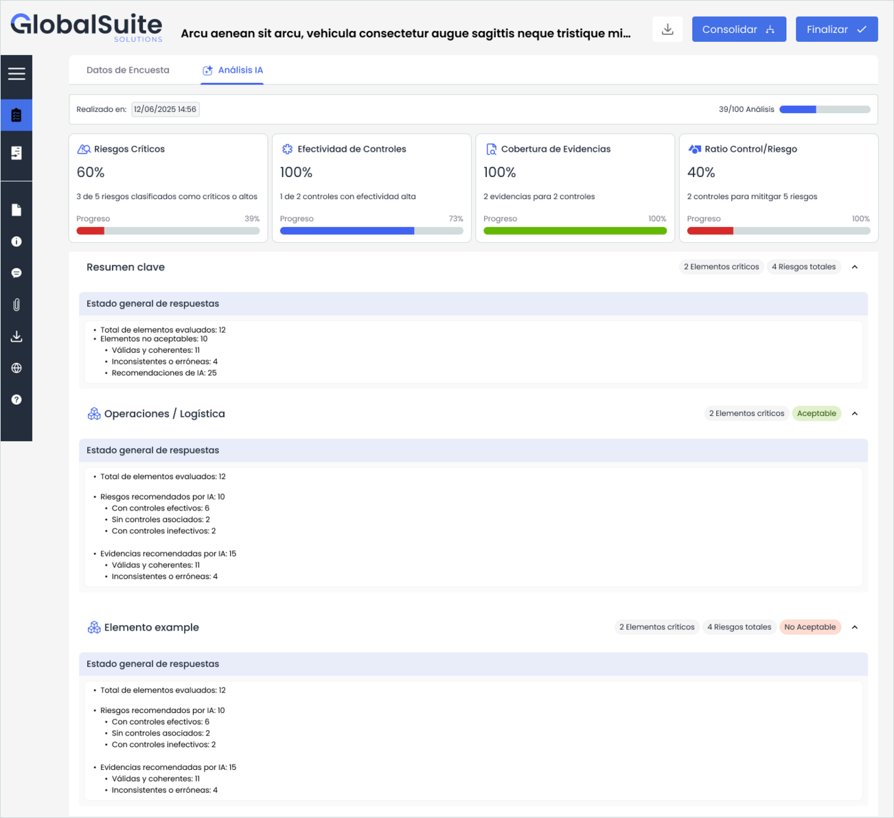
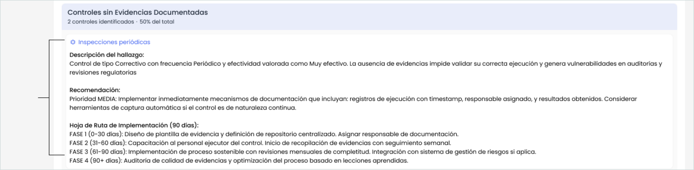
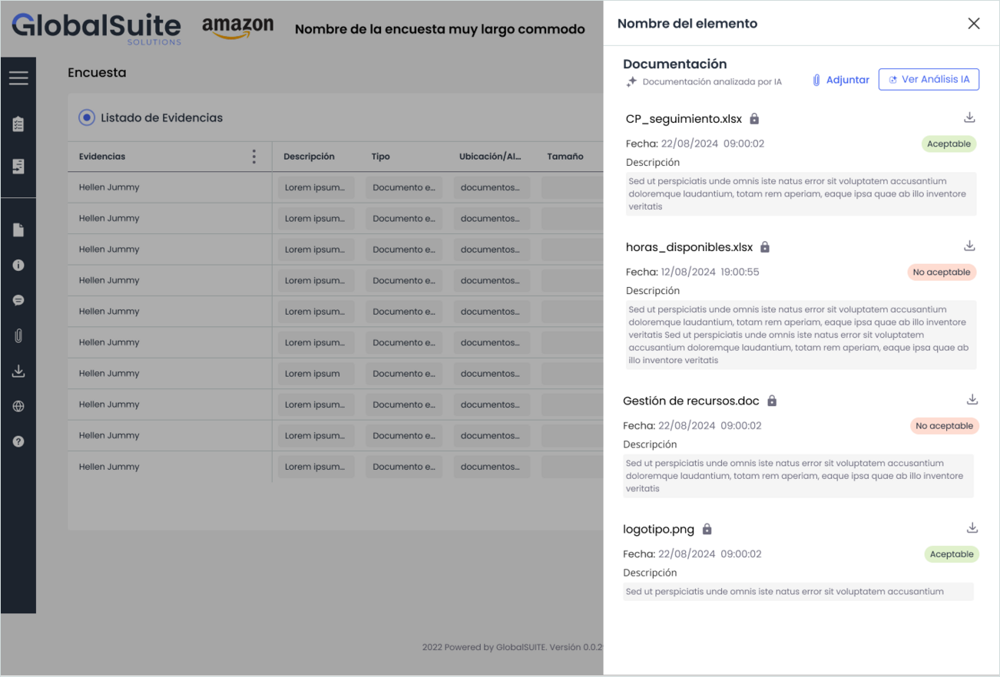

# Asistente IA - Analisis de Encuestas ERC - Confluence

## Asistente de IA: Análisis de Encuestas ERC

### Asistente de IA para el análisis de Encuestas ERC

GlobalSuite® incorpora en el módulo de Encuestas un asistente de Inteligencia Artificial que analiza la información registrada en las encuestas de Elementos, Riesgos y Controles y en las encuestas de Revisión de Controles.

El asistente revisa las respuestas, los riesgos, los controles y las evidencias aportadas para destacar los puntos que requieren atención y proponer recomendaciones. De este modo, facilita la revisión de la encuesta y reduce el tiempo necesario para obtener conclusiones.

#### ¿Para qué sirve?

El asistente apoya la revisión y la toma de decisiones de los usuarios que participan en la encuesta:

* Los responsables de verificar y consolidar la información obtienen una visión resumida del estado de la encuesta y de los principales puntos críticos.
* Los usuarios que completan la encuesta pueden identificar incoherencias, carencias o información pendiente antes de consolidarla o finalizarla.

#### Características principales

* Genera conclusiones sobre la criticidad, la cobertura de riesgos y la madurez de los controles.
* Identifica riesgos elevados sin controles asociados o con una cobertura insuficiente.
* Detecta controles débiles, poco efectivos o con una elevada dependencia de tareas manuales.
* Analiza las evidencias para comprobar si los documentos aportados responden a la información solicitada.
* Señala posibles carencias en las evidencias, como la ausencia de fecha, responsable, trazabilidad o contexto.
* Propone recomendaciones para mejorar los controles, la documentación o las próximas revisiones.
* Genera un resumen de los principales hallazgos para facilitar su seguimiento.

#### ¿Dónde se encuentra?

El asistente está disponible dentro del módulo de Encuestas. Al abrir una encuesta de Elementos, Riesgos y Controles, junto a la pestaña «Datos de Encuesta» se muestra la pestaña «Análisis IA».

La funcionalidad también está disponible en las encuestas de Revisión de Controles. En este caso, los indicadores y los hallazgos se adaptan al tipo de encuesta analizada.

#### ¿Cómo funciona?

El proceso consiste en iniciar el análisis, consultar los indicadores y el resumen y revisar el detalle de los elementos, los hallazgos, las recomendaciones y las evidencias.

##### 1. Iniciar el análisis

La primera vez que se accede a la pestaña «Análisis IA», la pantalla muestra el estado «Sin análisis disponible». Pulsa «Comenzar el análisis IA» para procesar las respuestas de la encuesta.

El análisis puede tardar unos minutos mientras la IA genera los indicadores, los hallazgos y las recomendaciones.

##### 2. Consultar los indicadores clave

En la parte superior de la pantalla se muestran cuatro indicadores que resumen el resultado del análisis. Cada indicador incluye el porcentaje y el dato utilizado para calcularlo.

|  |  |
| --- | --- |
| **Indicador** | **Qué refleja** |
| **Riesgos críticos** | Proporción de riesgos clasificados como críticos o altos. |
| **Efectividad de controles** | Proporción de controles que presentan una efectividad alta. |
| **Cobertura de evidencias** | Grado de cobertura de los controles mediante evidencias consideradas válidas. |
| **Ratio control/riesgo** | Relación entre los controles disponibles y los riesgos que deben mitigar. |

##### 3. Revisar el resumen clave

El bloque «Resumen clave» consolida el estado general de las respuestas e incluye el total de elementos evaluados, los controles con y sin evidencia válida, los riesgos identificados y las evidencias revisadas.

Los riesgos se diferencian según dispongan de controles efectivos, no tengan controles asociados o cuenten con controles inefectivos. Las evidencias se clasifican como válidas o inconsistentes.

##### 4. Analizar cada elemento

Cada elemento de la encuesta se muestra en una sección desplegable con su estado —«Aceptable» o «No Aceptable»— y el número de elementos críticos y riesgos asociados.

Despliega un elemento para consultar su detalle y revisar primero aquellos que requieren mayor atención.

##### 5. Consultar los hallazgos y las recomendaciones

El asistente agrupa los hallazgos por categorías. Para cada hallazgo muestra una descripción y una recomendación y, cuando corresponde, una hoja de ruta de implementación a 90 días dividida en fases.

Entre los hallazgos que puede identificar se encuentran los siguientes:

* Riesgos elevados sin controles asociados o con cobertura insuficiente.
* Controles sin evidencias documentadas.
* Riesgos cuyo nivel residual no se ha reducido respecto al nivel inherente.
* Evidencias erróneas o inconsistentes.

##### 6. Revisar las evidencias con IA

Desde cada elemento puedes abrir el panel de documentación. El asistente analiza cada documento aportado en el apartado «Documentación analizada por IA» y lo valora como «Aceptable» o «No aceptable».

La revisión comprueba si el documento responde a lo solicitado y señala posibles carencias, como la ausencia de fecha, responsable, trazabilidad o contexto. Pulsa «Ver Análisis IA» para consultar el detalle de la valoración.

##### 7. Actualizar y descargar el análisis

Cuando se modifican las respuestas después de ejecutar el análisis, la cabecera muestra el estado del resultado y habilita la acción «Actualizar Análisis IA». Utiliza esta acción para volver a generar el análisis con la información más reciente.

Desde la misma vista puedes descargar el resultado y continuar con el flujo de la encuesta mediante las acciones «Consolidar» o «Finalizar».

**Ten en cuenta:** el asistente es una ayuda a la decisión y no sustituye la revisión del usuario. Valida sus conclusiones y recomendaciones antes de consolidar o finalizar la encuesta.
