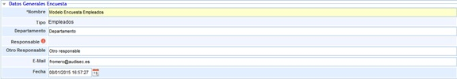
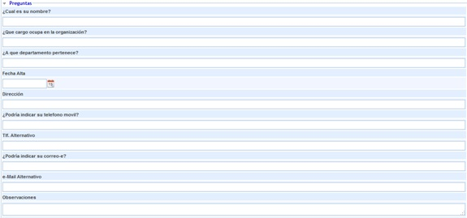
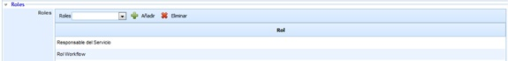
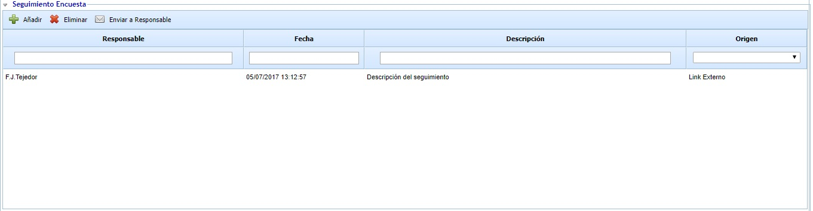

# Encuestas Empleados

## Datos generales encuesta

Permite definir la siguiente información:

* **Nombre:** Permite definir el nombre identificativo de la encuesta.
* **Tipo:** Indica en Modelo en base al cual se ha realizado la encuesta.
* **Departamento:** Permite identificar el nombre del Departamento sobre el cual se han obtenido los resultados de la encuesta.
* **Responsable:** Ofrece la posibilidad de identificar el responsable de la encuesta.
* **Otro responsable:** Permite identificar un responsable que no esté dado de alta en la herramienta.
* **Email:** Ofrece la posibilidad de incluir la dirección de correo para que el responsable sea notificado de cualquier modificación.
* **Fecha:** Posibilita establecer la fecha de realización de la encuesta.

## Preguntas

El presente apartado permite al usuario contestar a aquellas preguntas que han sido definidas en el apartado de 'Ajustes/Modelos de encuestas' y configuradas en el apartado de 'Gestión/Configuración encuestas', donde se establece en base a que modelo se genera la encuesta de empleados.

## Roles

Permite al responsable de generar la encuesta visualizar los roles que le han sido asignados inicialmente, pudiendo cargar roles adicionales en la encuesta. Para ello se ha de seleccionar el rol deseado en el desplegable y pulsar sobre el botón 'Añadir'. En el caso de querer desasociar un rol determinado, se ha de seleccionar el mismo en la tabla y pulsar sobre el botón 'Eliminar'.

## Seguimiento encuesta

Permite realizar un seguimiento de la encuesta, pudiendo realizar cualquier comentarios u observación sobre la misma.

En las encuestas publicadas, y completadas de forma anónima (a través de link), es posible enviar el seguimiento al responsable de la publicación para notificarle. Para ello, es necesario seleccionar el seguimiento deseado y pulsar "Enviar a Responsable".
