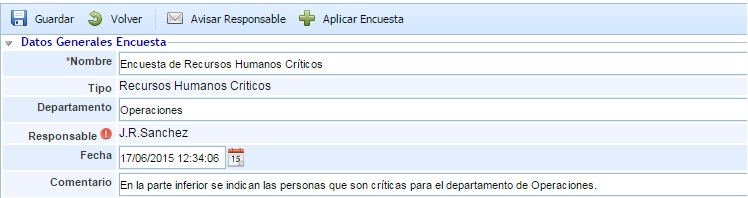
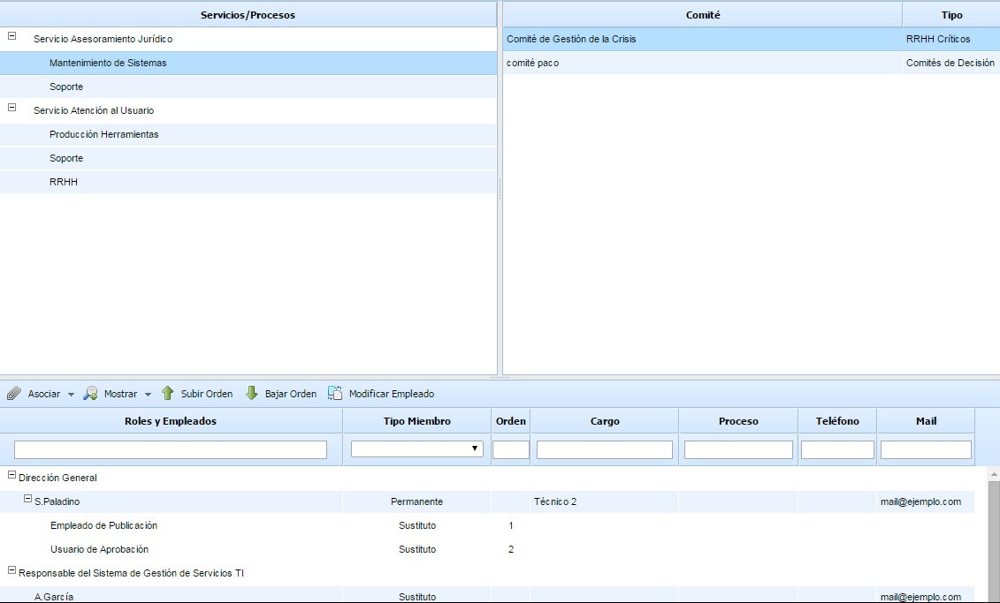
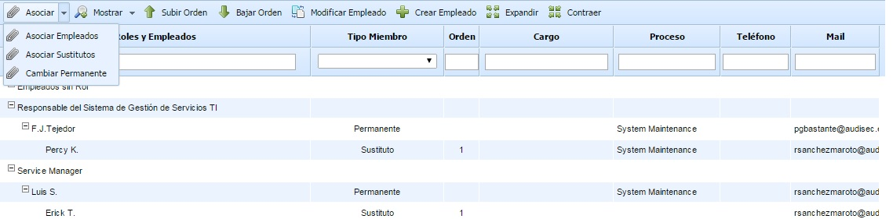

# Encuestas RRHH Críticos

## Datos generales Encuesta

Permite definir la siguiente información:

* **Nombre:** Permite definir el nombre identificativo de la encuesta.

* **Tipo:** Indica en tipo de encuesta.

* **Departamento:** Permite identificar el nombre del Departamento sobre el cual se han obtenido los resultados de la encuesta.

* **Responsable:** Ofrece la posibilidad de identificar el responsable de la encuesta.

* **Fecha:** Posibilita establecer la fecha de realización de la encuesta.

* **Comentario:** Indica comentarios adicionales en la encuesta.

## Contestación de la encuesta

El presente apartado permite al usuario seleccionar las personas del comité que quiere definir o modificar.

Para modificar las personas que forman parte de un Comité debe seleccionar, en primer lugar, un servicio o proceso de la tabla ubicada en la izquierda y, posteriormente, seleccionar uno de los comités que se muestran en la tabla ubicada en la derecha. Tras realizar esta selección, en la parte inferior se muestran las personas que forman parte del comité seleccionado, pudiéndose realizar las modificaciones que se consideren oportunas. Nota: Si no se muestran comités en la tabla derecha indica que el servicio o proceso seleccionado no dispone de ningún comité asociado."

La tabla de miembros del comité (ubicada en la parte inferior) permite asociar empleados dados de alta en GlobalSUITE al comité o RRHH Críticos. Esta tabla permite asociar empleados permanentes, sustitutos e invitados al comité.

Las opciones disponibles para establecer los empleados del comité son:

* **Asociar Empleados:** Pulsando sobre esta opción aparece una ventana con todos los roles y empleados definidos en la opción 'Roles y Responsabilidades'. También aparecen los empleados que no están asociados a ningún rol. A través de las casillas de selección de la derecha se permite asociar los empleados al comité. Una vez seleccionados hay que pulsar sobre el botón 'Cargar Roles/Empleados" para añadirlos al comité.

Los empleados añadidos al comité se registran, por defecto, como empleados de tipo 'Permanente'. Se permite cambiar el tipo en la columna 'Tipo Miembro' pudiendo definir un empleado como 'Sustituto' o 'Invitado'.

* **Asociar Sustitutos:** Esta opción permite asociar empleados sustitutos a un empleado del tipo 'Permanente' (para los tipos 'Sustituto' o 'Invitado' no se permite asociar empleados sustitutos). Para ello, hay que seleccionar el empleado y pulsar sobre el botón 'Asociar Sustitutos', mostrándose una tabla con todos los empleados de la organización pudiendo seleccionar uno o varios empleados sustitutos.

* **Cambiar Permanente:** Esta opción permite cambiar un miembro permanente por otro.

* **Mostrar:** Este botón permite filtrar la tabla para mostrar/ocultar los empleados sustitutos asociados a los empleados permanentes.

* **Subir/Bajar Orden:** Estos botones permiten ordenar los empleados sustitutos que están asociados a un empleado 'Permanente'. Para ello, hay que seleccionar un empleado sustituto y pulsar el botón correspondiente en función de si se desea subir o bajar el orden.

* **Modificar Empleado:** Este botón permite modificar los datos identificativos de un empleado seleccionado. Al pulsar sobre el botón (con un empleado seleccionado) aparece una ventana emergente que permite cambiar todos los datos del formulario de empleado.

* **Crear Empleado:** Este botón permite crear un empleado nuevo de la organización, y asociarlo a la tabla de miembros. Al pulsar sobre el botón se muestra una ventana emergente con el formulario de empleado.

* **Expandir/Contraer:** Estos botones permiten mostrar todos los empleados o contraer los elementos para que sólo se muestren los roles, respectivamente.
