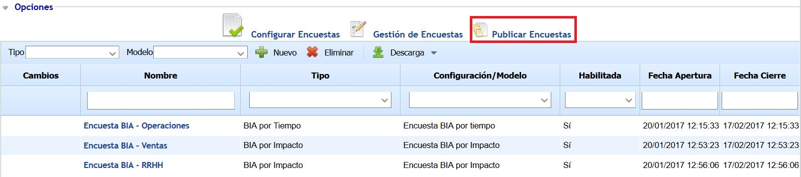
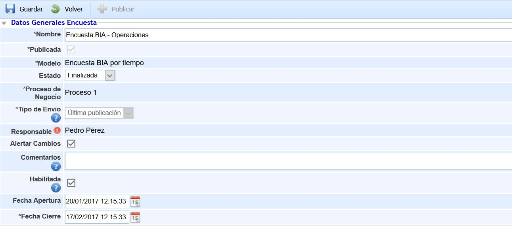
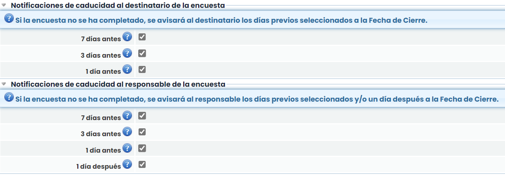
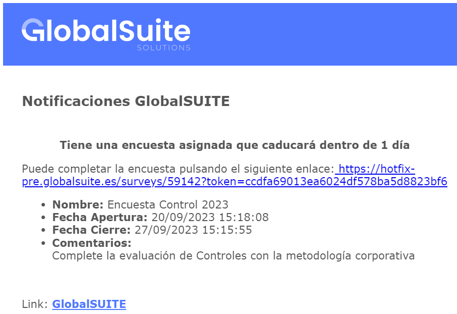
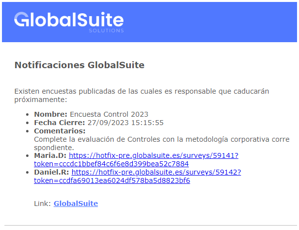
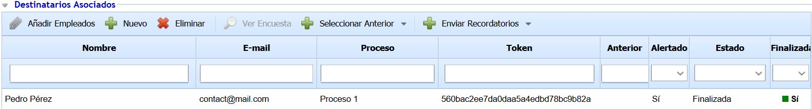
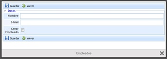
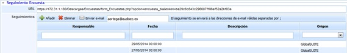
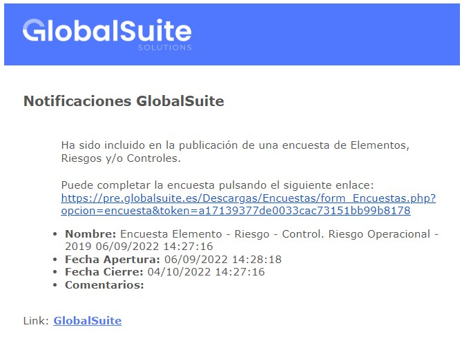
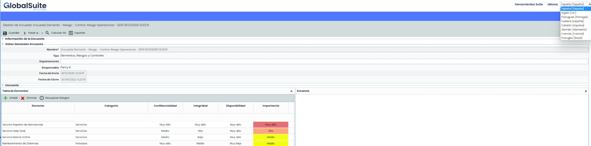

# Publicar encuestas

Al acceder a la opción se muestra una tabla que ofrece la siguiente información:

* **Cambios:** Informa si la publicación de la encuesta ha tenido algún cambio desde su creación.
* **Nombre:** Nombre identificativo de la encuesta.
* **Tipo:** Indica el tipo de encuesta ("BIA por Tiempo", "BIA por Impacto", "Elementos, Riesgos y Controles", "Empleados", "Recursos Humanos Críticos", "Compliance").
* **Configuración/Modelo:** Indica el modelo de encuesta en base al cual se ha realizado la encuesta.
* **Habilitada:** Indica si la encuesta está habilitada o no para que sea completada por los destinatarios.
* **Fecha Apertura:** Indica la fecha de inicio del periodo en el cual la encuesta puede ser completada.
* **Fecha Cierre :** Indica la fecha máxima del periodo en el cual la encuesta puede ser completada. Una vez superada esta fecha, las encuestas no son accesibles.

Las opciones que permite realizar la herramienta sobre la tabla inicial son las siguientes:

* **Nuevo:** Al pulsar sobre el botón se genera una nueva publicación en la tabla de encuestas. Para ello, es necesario definir el Tipo y Modelo de la encuesta a través de los desplegables que aparecen.

  * **Tipo:** Este desplegable contiene los tipos de encuestas que se pueden generar. En función de los módulos de GlobalSUITE habilitados aparecerán unos tipos u otros de encuestas. Los tipos disponibles son: "BIA por Tiempo", "BIA por Impacto", "Elementos, Riesgos y Controles", "Empleados", "Recursos Humanos Críticos", "Compliance".
  * **Modelo:** Este desplegable muestra los modelos de encuesta disponibles en función del tipo de encuesta seleccionado. Esta lista se completa una vez que se ha seleccionado un tipo de encuesta.
* **Eliminar:** Permite eliminar una encuesta ya creada en la tabla. Para ello se debe seleccionar la fila deseada y pulsar sobre el botón ‘Eliminar’.
* **Descarga:** Ofrece la posibilidad de descargar el listado de encuestas en formato editable (xlsx) o en formato PDF.

Al pulsar sobre cualquier registro de la tabla, se accede a la información específica de la publicación de la encuesta.

## **Datos Generales Encuesta**

Esta sección permite definir la siguiente información:

* **Nombre:** Nombre identificativo de la encuesta.
* **Publicada:** Indica si la encuesta está publicada. El check se marca automáticamente una vez que se pulsa el botón "Publicar" situado en la parte superior.
* **Modelo:** Indica el Modelo utilizado para realizar la encuesta.
* **Estado:** Indica el Estado en el que se encuentra la encuesta publicada.


\*\*Nota\*\*
Si el modelo de encuesta no dispone de estados configurados, el campo Estado no aparece.


* **Proceso de negocio:** Indica el proceso de negocio sobre el que se va ha realizar la encuesta.


\*\*Nota\*\*
Este campo sólo aparece en las encuestas de tipo BIA. Para el resto de encuestas no aparece.


* **Tipo de Envío:** Ofrece la posibilidad de enviar las encuestas según los siguientes tipos:

  * **Vacío:** La encuesta se envía a los usuarios con los campos sin completar o vacíos (para el caso de las encuestas tipo "BIA") o se envía con la información que existe actualmente en GlobalSUITE (para el resto de tipos de encuestas).
  * **Última publicación:** Permite seleccionar una encuesta anterior ya publicada para que los campos se completen con la información de la encuesta seleccionada. Si no se selecciona una encuesta anterior (en la sección "Destinatarios Asociados", opción "Seleccionar Anterior", la encuesta se crea vacía (para el caso de encuestas tipo "BIA") o se crea con la información que existe actualmente en GlobalSUITE (para el resto de tipos de encuestas).
  * **Datos del Empleado:** Este tipo sólo aparece para las encuestas de tipo "Empleado". Al seleccionar este tipo se crea la encuesta con los datos actuales del empleado que existen en GlobalSUITE.
* **Responsable:** Permite establecer el responsable de la publicación de la encuesta. Al finalizar la encuesta, este responsable recibe un correo electrónico avisando de ello.
* **Alertar cambios:** Ofrece la posibilidad de que el responsable sea alertado ante cualquier cambio realizado por un usuario sobre la encuesta.
* **Comentarios:** Permite incluir un texto o comentario de ayuda a los usuarios que van a completar la encuesta. El texto introducido en este campo aparece en el correo electrónico enviado a los destinatarios de la encuesta.
* **Habilitada:** Permite habilitar la encuesta a los usuarios. Si se encuentra marcado este check, las encuestas estarán disponibles durante el periodo establecido entre Fecha Apertura y Fecha Cierre. Si no se encuentra marcado este check, la encuesta no está habilitada ignorando las fechas establecidas. Si no se indican fechas de apertura y cierre, y el check se encuentra marcado, la encuesta estará siempre habilitada siendo necesario su deshabilitación de manera manual.
* **Fecha Apertura:** Permite establecer una fecha desde la cual la encuesta podrá ser completada.
* **Fecha Cierre:** Permite establecer una fecha a partir de la cual la encuesta no será accesible para ser completada.

## Notificaciones de Caducidad

Será posible enviar notificaciones a los responsables y a los destinatarios de las encuestas próximas a finalizar que aún no se han completado,  así como de las que estén finalizadas y sin completar.

Este sistema de notificaciones es una herramienta útil para garantizar que las encuestas se completen de manera oportuna y que se realicen seguimientos adecuados. Los recordatorios escalonados antes del cierre y las notificaciones posteriores son estrategias efectivas para aumentar las tasas de respuesta y la finalización de las encuestas.

### **Notificación de caducidad al destinatario de la encuesta**

El propósito de estas notificaciones es recordar a los destinatarios que deben completar la encuesta antes de su caducidad.

* Se podrá configurar el envío de notificaciones al destinatario 1, 3 y/o 7 días antes del cierre de la encuesta.

### **Notificación de caducidad al responsable de la encuesta**

Este tipo de notificaciones son útiles para que los responsables puedan dar seguimiento a la encuesta y garantizar que se complete a tiempo. Así como tener identificadas aquellas encuestas que no fueron completadas oportunamente. 

* Se podrán configurar el envío de notificaciones al responsable 1, 3 y/o 7 días,  antes del cierre de la encuesta.
* Adicionalmente se podrán enviar notificaciones respecto de las encuestas que han finalizado y no han sido completadas. Estas notificaciones se enviarían al día siguiente de la fecha de cierre de la encuesta.

## Destinatarios asociados

Esta sección permite definir los destinatarios de la encuestas para que sea completada. Las acciones que permite realizar la tabla son las siguientes:

* **Añadir Empleados:** Permite añadir destinatarios a la encuesta utilizando los empleados dados de alta en la herramienta. Al pulsar el botón se muestra una ventana emergente con el listado de empleados, permitiéndose seleccionar uno o varios empleados. Una vez seleccionado los empleados deseados, hay que pulsar sobre el botón "Asociar Empleados" situado en la parte superior de la ventana.
* **Nuevo:** Permite añadir un destinatario que no se encuentre dado de alta en la herramienta. Al pulsar el botón aparece una ventana que permite indicar el nombre y el correo electrónico del destinatario. Adicionalmente, se puede crear el destinatarios registrado como empleado en la herramienta, marcando el check "Crear Empleado".

* **Eliminar:** Permite eliminar un destinatario ya incluido en la tabla. Para ello se debe seleccionar el empleado y pulsar sobre el botón ‘Eliminar’.
* **Ver Encuesta:** Permite visualizar la encuesta especifica del usuario seleccionado en la tabla.
* **Seleccionar Anterior:** Permite asociar la información de una encuesta anterior para las encuestas incluidas en la publicación. Existen dos opciones:

  * **Todas:** Esta opción asocia a cada encuesta existente en la publicación una encuesta anterior de manera automática. Para ello, se comprueba que la encuesta anterior tenga el mismo Empleado y la misma Configuración de encuesta para realizar la asociación.
  * **Manualmente:** Esta opción permite seleccionar qué encuesta anterior se desea asociar. Para ello, se debe seleccionar una encuesta de la tabla y al pulsar esta opción aparece una ventana que contiene todas las encuestas anteriores que tienen el mismo modelo de encuesta, permitiendo seleccionar la encuesta deseada para que se asocie a la encuesta actual.


\*\*Nota\*\*
Este botón se encuentra deshabilitado cuando el Tipo de Envío de la publicación es "Vacío".


* **Enviar Recordatorios:** Esta opción permite enviar avisos mediante correo electrónico a los destinatarios. Los avisos contienen un texto introductorio de la encuesta, incluyendo los comentarios indicados en la publicación y el link de acceso a la encuesta. Existen 3 opciones:

  * **Enviar a Todos:** Se envía un correo electrónico a todos los destinatarios.
  * **No Alertados:** Se envía un correo electrónico a los destinatarios que no han sido avisados hasta el momento.
  * **Seleccionados:** Se envía un correo electrónico a los destinatarios seleccionados en la tabla.

La información que ofrece la tabla de destinatarios es la siguiente:

* **Nombre:** Indica el nombre del destinatario de la encuesta.
* **E-mail:** Indica el correo electrónico del destinatario de la encuesta.
* **Proceso:** Indica el proceso asociado a la encuesta.


\*\*Nota\*\*
Esta columna sólo aparece en las encuestas tipo BIA.


* **Token:** Permite visualizar el código de seguridad de autenticación asociado a la encuesta. Este código se genera automáticamente para cada encuesta creada.
* **Anterior:** Indica el nombre de la publicación de encuesta asociada a la encuesta actual. Si no se ha asociado una encuesta anterior, esta columna aparece sin información.


\*\*Nota\*\*
Esta columna sólo aparece en las encuestas con Tipo de Envío "Última publicación".


* **Alertado:** Indica si la encuesta ha sido enviada al usuario.
* **Estado:** Indica el estado en el que se encuentra la encuesta.


\*\*Nota\*\*
Esta columna sólo aparece en las encuestas cuyo modelo posee estados configurados.


* **Finalizado:** Indica si la encuesta ha sido finalizada. Cada destinatario puede indicar si ha terminado una encuesta pulsando un botón disponible en la encuesta.

## **Seguimiento Encuesta**

Esta sección permite gestionar el seguimiento de una encuesta a un destinatario concreto. Para ello se debe seleccionar el destinatario de la tabla anterior, pudiendo realizar lo siguiente:

* **URL:** Permite visualizar la URL que recibe el usuario por correo electrónico para completar la encuesta. Si se pulsa esta URL, se accede directamente a la encuesta tal cual lo visualiza el destinatario.
* **Seguimientos:** Ofrece la posibilidad de establecer comentarios u observaciones sobre la encuesta a través del botón "Añadir", pudiendo enviar dichos comentarios a través de correo electrónico pulsando el botón "Enviar e-mail". Adicionalmente, se registran seguimientos automáticos correspondientes a los recordatorios que son enviados al destinatario así como las modificaciones que ha realizado el usuario sobre la encuesta.


\*\*Nota\*\*
 Una vez publicada la encuesta, los usuarios reciben un correo electrónico con la dirección URL de acceso a la encuesta y toda la información asociada a la encuesta. En la siguiente imagen se muestra un ejemplo (tanto el contenido como el formato del correo electrónico puede ser diferente en función de cada entidad y el tipo de encuesta)


En cada una de las encuestas que se completan accediendo desde el enlace, tenemos la posibilidad de realizar las siguientes acciones:

* **Idioma:**Las encuestas se cargarán en el idioma por defecto de la empresa, pudiendo el usuario completarlas en el idioma que desea dentro de los disponibles en el desplegable.
* **Guardar:** Permite almacenar la información completa hasta el momento, pero sin dar por finalizada la encuesta y sin avisar a ningún responsable.
* **Finalizar Encuesta:** Guarda y da por finalizada la encuesta, depende de como esté definido el cambio de estado enviará un correo avisando al responsable de la publicación, Automático a no, o pasará al siguiente estado. En el caso de que no haya definidos estados para la encuesta, dará por finalizada la encuesta y avisará al responsable de la publicación.
* **Volver Estado Anterior:** Sólo disponible para encuestas que tengan estado y que hayan configurado Vuelta a Atrás en ese estado, permite llevar la encuesta al estado anterior.
