# Eventos de Pérdida

Los Eventos de Pérdida se pueden generar manualmente o a través de la clasificación de los Tickets abiertos cuando se define la tipología Evento de Pérdida.

En la pantalla principal de Eventos de Pérdida nos aparecen todos aquellos eventos que están en estado 'Abierto' o 'Investigación' (son estados que están configurados con el tipo de estado "Inicial" o "Intermedio"), así como las siguientes opciones:

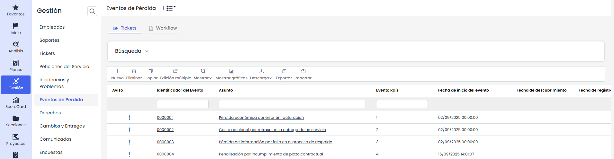

* **Nuevo:** Permite generar Eventos de Pérdida.

* **Eliminar:** Permite eliminar Eventos de Pérdida.

* **Copiar:** Esta opción permite copiar el registro de un Evento de Pérdida que ha sido definido con anterioridad.
* **Edición Múltiple:** Esta opción aparecerá en la barra de herramientas si hay configurado para este tipo de ticket un campo de estado.   
  El proceso se realiza desde un modal: se selecciona el estado actual (origen) —acompañado de su flujo de trabajo cuando corresponda y del número de tickets que se encuentran en él— y, a continuación, el nuevo estado (destino), que el sistema propone según el flujo de trabajo configurado. También puede decidirse si se envían las notificaciones de cambio de estado, activadas por defecto.

  

  Antes de ejecutar, el sistema muestra un mensaje de confirmación con el número de tickets afectados y la transición que se va a aplicar. Al confirmar, la operación se ejecuta en segundo plano —su avance puede seguirse en Procesos de trabajo—, de modo que es posible continuar trabajando mientras se completa.
* **Mostrar:** Al utilizar GlobalSUITE como base de datos de conocimientos, mediante esta opción podrá seleccionar que se muestren tan sólo aquellas no conformidades que estén abiertas, o por el contrario todas, a través del desplegable del que dispone esta opción.

  

  Adicionalmente, cuando el campo **Empleado** se encuentre configurado para el tipo de ticket, estarán disponibles las opciones **Abiertos por empleados** y **Todos por empleados**, que permiten mostrar los tickets agrupados por el empleado asociado.

* **Descarga:** Permite descargar el listado de eventos de pérdida representados en la vista (dependiendo de los filtros que tenga establecidos) en formato Excel o CSV.  Este Informe estará disponible en [Descargas Pendientes.](https://help.globalsuite.es/display/GlobalSUITEes/.Descargas+Pendientes+vv6.53)  
  Para las descargas en formato **Excel**, el sistema podrá limitar la generación del fichero cuando la información a exportar supere las **100.000 celdas**. Este límite se calcula en función de la cantidad de registros y columnas incluidas en la descarga.

  En caso de que no sea posible generar el fichero en formato Excel, se recomienda realizar la descarga en formato **CSV**.
* **Mostrar gráficas:** Ofrecen diferentes gráficas en función de los datos de los registros de eventos de pérdida existentes. Se muestran las siguientes gráficas:

  * **Estado**: Permite visualizar el porcentaje de Eventos de Pérdida que hay en cada estado. Situándose sobre la gráfica, se puede visualizar el número de cada estado.

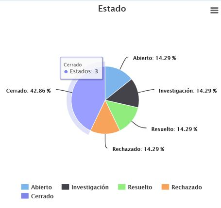

* **Registrados**: Permite visualizar en una misma gráfica el número de Eventos de Pérdida Totales de cada mes, los que están abiertos aun o los que están ya cerrados.

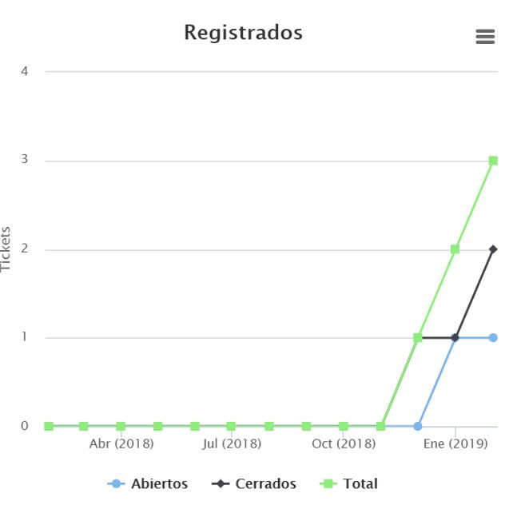

* **Tipo del evento**: Permite visualizar el porcentaje de Eventos de Pérdida registrados que han sido clasificados en cada uno de los "Tipo del Evento". Situándose sobre la gráfica, se puede visualizar el número de cada estado.

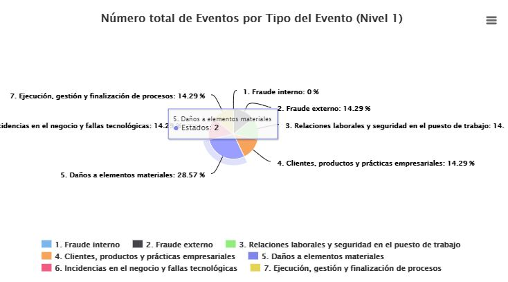

* **Tipo del evento**: Permite visualizar el número de Eventos de Pérdida que han sido registrados en cada mes y según han sido clasificados por "Tipo del Evento".

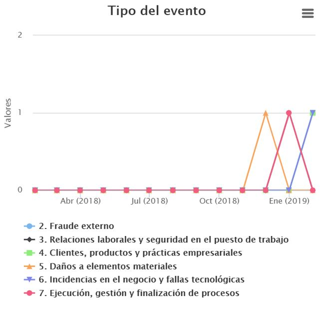

* **Línea de Negocio**: Permite visualizar el porcentaje de Eventos de Pérdida registrados que han sido clasificados en cada una de las "Líneas de Negocio". Situándose sobre la gráfica, se puede visualizar el número de cada estado.

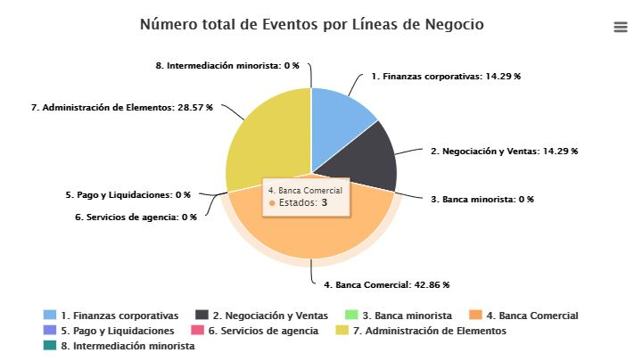

* **Línea de Negocio**: Permite visualizar el número de Eventos de Pérdida que han sido registrados en cada mes y según han sido clasificados por "Línea de Negocio".

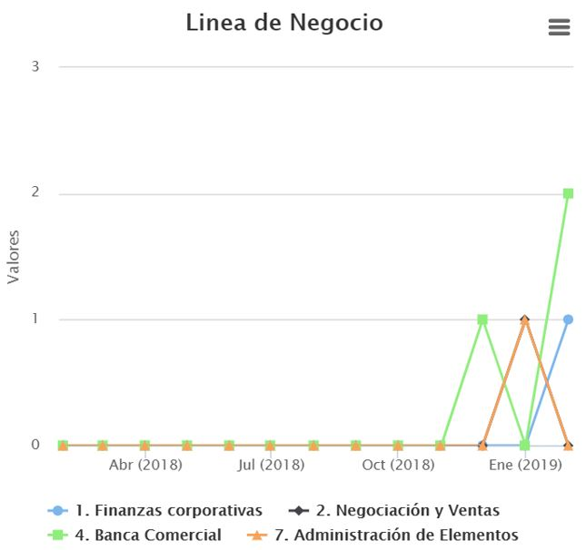

* **Carácter del evento**: Permite visualizar el porcentaje de Eventos de Pérdida registrados que han sido clasificados en cada uno de los tipos de definidos como "Carácter de Negocio". Situándose sobre la gráfica, se puede visualizar el número de cada estado.

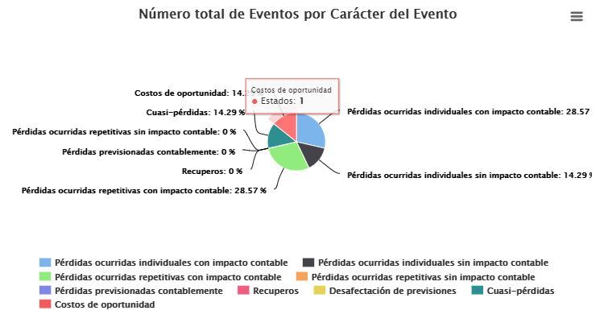

* **Carácter del evento**: Permite visualizar el número de Eventos de Pérdida que han sido registrados en cada mes y según han sido clasificados por "Carácter del Evento".

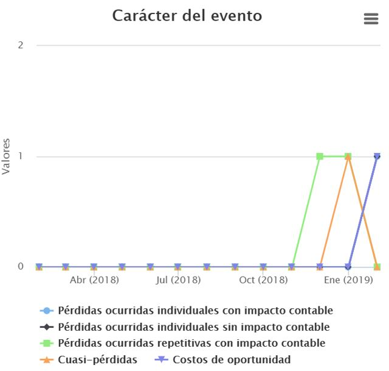

* **Total de Pérdida por Tipo del Evento (Nivel 1) al mes**: Permite visualizar el volumen total de pérdidas de los Eventos de Pérdida de cada mes y según han sido clasificados por "Tipo del Evento (Nivel 1)".

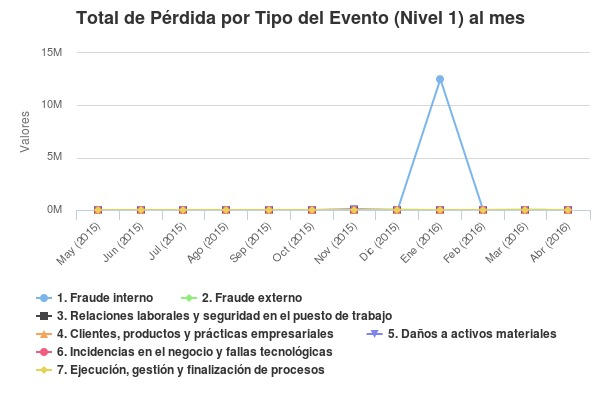

* **Comparativa de Pérdidas/Recuperaciones/Seguros**: Permite visualizar el volumen total de Pérdidas, Recuperaciones y Seguros de los Eventos de Pérdida de cada mes.

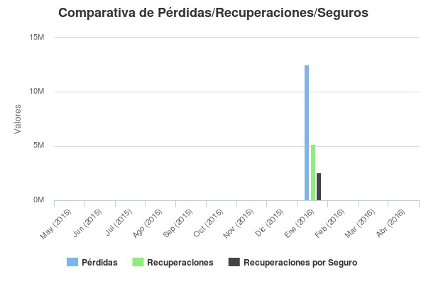

En la leyenda de cada gráfica podrá desmarcar parte de la información que se está visualizando con el fin de personalizar la vista de la gráfica. Por ejemplo, si en la gráfica de "Comparativa de Pérdidas/Recuperaciones/Seguros" desea solo visualizar las Pérdidas y Recuperaciones, pulse sobre la leyenda en "Recuperaciones por Seguro" y dejará de visualizar la gráfica con la esa información. Si desea que vuelva a aparecer en la gráfica el valor de las "Recuperaciones por Seguro", deberá volver a pulsar sobre el tipo en la leyenda de la gráfica.

Todas las gráficas pueden ser impresas directamente o ser descargadas pulsando sobre el símbolo de 3 rayas que aparece en la parte superior derecha de cada gráfica. Los formatos disponibles son PNG, JPEG, PDF y vectorial SVG.

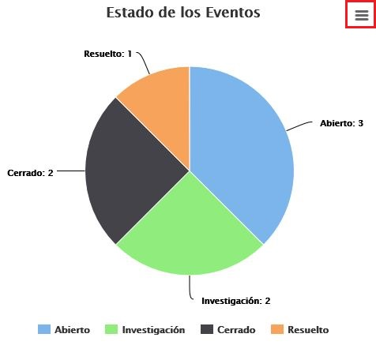

* [Workflow Eventos](workflow-eventos.md)
* [Formulario del Evento](formulario-del-evento.md)
