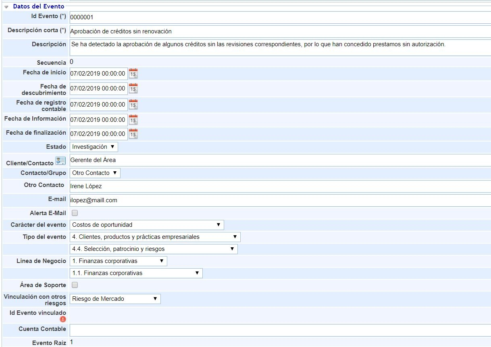
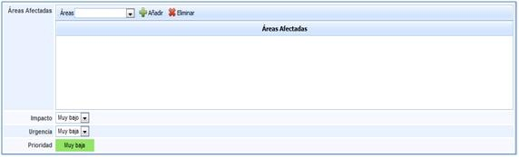
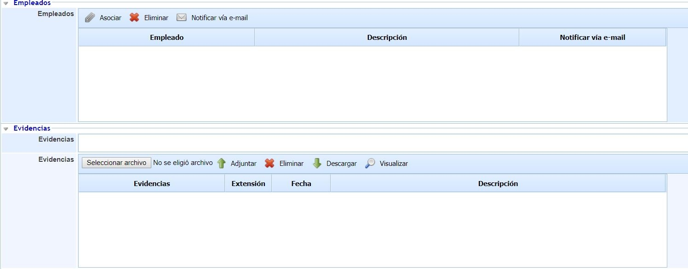
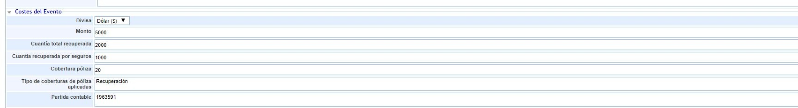
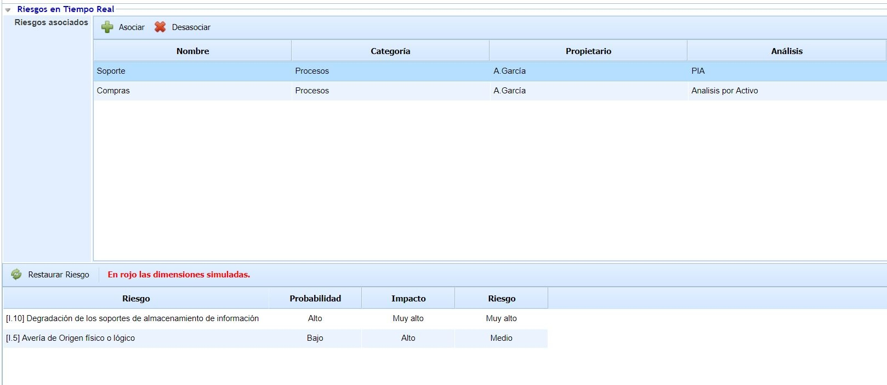
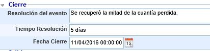
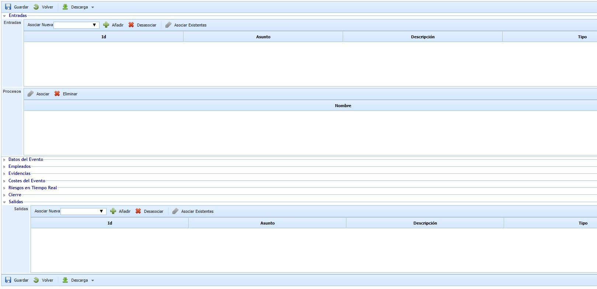

# Formulario del Evento

## Datos del Evento

Para acceder a cualquier Evento de Pérdida basta con pulsar sobre el Identificador del Evento o el asunto en el listado de Eventos de Pérdida de la pantalla principal. Una vez dentro, GlobalSUITE nos proporciona las siguientes opciones:

* **Identificador del Evento:** Corresponde con el número o identificador del Evento de Pérdida que se ha generado que se ha generado. Este identificador se genera de forma automática y a partir del identificador configurado en el apartado de 'Ajustes' en la opción de "Configuración de Tickets".
* **Descripción corta:** En este campo se define el título del evento de pérdida.
* **Descripción:** Es uno de los puntos más importantes, ya que es a través de este campo mediante el cual se especificará lo más detallado posible, en qué consiste el evento de pérdida.
* **Secuencia:** En este campo se define el número de la secuencia del evento de pérdida.
* **Fecha de inicio:** Permite establecer la fecha en la que comenzó el evento de pérdida.
* **Fecha de descubrimiento:** Permite establecer la fecha en la que fue descubierto el evento de pérdida.
* **Fecha de registro contable:** Permite establecer la fecha de registro contable del evento de pérdida.
* **Fecha de Información:** Permite establecer la fecha en la que se realizó la última actualización sobre el estado del evento de pérdida.
* **Fecha de finalización:** Permite establecer la fecha en la que se dio por finalizado el evento de pérdida.
* **Estado:** Se define si el evento se encuentra Abierto, Investigación, Resuelto, Rechazado o Cerrado. Los estados pueden ser editados en función de la configuración del workflow asociado al evento de pérdida registrado. La configuración de los workflows de eventos de pérdida se detalla más adelante.
* **Cliente/Contacto:** Permite registrar el cliente o personal que detectó el Evento de Pérdida. Este campo será de texto en el caso de no disponer de módulos con la funcionalidad de "Relaciones con el Negocio". Cuando esté disponible esta funcionalidad, se permite vincular el cliente que detectó el evento de pérdida del listado de clientes registrado en la opción de "Relaciones con el Negocio".
* **Contracto/Grupo:** Si dispone de la funcionalidad de "Relaciones con el Negocio" podrá seleccionar uno de los contactos asociados al cliente seleccionado en el campo anterior o bien seleccionar otro contacto para indicarlo manualmente. Este último caso es el que está disponible de forma fija cuando no está no dispone de la funcionalidad de "Relaciones con el Negocio".
* **Otro Contacto:** Permite reflejar el nombre del contacto.
* **E-mail:** Permite reflejar la dirección de e-mail del contacto anteriormente reflejado. Este campo será automático cuando se disponga de la funcionalidad de "Relaciones con el Negocio" y existan contactos con e-mail asociado al cliente asociado al evento de pérdida.
* **Alerta E-mail:** Permite indicar si se quiere alertar al contacto registrado en el e-mail especificado en el campo anterior, cada vez que el evento de pérdida cambie de estado.
* **Carácter del Evento:** Permite indicar el carácter del evento del listado que previamente ha sido configurado en la parte de "Configuración de Tickets" del panel de 'Ajustes' o del listado de la configuración por defecto que ofrece GlobalSUITE.
* **Tipo del Evento (Nivel 1):** Permite indicar el tipo del evento de nivel 1 que previamente ha sido configurado en la parte de "Configuración de Tickets" del panel de 'Ajustes' o del listado de la configuración por defecto que ofrece GlobalSUITE.
* **Tipo del Evento (Nivel 2):** Permite indicar el tipo del evento de nivel 2 que previamente ha sido configurado en la parte de "Configuración de Tickets" del panel de 'Ajustes' o del listado de la configuración por defecto que ofrece GlobalSUITE y que depende del valor seleccionado en el campo anterior de "Tipo del Evento (Nivel 1)".
* **Línea de Negocio (Nivel 1):** Permite indicar la línea de negocio de nivel 1 del evento de pérdida que previamente ha sido configurada en la parte de "Configuración de Tickets" del panel de 'Ajustes' o del listado de la configuración por defecto que ofrece GlobalSUITE.
* **Línea de Negocio (Nivel 2):** Permite indicar la línea de negocio de nivel 2 del evento de pérdida que previamente ha sido configurada en la parte de "Configuración de Tickets" del panel de 'Ajustes' o del listado de la configuración por defecto que ofrece GlobalSUITE y que depende del valor seleccionado en el campo anterior de "Línea de Negocio(Nivel 1)".
* **Área de soporte:** Permite marcar si el área de soporte está implicada o no en el evento de pérdida.
* **Vinculación con otros riesgos:** Permite reflejar si el evento de pérdida está asociado con otros riesgos como Riesgo de Mercado, Riesgo de Crédito, Riesgo de Mercado y Crédito o si no aplica mediante la opción N/A.
* **Id evento vinculado:** Permite asociar el id del evento con el que está vinculado el evento que se está registrando. Deberá pulsar sobre el botón rojo que aparece al lado de este campo para que se muestre el listado de eventos de pérdida y pueda seleccionar uno de ellos.
* **Cuenta contable:** Permite asociar el id del evento con el que está vinculado el evento que se está registrando.
* **Evento raíz:** Identificador del Evento - Puede ser automático o secuencial.

Adicional a estos campos, se podrá configurar para priorizar los Eventos de Pérdida en función de un Impacto y una Urgencia:

* **Impacto:** Permite establecer un valor cualitativo, para determinar el nivel de daño que provoca la petición de servicio.
* **Urgencia:** Permite establecer un valor cualitativo, para determinar la celeridad con la que debe ser resuelta la petición.
* **Prioridad:** Este valor es generado de forma automática por GlobalSUITE®, realizando la media aritmética de los valores establecidos en los campos de impacto y urgencia.

De forma complementaria al registro de información a realizar, la solución también le permitirá:

## Empleados

* **Empleados:** Permite definir los empleados que se encargarán del tratamiento del evento de pérdida. Es necesario que estos empleados hayan sido definidos en la opción de Empleados.

## Evidencias

* **Evidencias:** Con el fin de definir de la forma más completa posible, la solución le permite adjuntar cualquier tipo de archivo. En caso de no adjuntar dicha documentación, también es posible realizar una descripción en el campo Evidencias.

## Costes del Evento

* **Divisa:** Permite seleccionar la divisa asociada a las cuantías detalladas en este apartado de costes. Los tipos de divisa o moneda podrán ser definidos en la opción de Configuración de Tickets del apartado 'Ajustes' de GlobalSUITE.
* **Cuantía del evento:** Permite definir el valor numérico correspondiente a la cuantía del evento.
* **Cuantía total recuperada:** Permite definir el valor numérico correspondiente a la cuantía total recuperada.
* **Cuantía recuperada por seguros:** Permite definir el valor numérico correspondiente a la cuantía recuperada por seguros.
* **Cobertura póliza** Permite definir el valor numérico correspondiente al porcentaje de la pérdida que es cubierta por una póliza de seguro.
* **Tipo de coberturas de póliza aplicadas** Permite especificar el tipo de cobertura que tiene la póliza aplicada al evento de pérdida ocurrido.
* **Partida contable** Permite especificar el detalle de las partidas contables asociadas al evento de pérdida.
* **Cuantificadores** Permite añadir varios registros de pérdidas del Evento, y seleccionando sobre el cuantificador se pueden añadir en la tabla inferior los registros asociados.
* **Riesgos** Permite la relación directa de un evento con uno o varios riesgos (y viceversa). Una vez que se ha asociado el riesgo con el evento, la relación establecida también aparece desde la opción de análisis de riesgos.

## Riesgos en Tiempo Real

Ofrece la posibilidad de visualizar los servicios/procesos/elementos afectados por el suceso y valores definidos en el análisis de riesgos. Las tareas que se pueden realizar sobre esta apartado son:

* **Asociar:** Una vez seleccionado el servicio/proceso/elemento, permite insertar el mismo en la tabla.
* **Desasociar:** Permite eliminar uno o varios servicios/procesos/elementos de la tabla. Para ello se ha de seleccionar la fila deseada y pulsar sobre el botón 'Desasociar'
* **Elementos:** Dentro del botón "Asociar", permite seleccionar el/los servicios/procesos/elementos afectados por el evento de pérdida.
* **Análisis:** Dentro del botón "Asociar", una vez marcado el elemento en la parte de la izquierda, en la derecha permite seleccionar el/los análisis de riesgos donde se encuentra valorado el servicio/proceso/elemento seleccionado.

**NOTA:** Un mismo servicio/proceso/elemento puede estar evaluado en diferentes análisis de riesgos y con valoraciones diferentes, de ahí la necesidad de indicar el análisis de riesgos que queremos cargar. Lo habitual en este caso será seleccionar el Análisis de Riesgos Operacionales que haya sido realizado previamente.

Una vez seleccionamos la fila del servicio/proceso/elemento deseado, la tabla situada en la parte inferior permite al usuario visualizar o modificar los valores definidos en el apartado 'Análisis/Análisis de Riesgos'. La herramienta destaca en color rojo aquellas valoraciones que han sido modificadas.

**NOTA:** La herramienta permite simular como afecta el evento de pérdida a los servicios/procesos/elementos valorados en el apartado 'Gestión de Riesgos/Proyección y Simulación'. En función de la metodología definida en el apartado ''Ajustes' /Metodología Análisis', las valoraciones de las dimensiones pueden ser cualitativas o cuantitativas.

Las acciones que se pueden realizar sobre la tabla son:

* **Restaurar Riesgo:** Permite restaurar los valores iniciales de la tabla según el Análisis de Riesgos realizado.

## Datos de cierre

Una vez se haya solucionado el Evento de Pérdida, GlobalSUITE® le permite definir cómo se ha procedido al respecto.

* **Resolución del evento:** Para indicar la forma mediante la cual se ha procedido y que ha permitido cerrar el evento de pérdida.
* **Tiempo Resolución:** Permite indicar el tiempo que se ha empleado en la resolución del evento de pérdida ocurrido.
* **Fecha de cierre:** Permite indicar la fecha y hora exacta en la que se ha cerrado el evento de pérdida.

## Entradas y Salidas

La solución tiene en cuenta la opción de que la petición de servicio derive de un evento diferente o por el contrario que esta petición pueda generarlo. Para estos casos concretos se presentan las siguientes opciones:

* **Entradas:** Permite determinar si el evento de pérdida definido procede de otro tipo de evento, proporcionando la herramienta las siguientes opciones, que vienen determinadas en función de los módulos integrados que se tenga de GlobalSUITE®:

* Cambio.
* Correctiva.
* Derechos ARCO.
* Evento.
* Evento de Pérdida.
* Falso Positivo.
* Incidencia.
* Incidente.
* Mejora.
* No Conformidad.
* Oportunidades de Mejora.
* Petición de Servicio.
* Preventiva.
* Problema.
* Puntos Fuertes.
* **Procesos:** Permite seleccionar, de entre los procesos definidos en el sistema, cuáles se ven afectados o involucrados en el ticket.
* **Salidas:** Permite determinar si la petición de servicio definida deriva en otro tipo de evento, proporcionando la herramienta las opciones anteriormente expuestas para la entrada.

Tanto para las entradas como para las salidas se identifican una serie de opciones comunes:

* **Añadir:** Seleccionando el tipo de evento del que procede o en el que deriva, se incluirá en el campo correspondiente, generándose dicho evento en otra opción de las que proporciona GlobalSUITE®.
* **Eliminar:** Elimina la vinculación del evento asociado que haya sido añadido. En ningún caso elimina el registro del propio evento.
* **Asociar existentes:** En caso de que el evento del que derive haya sido creado con anterioridad, esta opción permite buscar dicho evento de tal forma que se pueda asociar al evento de pérdida correspondiente.
