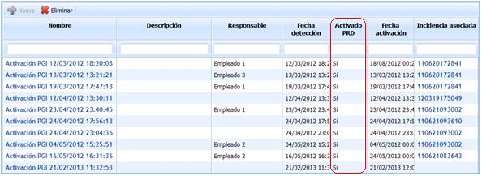

# Gestión de la Crisis

La opción Gestión de la Crisis permite actuar ante un escenario de crisis, con el fin de resolver la situación de desastre ocurrida.

En la pantalla principal se puede observar todos los Planes de Gestión de Incidentes a los que se ha llamado como consecuencia de la ocurrencia de una situación de desastre.

En la presente opción no es posible crear un nuevo Plan de Gestión de Crisis, ya que viene derivado de la opción 'Gestión/Incidentes y Problemas' o Planes/Plan de Gestión de Crisis.

**NOTA:** Un plan de gestión de crisis será mostrado en la presente opción (Gestión de la crisis) cuando el registro de un Incidentes (Gestión/Incidentes y problemas) reúna una serie de criterios definidos en el apartado 'Planes/Planes de Gestión de Crisis' o cuando el usuario **active** o **simule** directamente desde la opción 'Planes/Planes de Gestión de Crisis' una crisis.

Una vez se pulsa sobre el enlace deseado en la tabla, se accede a las siguientes vistas:

* [Información de Gestión de Crisis](informacion-de-gestion-de-crisis.md)
* [Cuadro de Mando Crisis](cuadro-de-mando-crisis.md)
* [Planes de la Gestión de Crisis](planes-de-la-gestion-de-crisis.md)
