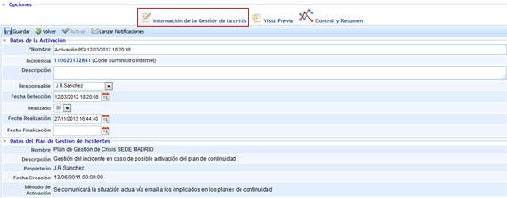
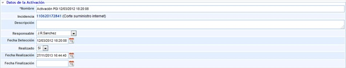

# Información de Gestión de Crisis

**Datos de la Activación**

En estos campos se permiten establecer todos aquellos datos que van a determinar, el origen, la fecha de detección , la causa y los responsables de la Activación del Plan de Gestión de Crisis.

* **Nombre:** Permite establecer un nombre concreto a la Crisis que se ha procedido a definir.

* **Incidencias Relacionadas:** Permite determinar si la Gestión de Crisis tiene su origen en una o varias incidencias concretas. En caso de que proceda de una incidencia, en la presente tabla aparecerán asociadas de forma automática a la Gestión de Crisis.

* **Descripción:** Permite determinar qué ha ocurrido para proceder a llamar al Plan de Gestión de Crisis para una posible activación.

* **Coordinador:** Persona que se encarga de coordinar y supervisar la Gestión de Crisis.

* **Fecha de Detección:** Permite establecer la fecha en la cual ha ocurrido el evento.

* **Estado:** Permite indicar el Estado en el que se encuentra la Gestión de Crisis (Avisado, En Progreso o Finalizada).

**Niveles**

* **Nivel de Crisis:** Indica el nivel actual de la crisis, y proviene del nivel que tuviera el plan de gestión de crisis que se haya activado. Este nivel no puede modificarse, sino que se escalaría la crisis a otro plan de gestión de crisis en caso de querer cambiar el nivel.

* **Impactos:** Permite indicar el estado bajo el cual, cada tipo de impacto se encuentra en ese momento en la gestión de crisis, así como el nivel individual en el que se encuentra cada tipo de impacto. El botón "Ver Impactos Generales" permite accede a la información general de la empresa relativa a los impactos y niveles, para ayudar al usuario a decidir si cambia el nivel de cada uno de los impactos.

* **Escenarios de Referencia:** En esta tabla se muestran los escenarios de crisis que han derivado en la activación del plan de gestión de crisis. Mediante el botón "Ver Acciones" se pueden visualizar las acciones que deben tenerse en cuenta al considerar un escenario en la gestión de crisis.

* **Servicios:** En esta tabla se asocian los servicios y procesos a los que está afectando la gestión de la crisis.

* **Infraestructuras:** En esta tabla se asocian las infraestructuras críticas que se están viendo afectadas por la gestión de la crisis.

**Datos de Gestión de la Crisis**

En esta sección se muestran los miembros del comité asociado a la gestión de la crisis declarada. El comité que se asocia a la crisis corresponde al comité asociado al Plan de Gestión de Crisis activado.

* **Comité de Decisión:** Indica el nombre del comité de decisión asociado a la gestión de la crisis.

* **Confirmación Asistencia Miembros Comité:** Esta tabla muestra de forma automática los miembros pertenecientes al comité. En este apartado es posible indicar si un miembro se ha presentado a la toma de decisiones, o si por el contrario no ha podido asistir. En caso de que un miembro no pueda asistir y éste tenga definidos miembros que le sustituyen, la funcionalidad de la opción permite avisar al primer sustituto que tenga asociado. Para ello, hay que seleccionar que un miembro no ha podido asistir a través del check situado en la última columna de la tabla, y automáticamente la herramienta solicita el aviso al primer sustituto asociado (en caso de que exista uno).

* **Miembros Externos y de soporte al Comité del Sistema de Gestión:** Esta tabla muestra los miembros externos del comité de gestión de crisis, que pueden tener relevancia en el plan, pero que no pertenecen al sistema de gestión.

* **Eventos Disruptivos:** En esta tabla se pueden gestionar los eventos que se van sucediendo en una gestión de crisis, y que necesitan un tratamiento posterior.

  * **Nuevo:** Permite crear un nuevo evento.
  * **Eliminar:** Permite eliminar un evento, seleccionándolo en la tabla.
  * **Asociar Impactos:** Permite asociar diferentes tipos de impactos que se están viendo afectado por dicho evento.
  * **Asociar Acciones:** Permite asociar acciones de la tabla "Acciones Resolutivas", que están tratando de resolver el evento disruptivo surgido.
  * **Asociar Stakeholders:** Permite asociar clientes / stakeholders, que se han definido en la tabla "Clientes/Relaciones con el Negocio", y que están siendo afectados por dicho evento.
  * **Asociar Proveedores:** Permite asociar proveedores que se han definido en la tabla "Proveedores", y que están siendo afectados por dicho evento.

* **Acciones Resolutivas:** En esta tabla se pueden gestionar las acciones resolutivas que se llevan a cabo durante una gestión de la crisis, para solventar los eventos disruptivos que se van sucediendo.

  * **Nuevo:** Permite crear una nueva acción.
  * **Eliminar:** Permite eliminar una acción, seleccionándola en la tabla.
  * **Asociar Escenarios:** Permite asociar escenarios que se han definido en la tabla "Escenarios de Referencia", y que están siendo afectados por dicho evento.
  * **Asociar Responsable:** Permite asignar un responsable a la acción, entre el listado de empleados de la organización.
  * **Asociar Eventos:** Permite asociar los eventos de la tabla a las que la acción está dando soporte para resolverlo.

**Sistemas de información soporte Gestión de Crisis**

* **Objetivos:** En esta tabla se indican los objetivos a conseguir en la gestión de la crisis.

**Relaciones y Comunicación**

* **Clientes (Relaciones con el Negocio):** En esta tabla se asocian los clientes (relaciones con el negocio) que se están viendo afectados en la gestión de la crisis.

* **Proveedores:** En esta tabla se asocian los proveedores que se están viendo afectados en la gestión de la crisis Estos proveedores se configuran en la opción "Proveedores" del menú Inicio.

**Escalado**

* **Escalado:** Esta tabla permite indicar a que otros planes de gestión de crisis de mi entidad, u otras entidades, puedo escalar la gestión de la crisis actual. El botón de "Escalar" enviará una notificación a los responsables del plan de gestión de crisis seleccionado en la tabla, para que dichos responsables consideren o no activar el plan de gestión de crisis seleccionado.

* **Crisis Activas:** Esta tabla permite conocer que crisis están activas, ya sea de la propia entidad o de entidades hijas, las cuales son susceptibles de escalar al Plan de Gestión de Crisis que activó la gestión de crisis concreta.

**Archivos Adjuntos**

Se ofrece la posibilidad al usuario de adjuntar cualquier documentos anexo, que ayude a completar la Gestión de la Crisis, pulsando sobre el botón 'Adjuntar'. Una vez subidos, los documentos pueden ser descargados pulsando sobre el botón 'Descarga'.
