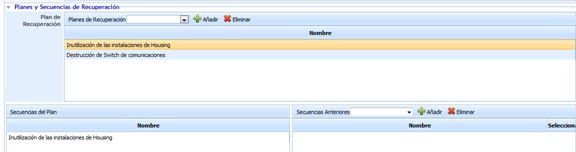
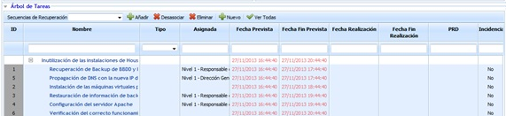

# Planes de la Gestión de Crisis

* **Finalizar:** Permite finalizar la Gestión de la Crisis.

* **Lanza Notificaciones:** Permite informar a través de correo electrónico al personal encargado de las tareas a realizar para completar la prueba en cuestión.

* **Control y Resumen:** La presente opción es similar a lo desarrollado en el apartado 'Planes/Programa de Pruebas'

**Datos del Plan**

* **Estado:** Permite indicar el Estado en el que se encuentran los planes relacionados en la gestión de crisis.

* **Fecha Realización:** Permite establecer la fecha de realización del plan.

* **Fecha Finalización:** Permite establecer la fecha de finalización del plan.

* **Margen retraso:** Permite introducir el margen de retraso con el cual con el cual pueden iniciarse o finalizarse las tareas.

**Planes de Continuidad**

La opción de planes de continuidad permite asociar los diferentes planes establecidos en el Plan de Gestión de Crisis

**Planes y Secuencias de Recuperación**

La opción de planes y secuencias de recuperación permiten asociar los diferentes planes de recuperación establecidos en el apartado 'Planes/Planes de Recuperación' para gestionar la crisis y las secuencias de ejecución de la misma.

**Árbol de tareas**

El árbol de tareas permite al usuario establecer las diferentes tareas a realizar para gestionar la crisis. Las opciones que permite la tabla son las siguientes:

* **Añadir** Ofrece la posibilidad de insertar una secuencia de recuperación.
* **Desasociar** Permite desasociar de la tabla una secuencia de recuperación junto con las tareas definidas en ella. Para ello se ha de seleccionar la secuencia deseada y pulsar sobre el botón 'Desasociar'.
* **Eliminar** Permite eliminar de la tabla una secuencia de recuperación junto con las tareas definidas en ella. Para ello se ha de seleccionar la secuencia deseada y pulsar sobre el botón 'Eliminar'.
* **Nueva** Permite insertar una nueva secuencia en la tabla.
* **Ver todas** Ofrece la posibilidad de ver todas las tareas a realizar.
* **Expandir** Permite expandir o contraer el árbol de tareas.
