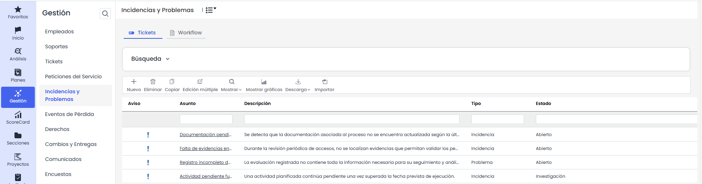
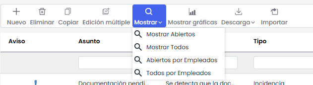
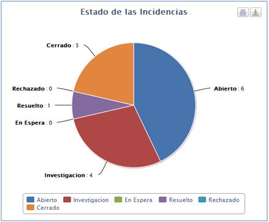
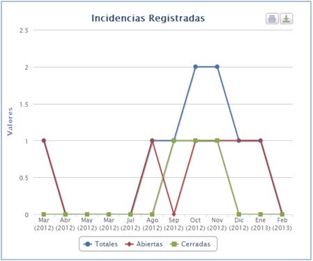
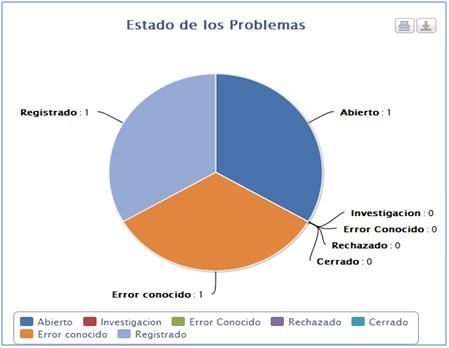
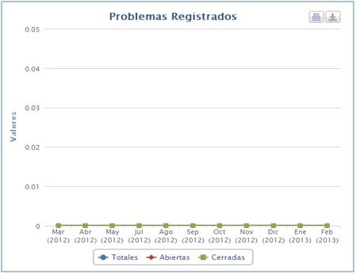
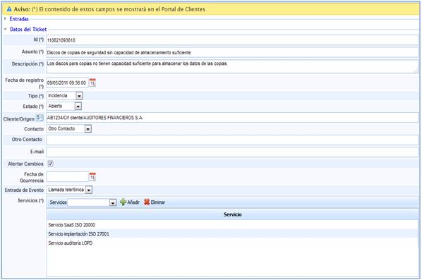

# Incidencias y Problemas

La opción Incidencias y Problemas permitirá gestionar todas aquellas incidencias y problemas abiertos por parte de clientes, proveedores o de forma interna. Hay que tener en cuenta que podrán ser abiertos manualmente, o por otra parte, ser generados por clientes de forma automática desde el portal de clientes a través de un Ticket.

En la pantalla principal nos aparecen todas aquellas incidencias y problemas que aun no están en estado cerrado, así como las siguientes opciones:

* **Nuevo:** Permite generar Incidencias o Problemas.

* **Eliminar**: Permite eliminar Incidencias o Problemas.

* **Copiar:** Esta opción permite copiar una Incidencia o Problema que ha sido definida con anterioridad.
* **Edición Múltiple:** Esta opción aparecerá en la barra de herramientas si hay configurado para este tipo de ticket un campo de estado.   
  El proceso se realiza desde un modal: se selecciona el estado actual (origen) —acompañado de su flujo de trabajo cuando corresponda y del número de tickets que se encuentran en él— y, a continuación, el nuevo estado (destino), que el sistema propone según el flujo de trabajo configurado. También puede decidirse si se envían las notificaciones de cambio de estado, activadas por defecto.

  

  Antes de ejecutar, el sistema muestra un mensaje de confirmación con el número de tickets afectados y la transición que se va a aplicar. Al confirmar, la operación se ejecuta en segundo plano —su avance puede seguirse en Procesos de trabajo—, de modo que es posible continuar trabajando mientras se completa.

* **Mostrar:** Al utilizar GlobalSUITE como base de datos de conocimientos, mediante esta opción podrá seleccionar entre diferentes filtros a través del desplegable del que dispone esta opción.

* **Mostrar gráficas:** Permite representar todas aquellas Incidencias y Problemas que se han definido, por subtipo y por estado. Esta opción nos permite mostrar las siguientes imágenes:

La solución le permite ver gráficamente y de forma separada tanto las Incidencias como Problemas. Las imágenes generadas permiten mostrar:

* **Totales:** Todas las Incidencias y Problemas registradas.

* **Abiertas:** Tan sólo representar aquellas que permanecen abiertas.

* **Cerradas:** Tan sólo representar aquellas que permanecen cerradas.

A su vez permite representar cualquier tipo de combinación entra estas opciones.

De la misma forma las imágenes pueden ser impresas directamente o ser descargadas en formato PNG, JPEG, PDF y vectorial SVG.

* **Descarga:** Permite descargar el listado de Incidencias y Problemas en formato Excel o CSV.  Este Informe estará disponible en [Descargas Pendientes.](https://help.globalsuite.es/display/GlobalSUITEes/.Descargas+Pendientes+vv6.53)  
  Para las descargas en formato **Excel**, el sistema podrá limitar la generación del fichero cuando la información a exportar supere las **100.000 celdas**. Este límite se calcula en función de la cantidad de registros y columnas incluidas en la descarga.

  En caso de que no sea posible generar el fichero en formato Excel, se recomienda realizar la descarga en formato **CSV**.
* **Importar:** Esta opción permite realizar una carga masiva de Incidencias que se encuentran en un archivo Excel. Al pulsar el botón, la herramienta solicita un archivo en formato Excel que debe contener un conjunto de columnas con la información de las Incidencias que se desean importar, no importa el orden de las columnas ya que permite seleccionar aquellas que se quieren importar.

Para acceder a cualquier Incidencia o Problema basta con pulsar sobre el ID o el asunto en el listado de la pantalla principal. Una vez dentro, GlobalSuite nos proporciona las siguientes opciones:

* [Formulario de Incidencias](formulario-de-incidencias.md)
* [Workflow Incidencias](workflow-incidencias.md)
