# Formulario de Incidencias

## Datos del ticket

* **Id:** Corresponde con el nombre o identificador del Indicador o Problema que se ha generado.

* **Asunto:** En este campo se define el título del Indicador o Problema.

* **Descripción:** Es uno de los puntos más importantes, ya que es a través de este campo mediante el cual se especificará lo más detallado posible, en qué consiste la Incidencia o Problema sucedida.

* **Fecha de registro:** Fecha de comunicación.

* **Tipo:** Permite determinar si el evento que se está definiendo se trata de una Incidencia, un Problema, un Evento o un Falso Positivo.

Es a través del desplegable que aparece en la imagen, donde se determina qué tipo de suceso se está registrando.

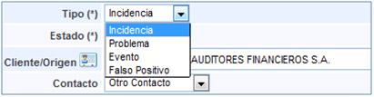

* **Estado:** Dependiendo de si el registro se trata de una Incidencia o un Problema, el desplegable que proporciona GlobalSUITE será diferente.

A continuación se muestran los tipos de estados en los que se puede encontrar un Incidente.

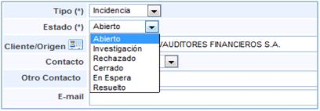

Por otra parte, si consiste en un problema, GlobalSUITE proporciona las siguiente opciones para el caso concreto de Problema.

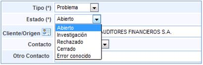

* **Servicios:** En este campo se asociarán los servicios que se ven afectados por la Incidencia o el Problema.

Todos los campos anteriormente identificados son los que aparecerán en la información que recibirá el cliente en caso de que la Incidencia o Problema haya sido comunicada mediante el Portal de Clientes a través de un Ticket.

GlobalSUITE también permite definir la siguiente información para Incidencias y Problemas:

* **Cliente/Origen:** En caso de que se haya abierto desde el portal, este campo se completará de forma automática. Si este se abre manualmente, la solución le permite establecer el origen.

* **Contacto:** Si se ha procedido a generar desde el portal de clientes, el contacto corresponderá a la persona encargada de generar dicho evento. Este campo contacto es modificable, pudiendo concretar otro usuario al cual proceder a informar sobre el estado de la Incidencia o Problema.

En caso de haberse generado de forma manual, en este campo se indicará con quién se debe poner en contacto para informar sobre el estado de las Incidencias y Problemas.

* **E-mail:** Se indica el correo al cual se podrá comunicar el estado.

* **Alertar cambios:** Seleccionando esta opción, GlobalSUITE®® enviará al e-mail indicado en el campo superior, información sobre cambios de estado y clasificaciones realizados.

* **NOTA:** En caso que se haya generado un grupo de correo en el aparatado de 'Inicio/Relaciones con el Negocio' la herramienta permite el envío de alertas a un grupo determinado. Para ello se ha de seleccionar la empresa deseada (debe estar creada en el apartado 'Inicio/Relaciones con el Negocio'), y determinar si alertar a un Contacto o a un Grupo. En el caso de seleccionar un Grupo, la herramienta ofrece la posibilidad de elegir el grupo al que notificar los cambios del ticket.

* **Fecha de ocurrencia:** GlobalSUITE®® permite definir una fecha diferente a la de registro, con el fin de evidenciar que la Incidencia o Problema ha ocurrido en un momento anterior al del registro.

* **Entrada de evento:** Permite determinar y dejar registro sobre cómo se ha procedido a comunicar el evento en cuestión. Este punto no aparece de forma automática, pero sí que es posible determinar que forme parte del registro a través de la configuración de la herramienta.

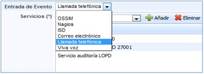

De forma complementaria al registro de información a realizar, la solución también le permitirá:

* **Áreas Afectadas:** Permite determinar qué áreas de la empresa se han visto afectadas por la incidencia o problema que ha surgido.

* **Categoría:** Permite determinar el tipo de incidencia o problema que ha sucedido.

* **Subcategoría:** Permite asignar un nivel de detalle superior al tipo de incidencia o problema determinado.

Este punto no aparece de forma automática, pero sí que es posible determinar que forme parte del registro a través de la configuración de la herramienta.

* **Ayuda de categorías:** Define de forma automática, en función de la definición realizada en la parte de configuración, sobre la causa o vulnerabilidad que ha causado el incidente o problema.

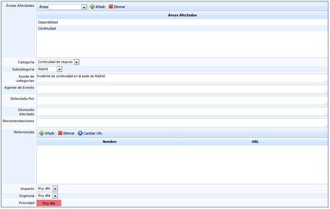

* **Agente del evento:** Permite indicar qué agente ha detectado el evento que se está tratando.

* **Detectado por:** Permite designar la persona encargada de comunicar o detectar el evento.

* **Elemento afectado:** Permite indicar textualmente los elementos afectados por la incidencia.

* **Recomendaciones:** Permite establecer las recomendaciones que se consideren oportunas con el fin de que sirvan para ayudar a la resolución de la incidencia o problema.

* **Referencias:** Mediante este campo se permite asociar una determinada URL asociada a un nombre, que pueda ser utilizado para una correcta o completa definición del evento.

* **Impacto:** Permite establecer un valor cualitativo, para determinar el nivel de daño que provoca la Incidencia o Problema.

* **Urgencia:** Permite establecer un valor cualitativo, para determinar la celeridad con la que debe ser resuelto el evento.

* **Prioridad**: Este valor es generado de forma automática por GlobalSUITE®®, realizando la media aritmética de los valores establecidos en los campos de impacto y urgencia.

* **Riesgos:** Mediante este campo, se permite definir qué riesgos están asociados a la ocurrencia de la incidencia o problema determinado.

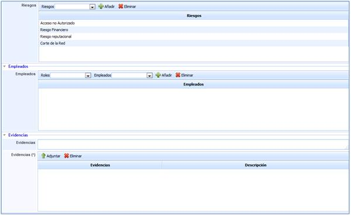

## Empleados

* **Empleados:** Permite definir los empleados que se encargarán del tratamiento de las incidencias y problemas. Es necesario que estos empleados hayan sido definidos en la opción gestión de empleados.

## Evidencias

* **Evidencias:** Con el fin de definir de la forma más completa posible, la solución le permite adjuntar cualquier tipo de archivo. En caso de no adjuntar dicha documentación, también es posible realizar una descripción en el campo Evidencias.

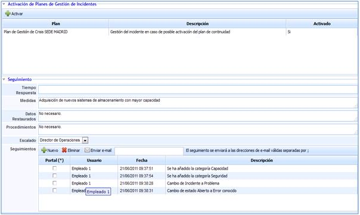

## Activación de Planes de Gestión de Crisis

Esta sección permite identificar (y activar si así se desea) los Planes de Gestión de Crisis cuyos criterios de activación se encuentran en el ticket que se está tratando.

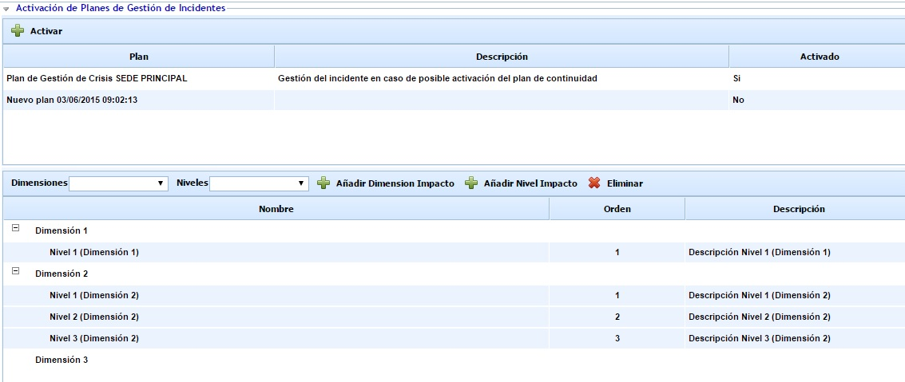

En la parte superior se muestran los Planes de Gestión de Crisis que cumplen los criterios de activación (si hubiera). En la parte inferior se permite seleccionar las dimensiones y niveles asociados para calificar el impacto del incidente. El listado de dimensiones y niveles que aparece corresponde a la configuración realizada en la opción "Continuidad de Negocio" en el apartado 'Ajustes'

Si se desea activar alguno de los Planes de Gestión de Crisis identificados, hay que seleccionar el plan correspondiente y pulsar sobre el botón "Activar". Esta acción avisa a todos los miembros del Comité responsable del Plan de Gestión de Crisis activado.

## Seguimiento

En esta sección comienza la etapa de seguimiento, donde se define qué pautas y qué acciones se han establecido con el fin de solventar el evento ocurrido.

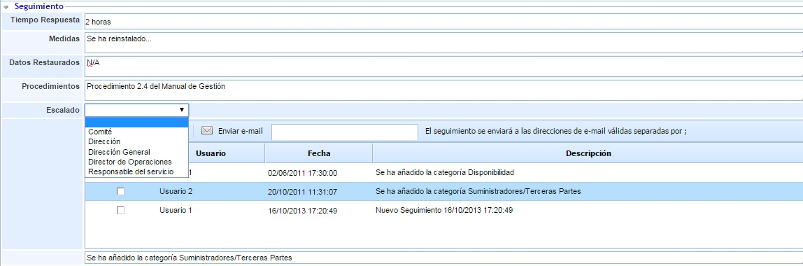

* **Tiempo de Respuesta:** Permite establecer el tiempo que se ha tardado en actuar para proceder a solucionar el evento.

* **Medidas:** Se establecen las acciones que hayan sido necesarias para comenzar a solventar la incidencia o problema.

* **Datos Restaurados:** Permite determinar los datos que han sido necesario recuperar para solventar la incidencia o problema que se ha producido.

* **Procedimientos:** Permite establecer qué procedimientos o instrucciones han sido necesarios, se han determinado o han ayudado a solucionar el evento.

* **Escalados:** Permite dejar registro de si ha sido o no necesario escalar la incidencia o problema a algún otro departamento o responsable.

* **Seguimientos:** Dentro de la opción, se podrá identificar cualquier modificación o cambio realizado en el evento en cuestión.

Cualquier seguimiento que quede registrado puede ser enviado a través de correo electrónico a todas aquellas personas a las que se considere necesario informar. Tal y como se indica es necesario especificar los correos electrónicos y utilizar la opción Enviar e-mail.

Por otra parte y en caso de que haya sido generado desde el portal de clientes, se procederá a informar a través de este medio, seleccionando en el seguimiento que corresponda de la columna Portal. Una vez se proceda al guardado generará el aviso de forma automática.

## Configuración

* **Elementos de Configuración:** Permite determinar qué elementos de configuración se han visto afectados por la incidencia o problema. A través de este campo de configuración se pueden asociar de forma automática a determinados elementos de configuración la incidencia o problema definido.

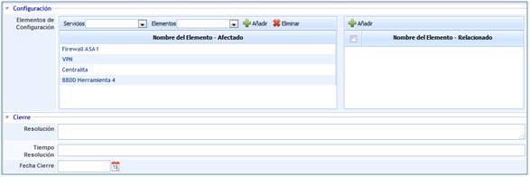

## Riesgos

Ofrece la posibilidad de visualizar los elementos afectados por el suceso y valores definidos en el análisis de riesgos. Las tareas que se pueden realizar sobre esta apartado son:

* **Elementos:** Permite seleccionar el/los elementos afectados por el suceso.

* **Análisis:** Permite seleccionar el/los análisis de riesgos donde se encuentra valorado el elemento seleccionado.

**NOTA:** Un mismo elemento puede estar evaluado en diferentes análisis de riesgos y con valoraciones diferentes, de ahí la necesidad de indicar el análisis de riesgos que queremos cargar.

* **Añadir Elemento:** Una vez seleccionado el elemento, permite insertar el mismo en la tabla.

* **Eliminar Elemento:** Permite eliminar uno o varios elementos de la tabla. Para ello se ha de seleccionar la fila deseada y pulsar sobre el botón 'Eliminar elemento'

Una vez seleccionamos la fila del elemento deseado, la tabla situada en la parte inferior permite al usuario visualizar o modificar los valores definidos en el apartado 'Análisis/Análisis de Riesgos'. La herramienta destaca en color rojo aquellas valoraciones que han sido modificadas.

**NOTA:** La herramienta permite simular como afecta la incidencia a los elementos valorados en el apartado 'Gestión de Riesgos/Proyección y Simulación' En función de la metodología definida en el apartado 'Ajustes /Metodología Análisis', las valoraciones de las dimensiones pueden ser cualitativas o cuantitativas.

Las acciones que se pueden realizar sobre la tabla son:

* **Restaurar Amenazas:** Permite restaurar los valores iniciales de la tabla según el Análisis de Riesgos realizado.

## Cierre

Una vez se haya solucionado el evento, GlobalSUITE®® le permite definir cómo se ha procedido al respecto.

* **Resolución:** Para indicar la forma mediante la cual se ha procedido y que ha permitido cerrar la petición de servicio.

* **Tiempo de Resolución:** Corresponde con el tiempo empleado en haber solucionado el evento.

* **Fecha de cierre:** Permite indicar la fecha y hora exacta en la que se ha cerrado la incidencia o problema.

## Entradas y Salidas

La resolución tiene en cuenta la opción de que el incidente o problema derive de un evento diferente, o por el contrario que pueda generado por éste. Para estos casos concretos se presentan las siguientes opciones:

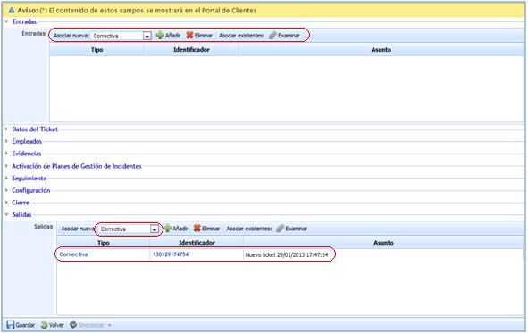

* **Entradas**: Permite determinar si la incidencia o problema definido procede de otro tipo de evento, proporcionando la herramienta las siguientes opciones:

  * *Acción correctiva.*
  * *Acción preventiva.*
  * *No conformidad.*
  * *Cambio.*
  * *Petición de Servicio.*
  * *Incidencia.*
  * *Problema.*
  * *Evento.*
  * *Falso positivo.*

* **Salidas:** Permite determinar si la incidencia o problema definido deriva en otro tipo de evento, proporcionando la herramienta las opciones anteriormente expuestas para la entrada.

**NOTA:** Bajo el ejemplo establecido en la imagen, la incidencia o problema ha generado la apertura de una acción correctiva, que es generada de forma automática dentro de la pestaña Gestión, en la opción Correctivas y Preventivas.

Tanto para las entradas como para las salidas se identifican una serie de opciones comunes:

* **Añadir:** Seleccionando el tipo de evento del que procede o en el que deriva, se incluirá en el campo correspondiente, generándose dicho evento en otra opción de las que proporciona GlobalSUITE®, exceptuando los casos de Evento y Falso Positivo.

* **Eliminar:** Elimina cualquier evento que haya sido añadido.

* **Asociar existentes:** En caso de que el evento del que derive haya sido creado con anterioridad, esta opción permite buscar dicho evento de tal forma que se pueda asociar a la petición de servicio correspondiente.
