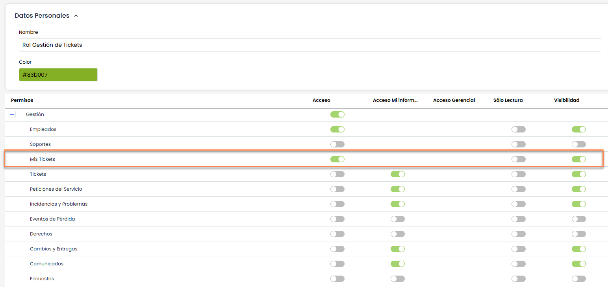

# Mis Tickets

La presente opción permite al usuario visualizar los tickets que le han sido asignados, centralizados en una misma tabla.

La siguiente opción se muestra si al usuario se le ha asignado un rol con acceso especifico al apartado de Mis Tickets, en Ajustes >[Roles de Empresa](https://help.globalsuitesolutions.com/es/globalsuite/v1/roles-de-empresa) , tal y como se muestra en la siguiente imagen:

Las opciones que se permiten realizar sobre la tabla son las siguientes:

* **Nuevo:** Permite generar nuevas entradas en la tabla.

* **Eliminar:** Permite eliminar una entrada de la tabla. Para ello se ha de seleccionar la línea deseada y pulsar sobre el botón 'Eliminar'

* **Mostrar:** La presente opción permite que se muestren tan sólo aquellos que tickets abiertos o todos a través del desplegable del que dispone esta opción.

* **Descarga:** Le permite descargar el listado de Mis Tickets representados en formato Excel o CSV.  Este Informe estará disponible en [Descargas Pendientes.](https://help.globalsuite.es/display/GlobalSUITEes/.Descargas+Pendientes+vv6.53)  
  Para las descargas en formato **Excel**, el sistema podrá limitar la generación del fichero cuando la información a exportar supere las **100.000 celdas**. Este límite se calcula en función de la cantidad de registros y columnas incluidas en la descarga.  
  En caso de que no sea posible generar el fichero en formato Excel, se recomienda realizar la descarga en formato **CSV**.  
  Una vez se accede al ticket, los campos gestionables se describen en cada una de las opciones específicas.
