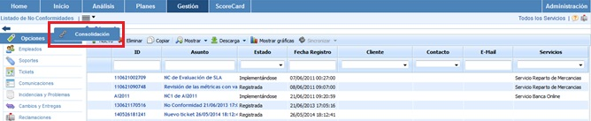
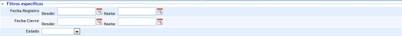
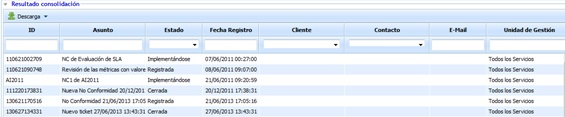

# Consolidación No Conformidades

La presente opción permite visualizar de manera resumida las diferentes no conformidades asociadas a la entidad y subentidades.

A continuación se desarrolla la funcionalidad que aporta cada una de las tablas disponibles.

* **Tabla Servicios:** Permite al usuario filtrar las no conformidades asociados a los Servicios seleccionados.

* **Tabla Subentidades:** Ofrece la posibilidad de filtrar las no conformidades definidas en las subentidades seleccionadas.

* **Tabla Etiqueta/Valor:** Permite visualizar las no conformidades que tengan asociadas una etiqueta determinada.

* **Filtros específicos:** Ofrece la posibilidad de visualizar las no conformidades por el estado de las no conformidades o filtrando por un rango de fechas.

Una vez se han establecido los filtros necesarios, hay que generar la consulta, para ello existen las siguientes opciones:

* **Consolidar:** Una vez se pulsa el botón y en función de los filtros establecidos, permite visualizar de manera resumida las no conformidades en la tabla inferior.

* **Volver:** Ofrece la posibilidad de regresar al listado inicial de no conformidades.

Los resultados se muestran en la tabla inferior 'Resultados de consolidación'

La información que aporta la tabla es la siguiente:

* **ID:** Permite visualizar el identificador asociado a la no conformidad.
* **Asunto:** Permite visualizar una descripción detallada de la no conformidad.
* **Estado:** Permite visualizar el estado de la no conformidad, si esta se encuentra registrada, abierta, cerrada, etc.
* **Fecha registro:** Permite visualizar la fecha en la cual se ha registrado la no conformidad.
* **Cliente:** Ofrece la posibilidad de visualizar el cliente asociado a la no conformidad.
* **Contacto:** Informa sobre el contacto asociado a la no conformidad.
* **Email:** Informe sobre el correo electrónico del contacto asociado a la no conformidad.
* **Unidad de Gestión:** Ofrece la posibilidad de visualizar la entidad o subentidad a la que está asociada la no conformidad.
