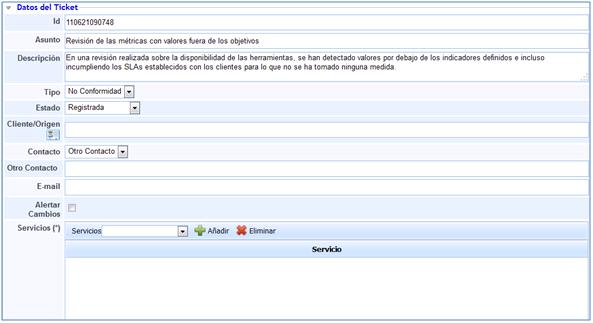
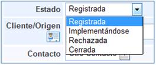
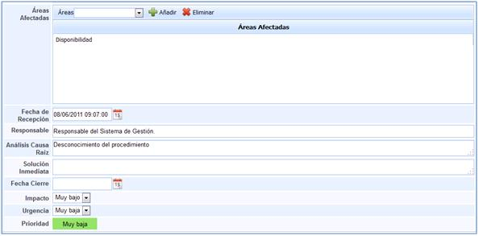
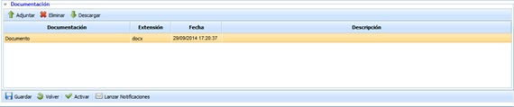
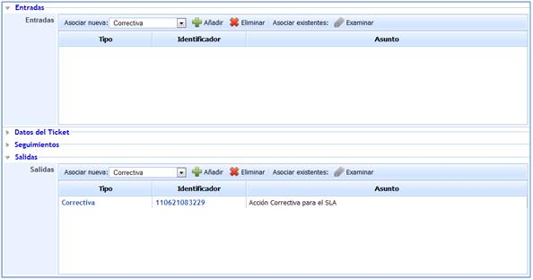

# Formulario de la No Conformidad

## Datos del ticket

A continuación se definen todos los campos que le permitirán realizar un adecuado registro de las No Conformidades.

* **Identificador (Id):** Este será generado de forma automática y corresponderá a un número único de no conformidad que permita diferenciarla del resto.

* **Asunto:** Permite asignar un nombre que describa la no conformidad.

* **Descripción:** Permite especificar el cuerpo de la no conformidad.

* **Tipo:** No existen opciones de selección. De forma automática la solución tan sólo le permite seleccionar la asignarle la tipología de No Conformidad.
* **Estado:** Define cómo se encuentra durante su gestión la no conformidad. La solución nos proporciona las siguientes opciones:

  * *Registrada:* Se establece este estado cuando se procede al registro de la reclamación.
  * *Implementándose:* Una vez registrada, el cambio a este estado indica que se ha iniciado el proceso de resolución de la no conformidad.
  * *Rechazada:* Determina que tras el análisis se considera que no se trata de una desviación real y por tanto se rechaza el establecimiento de una posible solución.
  * *Cerrada:* Establece que se ha propuesto una solución para la no conformidad.

* **Cliente/Origen:** Permite establecer si la no conformidad se encuentra asociada a un cliente o de un origen concreto.

* **Contacto:** Define la persona o el cliente al que afecta la no conformidad.

* **Otro contacto:** Permite determinar cualquier otro contacto de interés en el tratamiento de la no conformidad.

* **Email:** Dirección de correo electrónico de la persona al que se encuentra asociada la no conformidad.

* **Alertar Cambios:** Permite mandar de forma automática un correo, con cualquier modificación del estado que se produzca sobre la no conformidad. De esta forma, el cliente sabrá en todo momento como se está llevando a cabo la gestión de la no conformidad presentada.

* **NOTA:** En caso que se haya generado un grupo de correo en el aparatado de 'Inicio/Relaciones con el Negocio' la herramienta permite el envío de alertas a un grupo determinado. Para ello se ha de seleccionar la empresa deseada (debe estar creada en el apartado 'Inicio/Relaciones con el Negocio'), y determinar si alertar a un Contacto o a un Grupo. En el caso de seleccionar un Grupo, la herramienta ofrece la posibilidad de elegir el grupo al que notificar los cambios del ticket.

* **Servicios:** Podrán seleccionarse los servicios que se vean afectados por la no conformidad.

A su vez dentro de la definición de cada una de las no conformidades, se puede identificar:

* **Áreas Afectadas:** Podrán seleccionarse aquellas áreas que se han visto afectadas por la no conformidad definida.

* **Fecha de recepción:** Determina la fecha en la cual ha sido detectado la no conformidad.

* **Responsable:** Determina la persona encargada de gestionar la no conformidad.

* **Análisis Causa Raíz:** Permite determinar el origen de la no conformidad detectada.

* **Solución Inmediata:** Permite establecer la solución mediante la cual se solucionará la no conformidad registrada.

* **Fecha Cierre:** Establece la fecha en la cual se considera que se ha procedido a cerrar la no conformidad.

* **Impacto:** Establece el daño que supone el no llevar a cabo la resolución de la no conformidad registrada.

* **Urgencia:** Establece la necesidad de resolución con la que se debe tratar la no conformidad.

* **Prioridad:** Este valor se obtiene de la media entre los valores obtenidos en el impacto y la urgencia.

## Riesgos

Ofrece la posibilidad de visualizar los elementos afectados por el suceso y valores definidos en el análisis de riesgos. Las tareas que se pueden realizar sobre esta apartado son:

* **Elementos:** Permite seleccionar el/los elementos afectados por el suceso.

* **Análisis:** Permite seleccionar el/los análisis de riesgos donde se encuentra valorado el elemento seleccionado.

**NOTA:** Un mismo elemento puede estar evaluado en diferentes análisis de riesgos y con valoraciones diferentes, de ahí la necesidad de indicar el análisis de riesgos que queremos cargar.

* **Añadir Elemento:** Una vez seleccionado el elemento, permite insertar el mismo en la tabla.

* **Eliminar Elemento:** Permite eliminar uno o varios elementos de la tabla. Para ello se ha de seleccionar la fila deseada y pulsar sobre el botón 'Eliminar elemento'

Una vez seleccionamos la fila del elemento deseado, la tabla situada en la parte inferior permite al usuario visualizar o modificar los valores definidos en el apartado 'Análisis/Análisis de Riesgos'. La herramienta destaca en color rojo aquellas valoraciones que han sido modificadas.

**NOTA:** La herramienta permite simular como afecta la incidencia a los elementos valorados en el apartado 'Gestión de Riesgos/Proyección y Simulación'

Las acciones que se pueden realizar sobre la tabla son:

* **Restaurar Amenazas:** Permite restaurar los valores iniciales de la tabla según el Análisis de Riesgos realizado.

## Seguimientos

GlobalSUITE le permitirá registrar las diferentes acciones llevadas a cabo con respecto al tratamiento y gestión de las No Conformidades.

Las diferentes opciones que pueden realizarse desde el apartado de seguimientos queda definido en el punto.

## Documentación Asociada

Permite incluir cualquier documentación que tenga relación al plan de prueba. Para ello se ha de pulsar sobre el botón 'Adjuntar' y seleccionar el archivo deseado. En caso de querer eliminar un archivo, se ha de seleccionar la fila deseada y pulsar sobre el botón 'Eliminar'. Por último pulsando sobre el botón 'Descarga' la herramienta ofrece la posibilidad de descargar el archivo.

## Entradas y Salidas

* **Entradas:** Permite determinar si la no conformidad definida procede de otro tipo de evento, proporcionando la herramienta las siguientes opciones:

  * *Acción correctiva.*
  * *Acción preventiva.*
  * *No conformidad.*
  * *Cambio*
  * *Petición de Servicio.*
  * *Incidencia.*
  * *Problema.*
  * *Evento.*
  * *Falso positivo.*

* Salidas: Permite determinar si la no conformidad deriva en otro tipo de evento, proporcionando GlobalSUITE las opciones anteriormente expuestas para las entradas.

Tanto para las entradas como para las salidas se identifican una serie de opciones comunes:

* Añadir: Seleccionando el tipo de evento del que procede o en el que deriva, se incluirá en el campo correspondiente, generándose dicho evento en otra opción de las que proporciona GlobalSUITE®, exceptuando los casos de Evento y Falso Positivo.
* Eliminar: Elimina cualquier evento que haya sido añadido.
* Asociar existentes: En caso de que el evento del que derive haya sido creado con anterioridad, esta opción permite buscar dicho evento de tal forma que se pueda asociar a la petición de servicio correspondiente.
