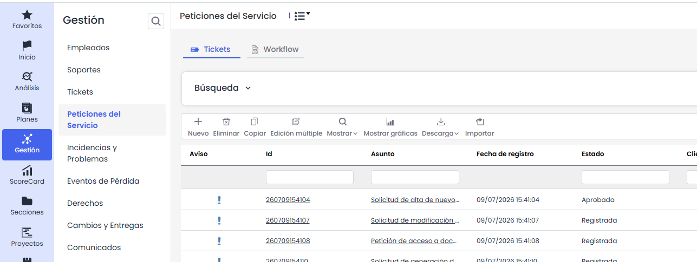
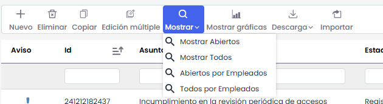
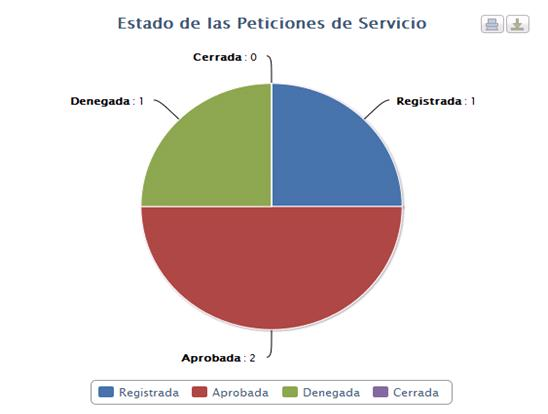
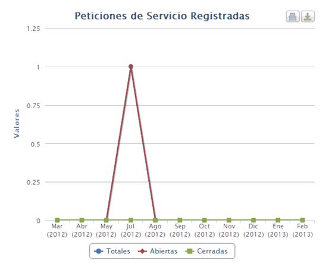

# Peticiones de Servicio

Los tickets pueden generar manualmente o a través de la clasificación de los Tickets abiertos cuando se define la tipología Petición de Servicio.

En la pantalla principal de Peticiones de Servicio nos aparecen todas aquellas peticiones que aun no están en estado cerrado, así como las siguientes opciones:

* **Nuevo:** Permite generar Peticiones de Servicio.

* **Eliminar:** Permite eliminar Peticiones de Servicio.

* **Copiar:** Esta opción permite copiar una petición de servicio que ha sido definida con anterioridad.

* **Edición Múltiple:** Esta opción aparecerá en la barra de herramientas si hay configurado para este tipo de ticket un campo de estado.   
  El proceso se realiza desde un modal: se selecciona el estado actual (origen) —acompañado de su flujo de trabajo cuando corresponda y del número de tickets que se encuentran en él— y, a continuación, el nuevo estado (destino), que el sistema propone según el flujo de trabajo configurado. También puede decidirse si se envían las notificaciones de cambio de estado, activadas por defecto.

  

  Antes de ejecutar, el sistema muestra un mensaje de confirmación con el número de tickets afectados y la transición que se va a aplicar. Al confirmar, la operación se ejecuta en segundo plano —su avance puede seguirse en Procesos de trabajo—, de modo que es posible continuar trabajando mientras se completa.
* **Mostrar:** Al utilizar GlobalSUITE como base de datos de conocimientos, mediante esta opción podrá seleccionar que se muestren tan sólo aquellas no conformidades que estén abiertas, o por el contrario todas, a través del desplegable del que dispone esta opción.

  

  Adicionalmente, cuando el campo **Empleado** se encuentre configurado para el tipo de ticket, estarán disponibles las opciones **Abiertos por empleados** y **Todos por empleados**, que permiten mostrar los tickets agrupados por el empleado asociado.

* **Descarga:** Permite descargar el listado de No Conformidades representados en formato Excel o CSV.  Este Informe estará disponible en [Descargas Pendientes.](https://help.globalsuite.es/display/GlobalSUITEes/.Descargas+Pendientes+vv6.53)  
  Para las descargas en formato **Excel**, el sistema podrá limitar la generación del fichero cuando la información a exportar supere las **100.000 celdas**. Este límite se calcula en función de la cantidad de registros y columnas incluidas en la descarga.

  En caso de que no sea posible generar el fichero en formato Excel, se recomienda realizar la descarga en formato **CSV**.
* **Mostrar gráficas:** Permite representar todas aquellas peticiones de servicio que se han definido. Se muestran las siguientes imágenes:

Las imágenes generadas permiten mostrar:

* **Totales:** Todas las peticiones de servicio registradas.

* **Abiertas:** Tan sólo representar aquellas que permanecen abiertas.

* **Cerradas:** Tan sólo representar aquellas que permanecen cerradas.

A su vez permite representar cualquier tipo de combinación entra estas opciones. De la misma forma las imágenes pueden ser impresas directamente o ser descargadas en formato PNG, JPEG, PDF y vectorial SVG.

* **Importar:** Esta opción permite realizar una carga masiva de Peticiones que se encuentran en un archivo Excel. Al pulsar el botón, la herramienta solicita un archivo en formato Excel que debe contener un conjunto de columnas con la información de las Peticiones que se desean importar, no importa el orden de las columnas ya que permite seleccionar aquellas que se quieren importar.

* [Workflow Peticiones](workflow-peticiones.md)
* [Formulario de Peticiones de Servicio](formulario-de-peticiones-de-servicio.md)
