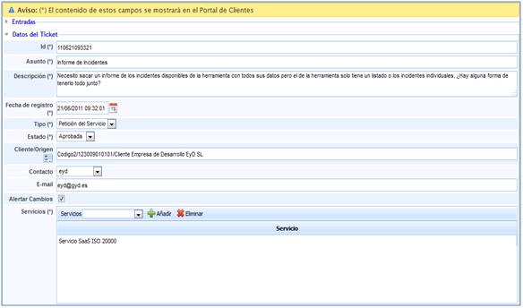
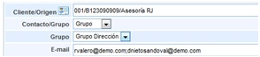
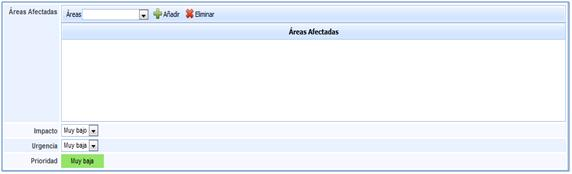
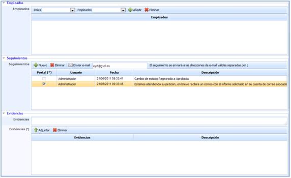
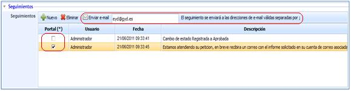
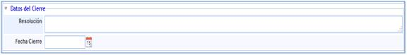
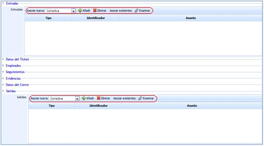

# Formulario de Peticiones de Servicio

## Datos del ticket

Para acceder a cualquier petición de servicio basta con pulsar sobre el ID o el asunto en el listado de peticiones de la pantalla principal. Una vez dentro, GlobalSuite nos proporciona las siguientes opciones:

* **Id:** Corresponde con el nombre o identificador de la petición de servicio que se ha generado.

* **Asunto:** En este campo se define el título de la petición de servicio.

* **Descripción:** Es uno de los puntos más importantes, ya que es a través de este campo mediante el cual se especificará lo más detallado posible, en qué consiste la petición de servicio.

* **Fecha de registro:** Fecha de comunicación.

* **Tipo:** Es fijo ya que se trata de una petición de servicio.

* **Estado:** Se define si la petición de servicio se encuentra registrada, aprobada, denegada o cerrada.

* **Servicios:** En este campo se asociarán los servicios asociados a la petición.

Todos los campos anteriormente identificados son los que aparecerán en la información que recibirá el cliente en caso de que la petición de servicio haya sido comunicada mediante el Portal de Clientes.

GlobalSuite también permite definir la siguiente información en las peticiones de servicio:

* **Cliente/Origen:** En caso de que se haya abierto desde el portal, este campo se completará de forma automática. Si este se abre manualmente, la solución le permite establecer el origen.

* **Contacto:** Si se ha procedido a generar desde el portal de clientes, el contacto corresponderá a la persona encargada de generar dicho evento. Este campo contacto es modificable, pudiendo concretar otro usuario al cual proceder a informar sobre el estado de la petición.

En caso de haberse generado de forma manual, en este campo se indicará con quién se debe poner en contacto para informar sobre el estado del evento.

* **E-mail:** Se indica el correo al cual se podrá comunicar el estado de la petición.

* **Alertar cambios:** Seleccionando esta opción, GlobalSuite enviará al e-mail indicado en el campo superior, información sobre cambios de estado y clasificaciones realizadas de la petición.

* **NOTA:** En caso que se haya generado un grupo de correo en el aparatado de 'Inicio/Relaciones con el Negocio' la herramienta permite el envío de alertas a un grupo determinado. Para ello se ha de seleccionar la empresa deseada (debe estar creada en el apartado 'Inicio/Relaciones con el Negocio'), y determinar si alertar a un Contacto o a un Grupo. En el caso de seleccionar un Grupo, la herramienta ofrece la posibilidad de elegir el grupo al que notificar los cambios del ticket.

* **Impacto:** Permite establecer un valor cualitativo, para determinar el nivel de daño que provoca la petición de servicio.

* **Urgencia:** Permite establecer un valor cualitativo, para determinar la celeridad con la que debe ser resuelta la petición.

* **Prioridad:** Este valor es generado de forma automática por GlobalSuite®, realizando la media aritmética de los valores establecidos en los campos de impacto y urgencia.

De forma complementaria al registro de información a realizar, la solución también le permitirá:

## Riesgos

Ofrece la posibilidad de visualizar los elementos afectados por el suceso y valores definidos en el análisis de riesgos. Las tareas que se pueden realizar sobre esta apartado son:

* **Elementos:** Permite seleccionar el/los elementos afectados por el suceso.

* **Análisis:** Permite seleccionar el/los análisis de riesgos donde se encuentra valorado el elemento seleccionado.

**NOTA:** Un mismo elemento puede estar evaluado en diferentes análisis de riesgos y con valoraciones diferentes, de ahí la necesidad de indicar el análisis de riesgos que queremos cargar.

* **Añadir Elemento:** Una vez seleccionado el elemento, permite insertar el mismo en la tabla.

* **Eliminar Elemento:** Permite eliminar uno o varios elementos de la tabla. Para ello se ha de seleccionar la fila deseada y pulsar sobre el botón 'Eliminar elemento'

Una vez seleccionamos la fila del elemento deseado, la tabla situada en la parte inferior permite al usuario visualizar o modificar los valores definidos en el apartado 'Análisis/Análisis de Riesgos'. La herramienta destaca en color rojo aquellas valoraciones que han sido modificadas.

**NOTA:** La herramienta permite simular como afecta la incidencia a los elementos valorados en el apartado 'Gestión de Riesgos/Proyección y Simulación'. En función de la metodología definida en el apartado Ajustes/Metodología Análisis', las valoraciones de las dimensiones pueden ser cualitativas o cuantitativas.

Las acciones que se pueden realizar sobre la tabla son:

* **Restaurar Amenazas:** Permite restaurar los valores iniciales de la tabla según el Análisis de Riesgos realizado.

## Empleados

* **Empleados:** Permite definir los empleados que se encargarán del tratamiento de la petición de servicio. Es necesario que estos empleados hayan sido definidos en la opción gestión de empleados.

## Seguimientos

* **Seguimientos:** Dentro de la opción, se podrá identificar cualquier modificación o cambio realizado en el evento en cuestión.

Cualquier **seguimiento de la petición de servicio** que quede registrada puede ser enviado a través de correo electrónico a todas aquellas personas a las que se considere necesario informar. Tal y como se indica es necesario especificar los correos electrónicos y utilizar la opción Enviar e-mail.

Por otra parte y en caso de que haya sido generado desde el **portal de clientes**, se procederá a informar a través de este medio, seleccionando en el seguimiento que corresponda de la columna Portal. Una vez se proceda al guardado generará el aviso de forma automática.

## Evidencias

* **Evidencias:** Con el fin de definir de la forma más completa posible, la solución le permite adjuntar cualquier tipo de archivo. En caso de no adjuntar dicha documentación, también es posible realizar una descripción en el campo Evidencias.

## Datos de cierre

Una vez se haya solucionado la petición de servicio, GlobalSuite®® le permite definir cómo se ha procedido al respecto.

* **Resolución:** Para indicar la forma mediante la cual se ha procedido y que ha permitido cerrar la petición de servicio.

* **Fecha de cierre:** Permite indicar la fecha y hora exacta en la que se ha cerrado la petición. Mediante esta fórmula ofrecida por GlobalSuite, permite medir el tiempo empleado en este cierre.

## Entradas y Salidas

La solución tiene en cuenta la opción de que la petición de servicio derive de un evento diferente o por el contrario que esta petición pueda generarlo. Para estos casos concretos se presentan las siguientes opciones:

* Entradas: Permite determinar si la petición de servicio definida procede de otro tipo de evento, proporcionando la herramienta las siguientes opciones:

  * Acción correctiva.
  * Acción preventiva.
  * No conformidad.
  * Cambio.
  * Petición de Servicio.
  * Incidencia.
  * Problema.
  * Evento.
  * Falso positivo.

* **Salidas:** Permite determinar si la petición de servicio definida deriva en otro tipo de evento, proporcionando la herramienta las opciones anteriormente expuestas para la entrada.

Tanto para las entradas como para las salidas se identifican una serie de opciones comunes:

* **Añadir:** Seleccionando el tipo de evento del que procede o en el que deriva, se incluirá en el campo correspondiente, generándose dicho evento en otra opción de las que proporciona GlobalSuite®®, exceptuando los casos de Evento y Falso Positivo.

* **Eliminar:** Elimina cualquier evento que haya sido añadido.

* **Asociar existentes:** En caso de que el evento del que derive haya sido creado con anterioridad, esta opción permite buscar dicho evento de tal forma que se pueda asociar a la petición de servicio correspondiente.
