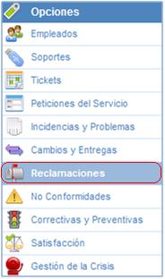
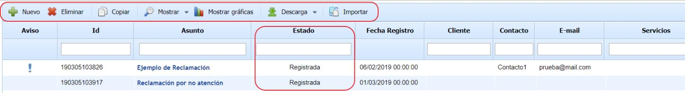
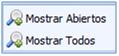
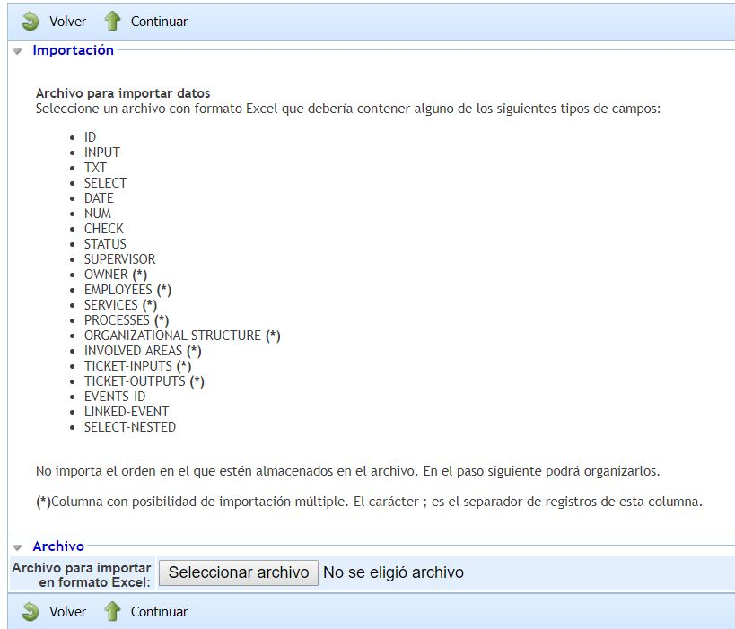

# Reclamaciones

En cuanto a las reclamaciones, GlobalSUITE dispone de una opción con la que poder registrar, gestionar y almacenar todo tipo de reclamaciones que se hagan llegar desde cualquier ámbito de la organización.

Una vez dentro de la opción Reclamaciones, se encontrará por defecto el listado de todas aquellas que permanecen registradas, informadas o en investigación:

* **Nuevo:** Permite generar manualmente reclamaciones.

* **Eliminar:** Permite eliminar las reclamaciones generadas.

* **Copiar:** Esta opción permite copiar una reclamación que ha sido definida con anterioridad.

* **Mostrar:** Al utilizar GlobalSUITE como base de datos de conocimientos, mediante esta opción podrá seleccionar que se muestren tan sólo aquellas reclamaciones que estén abiertas, o por el contrario todos, a través del desplegable del que dispone esta opción.

* **Descarga**: Permite descargar el listado de Reclamaciones representados en formato Excel o CSV.  Este Informe estará disponible en [Descargas Pendientes.](https://help.globalsuite.es/display/GlobalSUITEes/.Descargas+Pendientes+vv6.53)

* **Mostrar gráficas**: Permite representar todas aquellas reclamaciones que se han definido. Esta opción nos permite mostrar las imágenes estadísticas de estos:

La solución le permite ver gráficamente y de forma separada el estado de las reclamaciones registradas. Las imágenes generadas permiten mostrar:

* **Totales:** Todas las cambios registrados.

* **Abiertas:** Tan sólo representar aquellas que permanecen abiertas.

* **Cerradas:** Tan sólo representar aquellas que permanecen cerradas.

A su vez permite representar cualquier tipo de combinación entra estas opciones.

De la misma forma las imágenes pueden ser impresas directamente o ser descargadas en formato PNG, JPEG, PDF y vectorial SVG a través de la opción identificada a continuación.

* **Importar:** Esta opción permite realizar una carga masiva de Reclamaciones que se encuentran en un archivo Excel. Al pulsar el botón, la herramienta solicita un archivo en formato Excel que debe contener un conjunto de columnas con la información de las Reclamaciones que se desean importar, no importa el orden de las columnas ya que permite seleccionar aquellas que se quieren importar.

* [Consolidación Reclamaciones](consolidacion-reclamaciones.md)
* [Workflow Reclamaciones](workflow-reclamaciones.md)
* [Formulario de la Reclamación](formulario-de-la-reclamacion.md)
