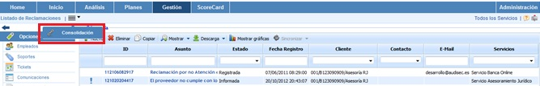
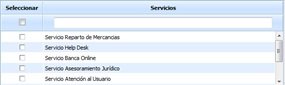
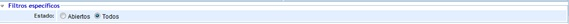
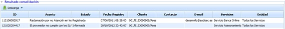

# Consolidación Reclamaciones

La presente opción permite visualizar de manera resumida las diferentes reclamaciones asociados a la entidad y subentidades.

A continuación se desarrolla la funcionalidad que aporta cada una de las tablas disponibles.

* **Tabla Servicios:** Permite al usuario filtrar las reclamaciones asociados a los Servicios seleccionados.

* **Tabla Subentidades:** Ofrece la posibilidad de filtrar las reclamaciones definidas en las subentidades seleccionadas.

* **Tabla Etiqueta/Valor:** Permite visualizar las reclamaciones que tengan asociadas una etiqueta determinada.

* **Filtros específicos:** Ofrece la posibilidad de visualizar las reclamaciones por el estado, mostrando únicamente las que se encuentran abiertas o todas las registradas.

Una vez se han establecido los filtros necesarios, hay que generar la consulta, para ello existen las siguientes opciones:

* **Consolidar:** Una vez se pulsa el botón y en función de los filtros establecidos, permite visualizar de manera resumida las reclamaciones en la tabla inferior.

* **Volver:** Ofrece la posibilidad de regresar al listado inicial de reclamaciones.

Los resultados se muestran en la tabla inferior 'Resultados de consolidación'

La información que aporta la tabla es la siguiente:

* **ID:** Permite visualizar el identificador asociado a la reclamación
* **Asunto:** Permite visualizar una descripción detallada de la reclamación
* **Estado:** Permite visualizar el estado de la reclamación, si esta se encuentra registrada, abierta, cerrada, etc.
* **Fecha registro:** Permite visualizar la fecha en la cual se ha registrado la reclamación
* **Cliente:** Ofrece la posibilidad de visualizar el cliente que ha interpuesto la reclamación
* **Contacto:** Informa sobre el contacto asociado a la reclamación
* **Email:** Informe sobre el correo electrónico del contacto asociado a la reclamación.
* **Servicios:** Permite visualizar los servicios afectados por la reclamación.
* **Entidad:** Ofrece la posibilidad de visualizar la entidad o subentidad a la que está asociada la reclamación.
