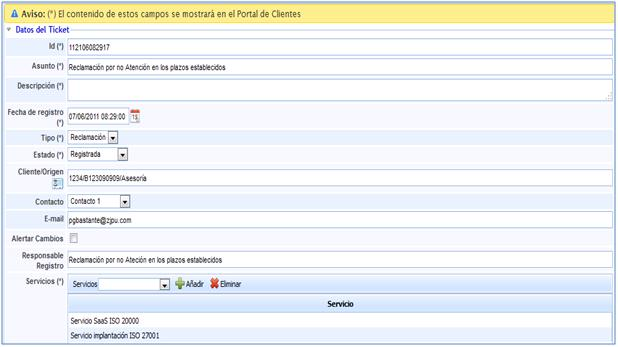
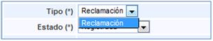
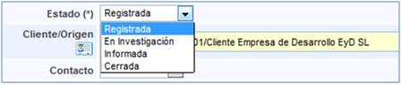
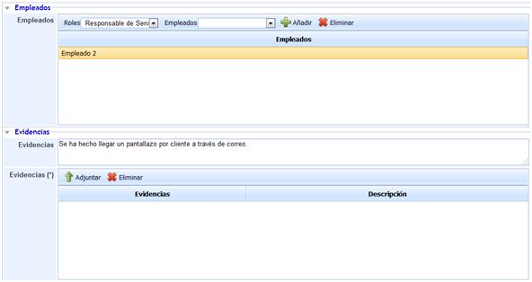
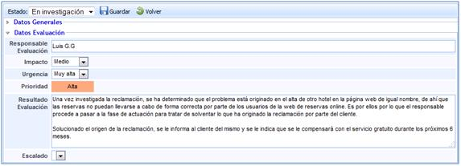
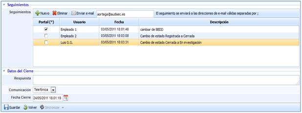
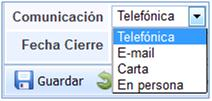

# Formulario de la Reclamación

## Datos del Ticket

A continuación se definen todos los campos que le permitirán realizar el registro de la reclamación.

* **Identificador (Id):** Este será generado de forma automática y corresponderá a un número único de reclamación.

* **Asunto:** Permite asignar un nombre o describir brevemente una reclamación.

* **Descripción:** Permite especificar en qué consiste la reclamación.

* **Fecha de recepción:** Fecha en la que se recibe la reclamación del cliente.

* **Tipo:** No existen opciones de selección. De forma automática la solución tan sólo le permite seleccionar Reclamación.

* **Estado:** Define cómo se encuentra durante su gestión la reclamación. Nos proporciona las siguientes opciones:

  * *Registrada:* Se establece este estado cuando se procede al registro de la reclamación.
  * *En investigación:* Una vez registrada, el cambio a este estado corresponde a la gestión y tratamiento de la reclamación.
  * *Informada:* Determina el momento en el que se ha hecho llegar al personal que corresponda sobre la reclamación.
  * *Cerrada:* Establece la resolución de la reclamación.

* **Cliente/Origen:** Permite registrar de dónde procede la reclamación.
* **Contacto:** Define la persona o el cliente al que afecta la reclamación.
* **Email:** Dirección de correo electrónico de la persona que presenta la reclamación.
* **Alertar Cambios:** Permite mandar de forma automática un correo, con cualquier modificación del estado que se produzca sobre la reclamación. De esta manera, el cliente sabrá en todo momento como se está llevando a cabo la resolución de la reclamación presentada.

* **NOTA:** En caso que se haya generado un grupo de correo en el aparatado de 'Inicio/Relaciones con el Negocio' la herramienta permite el envío de alertas a un grupo determinado. Para ello se ha de seleccionar la empresa deseada (debe estar creada en el apartado 'Inicio/Relaciones con el Negocio'), y determinar si alertar a un Contacto o a un Grupo. En el caso de seleccionar un Grupo, la herramienta ofrece la posibilidad de elegir el grupo al que notificar los cambios del ticket.

* **Responsable del registro:** Persona encargada de atender la reclamación.
* **Servicios:** Podrán seleccionarse los servicios que se vean afectados por la reclamación.

**NOTA:** Todos aquellos campos identificados con (\*) corresponderán con los datos que aparecen en el Portal del Cliente siempre que se haya abierto desde este medio.

## Empleados y Evidencias

A su vez dentro de la definición de cada una de las reclamaciones, se puede identificar:

**Empleados:** Podrán seleccionarse aquellos empleados que se deberán encargar del tratamiento de la reclamación definida.

**Evidencias:** Cualquier evidencia que haya podido obtenerse al investigar la reclamación, podrá indicarse en este lugar. Del mismo modo se permite adjuntar cualquier tipo de documento o imagen.

En las imágenes anteriores se puede visualizar el registro de una reclamación.

## Datos de la evaluación

Una vez realizado el registro de la reclamación, el estado de la misma podría cambiar y se podría proceder a la evaluar o investigar. Para ello se disponen de los campos siguientes de registro en el apartado Datos de Evaluación:

* **Responsable Evaluación:** Es el responsable encargado de evaluar la reclamación.

* **Impacto** que podría suponer el no llevar a cabo la resolución de la reclamación registrada.

* **Urgencia** con la que debería ser tratada la reclamación.

* **Prioridad:** Este valor se obtiene de la media entre los valores obtenidos en el impacto y la urgencia.

Resultado de la evaluación, indicando el acuerdo al que se ha llegado con el cliente.

* **Escalado:** Permite la posibilidad de reflejar el escalado que sea necesario y entre los diferentes niveles que hayan podido ser definidos en el apartado de configuración de GlobalSUITE®.

La imagen siguiente muestra los datos completos en GlobalSUITE de la reclamación que fue tratada en el caso práctico de la unidad:

Finalmente, existe un apartado para poder registrar seguimientos referentes a la reclamación, para dejar evidencia de todas las actuaciones que hayan sido llevadas a cabo para la resolución de la reclamación.

## Riesgos

Ofrece la posibilidad de visualizar los elementos afectados por el suceso y valores definidos en el análisis de riesgos. Las tareas que se pueden realizar sobre esta apartado son:

* **Elementos:** Permite seleccionar el/los elementos afectados por el suceso.

* **Análisis:** Permite seleccionar el/los análisis de riesgos donde se encuentra valorado el elemento seleccionado.

**NOTA:** Un mismo elemento puede estar evaluado en diferentes análisis de riesgos y con valoraciones diferentes, de ahí la necesidad de indicar el análisis de riesgos que queremos cargar.

* **Añadir Elemento:** Una vez seleccionado el elemento, permite insertar el mismo en la tabla.

* **Eliminar Elemento:** Permite eliminar uno o varios elementos de la tabla. Para ello se ha de seleccionar la fila deseada y pulsar sobre el botón 'Eliminar elemento'

Una vez seleccionamos la fila del elemento deseado, la tabla situada en la parte inferior permite al usuario visualizar o modificar los valores definidos en el apartado 'Análisis/Análisis de Riesgos'. La herramienta destaca en color rojo aquellas valoraciones que han sido modificadas.

**NOTA:** La herramienta permite simular como afecta la incidencia a los elementos valorados en el apartado 'Gestión de Riesgos/Proyección y Simulación'. En función de la metodología definida en el apartado Ajustes/Metodología Análisis', las valoraciones de las dimensiones pueden ser cualitativas o cuantitativas.

Las acciones que se pueden realizar sobre la tabla son:

* **Restaurar Amenazas:** Permite restaurar los valores iniciales de la tabla según el Análisis de Riesgos realizado.

## Seguimientos

Por otra parte se puede identificar un apartado de Datos de Cierre, con el fin de especificar el proceso de comunicación del resultado de la reclamación al cliente correspondiente.

## Datos de cierre

La presente opción permite dejar registro de cómo se ha procedido a responder al cliente que ha generado la reclamación.

* **Respuesta:** Permite determinar cuál ha sido el mensaje que se ha hecho llegar al cliente que ha procedido a generar la reclamación.

* **Comunicación:** Permite establecer la forma mediante la cuál se ha realizado la comunicación con el cliente.

Dentro de las diferentes opciones para la realización de la comunicación que ofrece GlobalSUITE, se pueden identificar las siguientes:

1. Telefónica. 2. E-mail. 3. Carta. 4. En persona.

* **Fecha Cierre:** Permite determinar cuándo se ha realizado la comunicación con el cliente.
