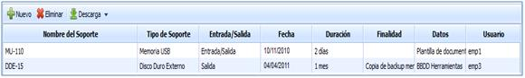

# Soportes

La opción Soportes le permitirá gestionar todos los elementos que entran y salen de la organización a través de una serie de opciones que generan un registro adecuado para disponer de la trazabilidad suficiente como para saber el origen de posibles incidencias.

Las opciones que GlobalSuite proporciona son las siguientes:

* **Nombre del soporte:** Para la identificación del soporte que está siendo utilizado.

* **Tipo de Soporte:** Con el fin de identificar si se trata de un usb, cd, disco duro, etc.

* **Entrada/Salida:** Permite identificar si el soporte ha salido, ha entrado o si se trata de una entrada y salida temporal.

De esta forma se dispone de un registro de entrega y recepción de soportes.

* **Fecha:** Identificar la fecha en la cual se ha salido o recibido el soporte.

* **Duración:** Tiempo durante el que será utilizado el soporte correspondiente.

* **Finalidad:** Define para qué será utilizado el soporte en concreto.

* **Datos:** Permite identificar qué tipo de información estaba contenida en el soporte en cuestión, con el fin de saber si hay que establecer medidas adicionales de seguridad.

* **Usuario:** Persona que dispone del soporte en cuestión.

Al igual que en la opción de empleados, GlobalSuite® permite la descarga del listado de registros de entrada y salida de soportes.
