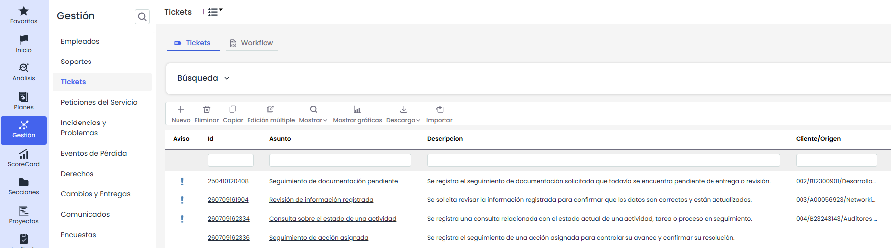
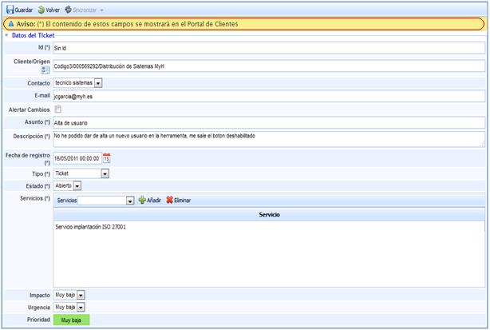
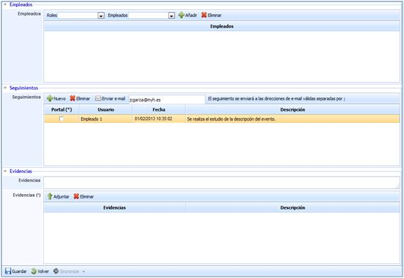
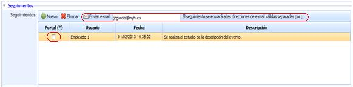
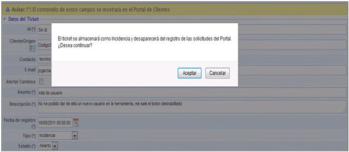

# Tickets

La opción Ticket permitirá gestionar todas aquellas etiquetas abiertas por parte de clientes, proveedores o de forma interna. Hay que tener en cuenta que el origen de los tickets que se pueden gestionar desde la herramienta, podrán ser abiertos manualmente, cargados a través de un documento excel con la opción de importar, o por otra parte, ser generados por clientes de forma automática desde el portal de clientes.

* **Nuevo:** La forma mediante la cual se debe proceder a generar etiquetas manualmente es a través de la opción “Nuevo”. Una vez generada se procederá a realizar el acceso a la etiqueta generada pulsando sobre el asunto o ID.
* **Eliminar:** Permite eliminar los tickets generados.
* **Copiar:** Esta opción permite copiar un ticket que ha sido definida con anterioridad.
* **Edición Múltiple:** Esta opción aparecerá en la barra de herramientas si hay configurado para este tipo de ticket un campo de estado.   
  El proceso se realiza desde un modal: se selecciona el estado actual (origen) —acompañado de su flujo de trabajo cuando corresponda y del número de tickets que se encuentran en él— y, a continuación, el nuevo estado (destino), que el sistema propone según el flujo de trabajo configurado. También puede decidirse si se envían las notificaciones de cambio de estado, activadas por defecto.

  

  Antes de ejecutar, el sistema muestra un mensaje de confirmación con el número de tickets afectados y la transición que se va a aplicar. Al confirmar, la operación se ejecuta en segundo plano —su avance puede seguirse en Procesos de trabajo—, de modo que es posible continuar trabajando mientras se completa.
* **Mostrar:** Al utilizar GlobalSUITE como base de datos de conocimientos, mediante esta opción podrá seleccionar que se muestren tan sólo aquellas no conformidades que estén abiertas, o por el contrario todas, a través del desplegable del que dispone esta opción.

  

  Adicionalmente, cuando el campo **Empleado** se encuentre configurado para el tipo de ticket, estarán disponibles las opciones **Abiertos por empleados** y **Todos por empleados**, que permiten mostrar los tickets agrupados por el empleado asociado.

* **Descarga:** Permite descargar el listado de Tickets representados en formato CSV.  Este Informe estará disponible en [Descargas Pendientes.](https://help.globalsuite.es/display/GlobalSUITEes/.Descargas+Pendientes+vv6.53)  
  Para las descargas en formato **Excel**, el sistema podrá limitar la generación del fichero cuando la información a exportar supere las **100.000 celdas**. Este límite se calcula en función de la cantidad de registros y columnas incluidas en la descarga.

  En caso de que no sea posible generar el fichero en formato Excel, se recomienda realizar la descarga en formato **CSV**.

Una vez se dispone de un Ticket, bien sea generado de forma manual o automática, se procederá a definir tal y como se detalla a continuación, siendo necesario completar al menos los campos identificados con (\*):

## Datos del ticket

* **Id:** Corresponde con el nombre o identificador de la etiqueta que se ha generado.
* **Asunto:** En este campo se define el título del evento que se ha procedido a comunicar.
* **Descripción:** Es uno de los puntos más importantes, ya que es a través de este campo mediante el cual se especificará lo más detallado posible, en qué ha consistido el evento que se ha procedido a comunicar o generar.
* **Fecha de registro:** Fecha de comunicación del evento.
* **Tipo:** Una vez analizado el evento, es en este campo donde se clasificará de qué tipo de etiqueta se trata, es decir, si lo que el cliente ha abierto es considerado como una incidencia, problema, RFC, petición de servicio, evento, falso positivo o reclamación.
* **Estado:** Permaneciendo abiertos hasta que se realice la clasificación.
* **Servicios:** En este campo se asociarán los servicios que se ven han visto afectados por el evento en concreto.

Tal y como indica el aviso, si este ticket ha sido abierto desde el portal de clientes, los campos anteriormente definidos son los que tendrá disponibles el cliente en cuestión.

Para que la definición de los tickets sea adecuada, GlobalSuite le permite registrar información del evento en una serie de campos complementarios a los anteriormente identificados:

* **Cliente/Origen:** En caso de que el ticket se haya abierto desde el portal, este campo se completará de forma automática. Si este se abre manualmente, la solución le permite establecer el origen del evento.
* **Contacto:** Si se ha procedido a generar el ticket desde el portal de clientes, el contacto corresponderá a la persona encargada de generar dicho evento. Este campo contacto es modificable, pudiendo concretar otro usuario al cual proceder a informar sobre el estado de los eventos que haya abierto.

En caso de haberse generado de forma manual, en este campo se indicará con quién se debe poner en contacto para informar sobre el estado del evento.

* **E-mail:** Se indica el correo al cual se podrá comunicar el estado del evento.
* **Alertar cambios:** Seleccionando esta opción, GlobalSuite enviará al e-mail indicado en el campo superior, información sobre cambios de estado y clasificaciones realizadas del evento.
* **NOTA:** En caso que se haya generado un grupo de correo en el aparatado de 'Inicio/Relaciones con el Negocio' la herramienta permite el envío de alertas a un grupo determinado. Para ello se ha de seleccionar la empresa deseada (debe estar creada en el apartado 'Inicio/Relaciones con el Negocio'), y determinar si alertar a un Contacto o a un Grupo. En el caso de seleccionar un Grupo, la herramienta ofrece la posibilidad de elegir el grupo al que notificar los cambios del ticket.

* **Impacto:** Permite establecer un valor cualitativo, basado en un nivel cuantitativo, para determinar el nivel de daño que provoca el evento en cuestión.
* **Urgencia:** Permite establecer un valor cualitativo, para determinar la celeridad con la que debe ser resuelto el evento.
* **Prioridad:** Este valor es generado de forma automática por GlobalSuite, realizando la media aritmética de los valores establecidos en los campos de impacto y urgencia.

De forma complementaria al registro de información a realizar, la solución también le permitirá:

* **Empleados:** Permite definir los empleados que se encargarán del tratamiento del evento. Es necesario que estos empleados hayan sido definidos en la opción gestión de empleados. (Hacer referencia a gestión de empleados).

* **Seguimientos:** Dentro de la opción, se podrá identificar cualquier modificación o cambio realizado en el evento en cuestión.

Cualquier seguimiento del evento que quede registrado puede ser enviado a través de correo electrónico a todas aquellas personas a las que se considere necesario informar. Tal y como se indica es necesario especificar los correos electrónicos y utilizar la opción Enviar e-mail.

Por otra parte y en caso de que el evento haya sido generado desde el portal de clientes, se procederá a informar a través de este medio, seleccionando en el seguimiento que corresponda de la columna Portal. Una vez se proceda al guardado generará el aviso de forma automática.

* **Evidencias:** Con el fin de definir de la forma más completa posible, la solución le permite adjuntar cualquier tipo de archivo. En caso de no adjuntar dicha documentación, también es posible realizar una descripción en el campo Evidencias.

Tras analizar el evento, se procede a clasificar en función de la tipología. Una vez se realiza la clasificación y se guarda el cambio le aparecerá el siguiente aviso:

**NOTA:** La aceptación del aviso conlleva la desaparición del evento en concreto de la opción de Ticket y el cambio de ubicación en función de su tipología, por ejemplo, para el caso de la imagen su nueva ubicación será la opción Incidencias dentro de la pestaña de Gestión.
