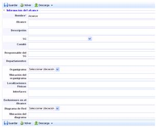
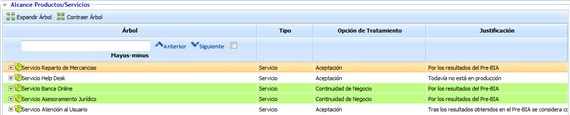
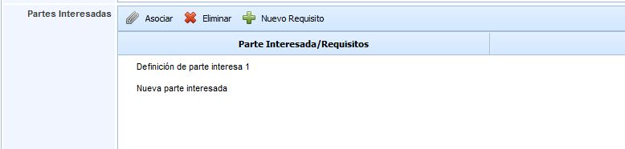
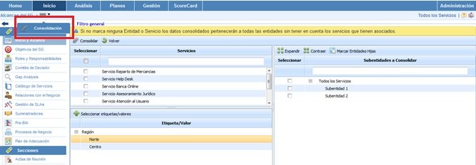
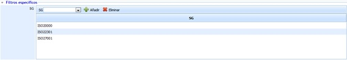
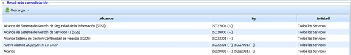

# Alcance

La opción de inicio y alcance del proyecto permite definir los requisitos iniciales para establecer el alcance del proyecto, responsables, ubicaciones, etc.

Lo primero que el usuario ve es una tabla donde pueden establecer diferentes alcances como uno por cada tipo de sistemas, actualizar alcances a lo largo de la vida del sistema de gestión, etc.

Para crear un nuevo alcance se debe seleccionar el botón de ‘Nuevo’ y a continuación aparecerá el nuevo alcance dentro de la tabla. Para eliminar un alcance se deberá seleccionar la fila o filas que se desean eliminar y a continuación pinchar sobre el botón ‘Eliminar’. Por otro lado se ofrece la posibilidad de descargar el listado de Alcances en formato editable (.xlsx) o en formato .pdf pulsando sobre el botón ‘Descargar’.

Para establecer los detalles de un alcance se debe seleccionar pinchando directamente en el nombre del alcance. Una vez que se ha accedido a los detalles del alcance aparece un formulario donde poder especificar cada uno de los parámetros del mismo.

El formulario permite definir los siguientes campos:

* **Nombre:** Nombre descriptivo del alcance. Estos aparecerá en la tabla inicial con el listado de alcances.
* **Alcance:** Frase que engloba el alcance del sistema y que figurará en los certificados correspondientes.
* **Descripción:** Permite desarrollar en detalle la cobertura del alcance.
* **SG:** Sistema de Gestión al que aplica este alcance. Se pueden tener distintos alcances para cada sistema de gestión de la organización.

**NOTA:** Si el SG elegido es 'Sistema de Gestión de la Continuidad de Negocio' se ofrece la posibilidad de acotar y justificar los servicios que van a estar dentro del alcance, en base al Análisis de Impacto en el Negocio (Pre-BIA) realizado.

* **Catálogo de Servicios:** Ofrece la posibilidad de establecer los servicios que están implicados en el Alcance.
* **Comité:** En este apartado se especifican los recursos implicados en la gestión del sistema.
* **Responsable del SG:** Será el encargado del sistema de gestión e intermediario entre la Dirección y el Comité de Gestión.
* **Departamentos:** Permite identificar aquellos departamentos que están implicados dentro del alcance del sistema. Dependiendo del volumen de la organización es necesario especificar cuáles son.
* **Organigrama:** Existen dos opciones para completar este apartado.

  * *Seleccionar una ubicación:* permite especificar en el campo de texto siguiente donde se encuentra almacenado el archivo.
  * *Subir archivo:* Si se selecciona esta opción se podrá adjuntar el archivo con el organigrama de la organización para una mejor comprensión del alcance. Para ello aparecerá en la parte inferior la opción de examinar en el explorar la ubicación del archivo. Una vez seleccionado se debe pulsar el botón ‘Subir’. Cuando la subida se complete el archivo aparecerá en la tabla inferior.

NOTA: únicamente se permite subir un archivo. Si sube algún otro archivo se eliminará el organigrama actual.

* **Localizaciones Físicas.** Permite identificar las ubicaciones, sedes, delegaciones incluidas en el alcance.

* **Interfaces.** Cuando dentro del alcance no está implicada toda la organización, los departamentos implicados deben comunicarse con estas partes, como por ejemplo la comunicación entre el Dpto. de Sistemas (dentro del alcance) con el Dpto. de RRHH (fuera del alcance). Este último debe figurar en este campo.

* **Exclusiones al alcance** Partes de la organización que no se incluyen en el alcance y la justificación de su exclusión.

* **Diagrama de Red.** Permite indicar el diagrama de red implicado dentro del alcance, algo necesario para normas muy técnicas. La gestión de este campo es igual al campo Organigrama.

* **Partes interesadas** Permite definir las partes interesadas que afectan al alcance del proyecto. El formulario permite realizar las siguientes acciones:

  * *Asociar:* Si se han definido previamente las partes interesadas desde **Ajustes**, es posible asociarlas a nuestro alcance utilizando este botón.
  * *Eliminar:* Permite eliminar la fila generada de partes interesadas.
  * *Nuevo Requisito:* Es posible asociar requisitos por cada parte interesada, para ello, se debe seleccionar la parte interesada a la que se le quiere asociar el requisito y a continuación se debe pulsar este botón para añadir el nuevo requisito.

* **Contexto** Ofrece la posibilidad de establecer el contexto de la organización que puede afectar al alcance del proyecto.

* **Proposito del Sistema de Gestión** Permite describir en detalle el proposito por el cual se implanta el Sistema de Gestión en la organización.

* **Factores Internos/Externos** Ofrece la posibilidad de inidcar aquellos elementos internos o externos que puden afectar al alcance del sistema de gestión.

* **Consecuencias** Permite describir las consecuencias de implantar el sistema de gestión en base al alcance definido.

## Consolidación de Alcances

La presente opción permite visualizar de manera resumida los diferentes alcances asociados a la entidad y subentidades.

A continuación se desarrolla la funcionalidad que aporta cada una de las tablas disponibles.

* **Tabla Servicios:** Permite al usuario filtrar los alcances asociados a los Servicios seleccionados.

* **Tabla Subentidades:** Ofrece la posibilidad de filtar los alcances definidos en las subentidades seleccionadas.

* **Tabla Etiqueta/Valor:** Permite visualizar los alcances que tengan asociados una etiqueta determinada.

* **Filtros específicos:** Ofrece la posibilidad de visualizar los alcances asociados a uno o varios sistemas de gestión.

Una vez se han establecido los filtros necesarios, hay que generar la consulta, para ello exiten las siguientes opciones:

* **Consolidar:** Una vez se pulsa el botón y en función de los filtros establecidos, permite visualizar de manera resumida los alcances en la tabla inferior.

* **Volver:** Ofrece la posibilidad de regresar al listado inicial de alcances.

Los resultados se muestran en la tabla inferior 'Resultados de consolidación'

La información que aporta la tabla son las siguientes:

* **Alcance:** Informe sobre el nombre del alcance establecido.

* **SG:** Permite visualizar el sistema de gestión al que está asociado el alcance

* **Entidad:** Ofrece la posibilidad de visualizar la entidad o subentidad a la que está asociado el alcance
