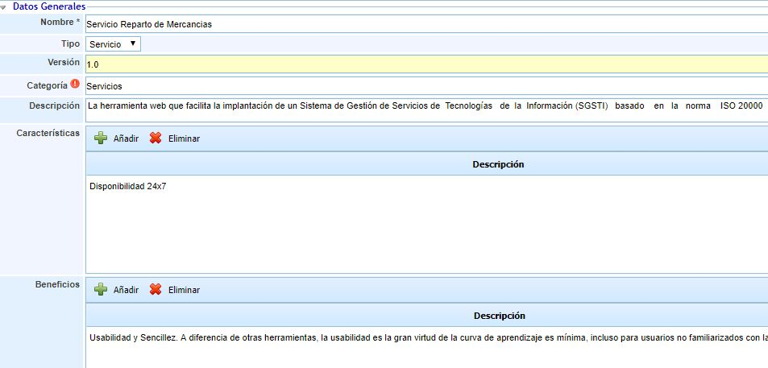
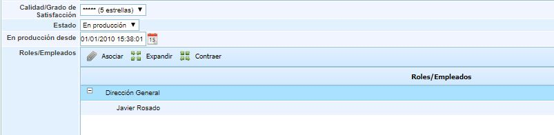
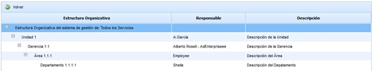
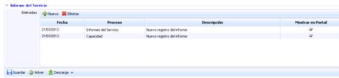
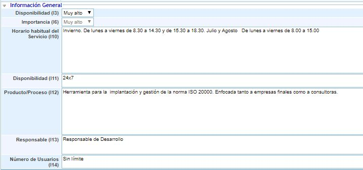
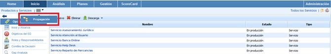
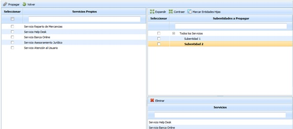

# Catálogo de Servicios

La opción catálogos de servicios permite a la organización especificar y detallar cada uno de los servicios que presta la empresa y que se encuentran dentro del alcance.

En la tabla inicial se puede ver un resumen de los servicios definidos por la empresa. Para crear un nuevo servicio basta con pulsar el botón ‘Nuevo’ y aparecerá en la tabla un nuevo servicio. Para eliminar un servicio se deberá seleccionar la fila o filas que se desean eliminar y a continuación pinchar sobre el botón ‘Eliminar’. El botón ‘Descarga’ permite descargar el listado de servicios en formato editable (.xlsx) o en formato .PDF

**NOTA:** Al eliminar un servicio del listado se eliminarán los SLA’s (Acuerdos de Nivel de Servicio) asociados al servicio.

Al acceder a uno de los servicios de la empresa aparecerá un formulario para la descripción del servicio concreto donde disponemos de las siguientes opciones.

* **Guardar:** Permite guardar todos los cambios o modificaciones realizadas en el formulario.

* **Volver:** La herramienta regresa a la pantalla anterior, donde figura el listado con todos los servicios establecidos.

El formulario se divide en dos apartados: Datos Generales del Servicio e Informe del Servicio.

## Datos Generales

Los datos generales describen el servicio de manera exhaustiva. La información de este apartado se mostrará en el portal del cliente como información del informe del servicio.

Los puntos que se pueden definir son los siguientes:

* **Nombre:** Es el nombre completo del servicio para delimitar el alcance del mismo.

* **Tipo:** Permite especificar la tipología del servicio. De este modo se puede optar entre Servicios, cuando se provisiona a los clientes un bien compuesto por varios procesos, o Producto, cuando el bien entregado es de tipo Software, etc.

* **Versión:** Si el servicio dispone de versiones (en el caso de ser un producto) se especificará aquí la versión de este servicio.

* **Categoría:** Permite identificar el Servicio con una de las categorías o subcategorías definidas para los servicios en 'Ajustes'.

* **Descripción:** Posibilita realizar una descripción más amplia del servicio.

* **Características:** En la tabla se pueden especificar las principales características del servicio. Para crear una nueva característica se debe pulsar el botón ‘Añadir’. Para eliminar una característica se deberá seleccionar la fila o filas a eliminar en la tabla y pulsar el botón ‘Eliminar’.

* **Beneficios:** En la tabla se pueden especificar los beneficios que aporta el servicio a los clientes. Para crear un nuevo beneficio se debe pulsar el botón ‘Añadir’. Para eliminar un beneficio se deberá seleccionar la fila o filas a eliminar en la tabla y pulsar el botón ‘Eliminar’.

* **Calidad/Grado de satisfacción:** Este campo permite identificar el resultado general de la satisfacción de los clientes sobre el servicio.

* **Estado:** Indicar el grado de madurez del servicio, permitiendo elegir entre en desarrollo, en producción, retirado.

* **En producción desde:** Identifica la fecha desde la cual el servicio se presta a los clientes.

* **Roles/Empleados:** Permite asociar al servicio los roles y empleados que se encuentran relacionados con el mismo. Esta asociación es indispensable si se requiere utilizar el privilegio "Acceso Gerencial" disponible en la opción "Roles Empresa" en el apartado de 'Ajustes'. Aquellos empleados asignados al servicio (ya sea directamente, ya sea por el rol al que pertenecen) y que tengan acceso gerencial a alguna opción, sólo podrán ver la información de dicha opción relacionada con los servicios a los que pertenecen.

## Estructura Organizativa

La opción permite al usuario asociar una unidad organizativa al servicio. Las opciones que permite la herramienta son las siguientes:

* **Añadir Estructura Organizativa:** Permite definir la unidad asociada a la gestión del servicio. Para ello se ha de pulsar sobre el botón y seleccionar la unidad en la opción mostrada en la siguiente imagen.

* **Eliminar:** Ofrece la posibilidad de desasociar una unidad organizativa. Para ello se ha de seleccionar la línea deseada y pulsar sobre el botón 'Eliminar'.

* **Ver en Estrucutura Organizativa:** Permite al usuario visualizar las dependencias de la unidad asociada, tal y como se muestra en la siguiente imagen.

## Informes del Servicio

La opción de Informe de Servicio permite mostrar en el portal de clientes información periódica sobre el desarrollo del servicio. Se pueden elegir los informes que se muestran a los clientes dentro del campo ‘Mostrar en el Portal’. Para crear una nueva entrada se debe pulsar el botón ‘Nuevo’. Para eliminar un informe se deberá seleccionar la fila o filas a eliminar en la tabla y pulsar el botón ‘Eliminar’.

## Información General

Esta sección del formulario permite realizar la valoración del servicio en las dimensiones configuradas para el inventario de activos.

Las dimensiones que aparecen son configurables en 'Ajustes - Metodologías Análisis - Configuración General'. Se puede indicar qué dimensiones son visibles y cuales no. En caso de que no haya ninguna dimensión visible, esta sección no se muestra en el formulario del servicio. Algunas opciones que vienen preconfiguradas por defecto son las siguientes:

* **Disponibilidad:** La disponibilidad del servicio hace referencia al horario en el cual el servicio está disponible. Por ejemplo, disponibilidad 24x7 o 8x5 que posteriormente servirá para establecer los SLA’s del servicio y mediciones de la disponibilidad.

* **Horario habitual del servicio:** Este apartado referencia a los horarios en el que el servicio estará disponible en el caso en el que la disponibilidad no sea 24x7 o si se dispone de diferentes horarios entre invierno, verano o fines de semana.

* **Producto/Proceso:** Permite realizar una descripción de los productos o procesos que involucran el servicio.

* **Responsable:** Permite definir el responsable de gestión del servicio.

* **Número de Usuarios:** Permite identificar el número de clientes aproximando a los que se le presta el servicio.

## Propagación Servicios

La presente opción permite el propagar los servicios generados en la empresa matriz a las subentidades que dependen de esta.

Una vez se ha accedido a la opción, se muestran las siguientes tablas:

* **Tabla Servicios Propios:**Muestra el listado de servicios que se han definido en la empresa matriz. Las opciones que permite la tabla son:

  * **Propagar:** Una vez seleccionados los servicios deseados permite propagar los mismo a las subentidades seleccionadas.
  * **Volver:** Ofrece la posibilidad de volver a la pantalla inicial de servicios.

* **Tabla Subentidades:**Muestra el listado de subentidades a las que se pueden asociar servicios de la empresa matriz. Las opciones que permite la tabla son la de expandir o contraer el listado de subentidades, además de poder marcar todas las subentidades pulsando sobre el botón 'Marcar Entidades Hijas'

* **Tabla Servicios:** Una vez seleccionada la subentidad en la tabla superior, muestra los servicios que se han asociado a la misma. La herramienta ofrece la posibilidad de eliminar un servicio asociado, para ello se ha de seleccionar la fila deseada y pulsar sobre el botón 'Eliminar'
