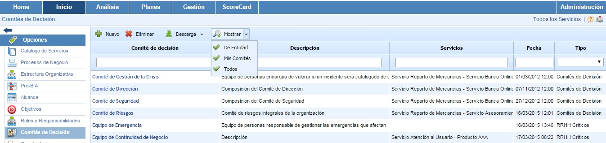
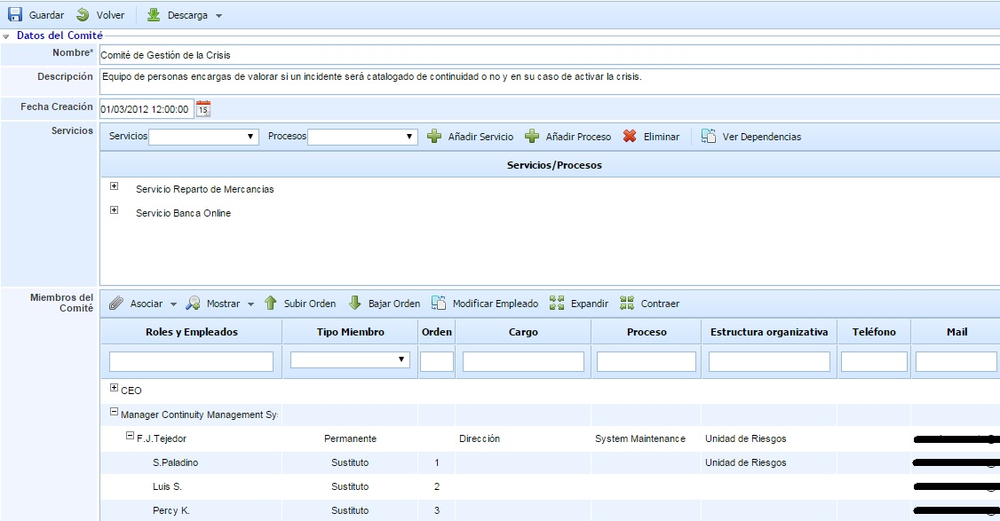
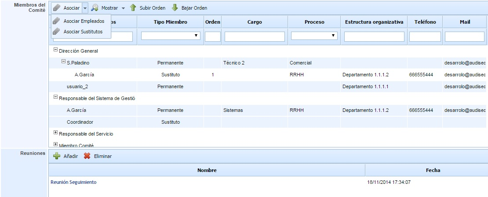
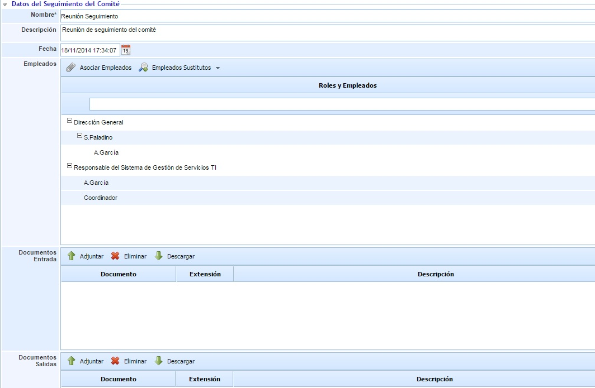
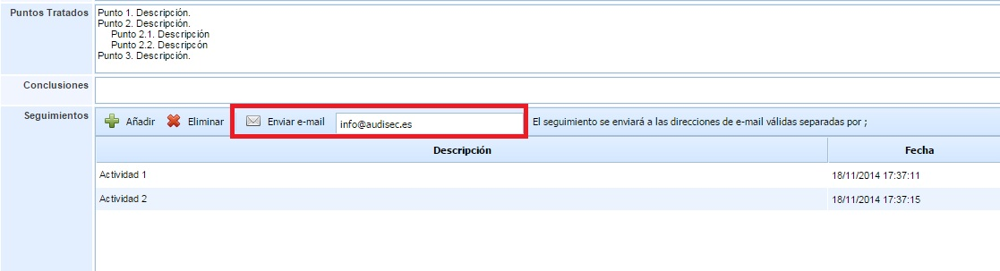

# Comités de Decisión

Esta opción permite definir los comités de la organización que son responsables de gestionar diferentes aspectos de seguridad, continuidad, riesgos, etc.

Para crear un comité de decisión se debe pulsar el botón de ‘Nuevo’ y a continuación aparecerá una nueva entrada en la tabla. Para eliminar un comité creado se deberá seleccionar la fila o filas que se desean eliminar y a continuación pulsar sobre el botón ‘Eliminar’.

El botón ‘Descarga’ permite descargar el listado de comités en formato editable (.xlsx) o en formato .PDF

El botón 'Mostrar' permite filtrar los comités de decisión que se muestran en la tabla. Cada opción permite:

* **De Entidad:** Muestra todos los comités de decisión de la entidad con la que se está trabajando. Es la vista por defecto al ingresar en la opción.
* **Mis Comités:** Muestra los comités de decisión dónde el usuario pertenece.
* **Todos:** Muestra todos los comités de decisión definidos, tanto de la entidad con la que se está trabajando como de las entidades que se encuentran por debajo.

Para definir los detalles de un comité de decisión se debe ingresar en el formulario pulsando directamente en el nombre del mismo.

El formulario permite realizar las siguientes acciones:

* **Guardar:** Permite guardar todos los cambios o modificaciones realizadas en el formulario.

* **Volver:** La herramienta regresa a la pantalla anterior, donde figura el listado con todos los comités de decisión.

* **Descarga:** Permite descargar la información del comité en formato editable (.docx).

El formulario está compuesto por la siguiente información:

* **Nombre:** Nombre descriptivo del comité que aparecerá en la tabla inicial de Comités de Decisión.

* **Descripción:** Permite realizar una descripción más detallada de la función del comité.

* **Fecha Creación:** Identifica la fecha de creación del comité.

* **Servicios:** Permite asociar al comité los servicios y los procesos de negocio de la organización. Para asociar un servicio se debe seleccionar en el desplegable el servicio deseado y pulsar el botón ‘Añadir Servicio’. Para asociar un proceso, se debe seleccionar un servicio ya insertado y un proceso del desplegable, y pulsar el botón 'Añadir Proceso'. En caso de querer eliminar un servicio o un proceso de la tabla, se debe seleccionar el servicio o proceso en la tabla y pulsar el botón ‘Eliminar’.

* **Miembros del Comité:** Esta tabla permite asociar al comité los empleados que lo componen. En la siguiente sección se detalla su funcionamiento.

* **Reuniones:** Esta tabla permite registrar las reuniones realizadas por el comité de decisión. En la siguiente sección se detalla su funcionamiento.

## Miembros del Comité

La tabla de miembros del comité permite asociar empleados dados de alta en GlobalSUITE al comité. Esta tabla permite asociar empleados permanentes, sustitutos e invitados al comité.

Las opciones disponibles para establecer los empleados del comité son:

* **Asociar Empleados:** Pulsando sobre esta opción aparece una ventana con todos los roles y empleados definidos en la opción 'Roles y Responsabilidades'. También aparecen los empleados que no están asociados a ningún rol. A través de las casillas de selección de la derecha se permite asociar los empleados al comité. Una vez seleccionados hay que pulsar sobre el botón 'Cargar Roles/Empleados" para añadirlos al comité.

Los empleados añadidos al comité se registran, por defecto, como empleados de tipo 'Permanente'. Se permite cambiar el tipo en la columna 'Tipo Miembro' pudiendo definir un empleado como 'Sustituto' o 'Invitado'.

* **Asociar Sustitutos:** Esta opción permite asociar empleados sustitutos a un empleado del tipo 'Permanente' (para los tipos 'Sustituto' o 'Invitado' no se permite asociar empleados sustitutos). Para ello, hay que seleccionar el empleado y pulsar sobre el botón 'Asociar Sustitutos', mostrándose una tabla con todos los empleados de la organización pudiendo seleccionar uno o varios empleados sustitutos.

* **Mostrar:** Este botón permite filtrar la tabla para mostrar/ocultar los empleados sustitutos asociados a los empleados permanentes.

* **Subir/Bajar Orden:** Estos botones permiten ordenar los empleados sustitutos que están asociados a un empleado 'Permanente'. Para ello, hay que seleccionar un empleado sustituto y pulsar el botón correspondiente en función de si se desea subir o bajar el orden.

## Reuniones

Para los comités de decisión definidos, en la parte inferior se permite registrar las reuniones que se realizan. Para ello, se pueden utilizar los botones 'Añadir' y 'Eliminar' para crear o eliminar actas de reunión del comité, respectivamente.

Para acceder al detalle de una reunión hay que pulsar sobre el nombre de la misma. Al acceder se muestra un formulario con la siguiente información:

* **Nombre:** Permite registrar un nombre identificativo a la reunión.

* **Descripción:** Permite registrar la descripción de la reunión.

* **Fecha:** Permite registrar la fecha de la reunión.

* **Empleados:** Contiene los empleados que asisten a la reunión. Por defecto, al crear una reunión se seleccionan todos los empleados que forman parte del comité. Si algún empleado no asiste a la reunión, a través del botón 'Asociar Empleados' se puede quitar la asociación de estos empleados.

* **Documentos Entrada:** Permite adjuntar la documentación que es tratada en la reunión.

* **Documentos Salida:** Permite adjuntar la documentación que se genera como consecuencia de al reunión.

* **Puntos Tratados:** Permite identificar los puntos tratados de la reunión. Es decir, el orden del día de la misma.

* **Conclusiones:** Permite registrar aquellas conclusiones que se lleguen en la reunión.

* **Seguimientos:** Esta tabla permite registrar todas aquellas acciones que requieran de un seguimiento posterior. Estas acciones se pueden enviar por correo electrónico a una o varias personas indicando las direcciones de e-mail en el cuadro blanco superior y pulsando sobre el botón 'Enviar e-mail'.

