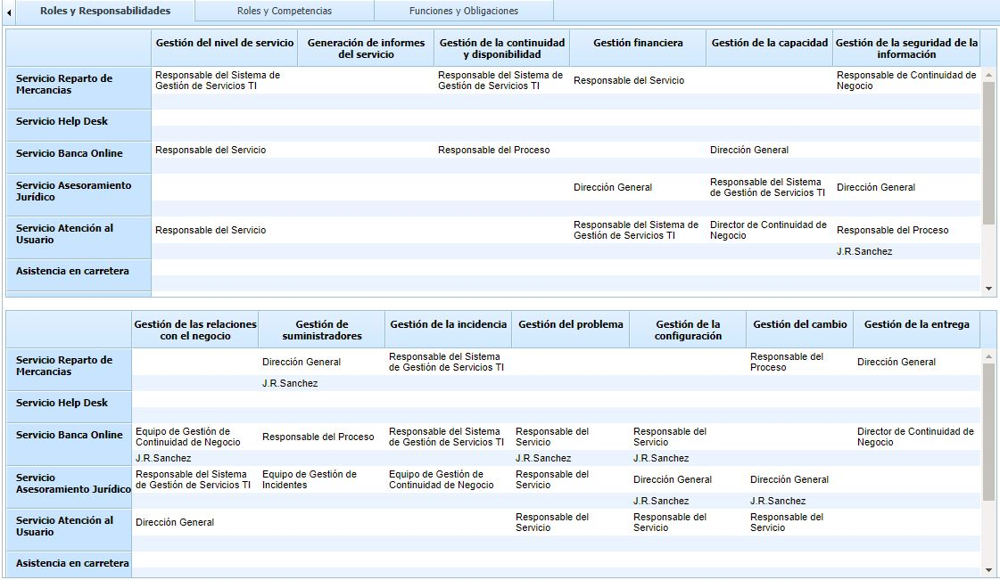
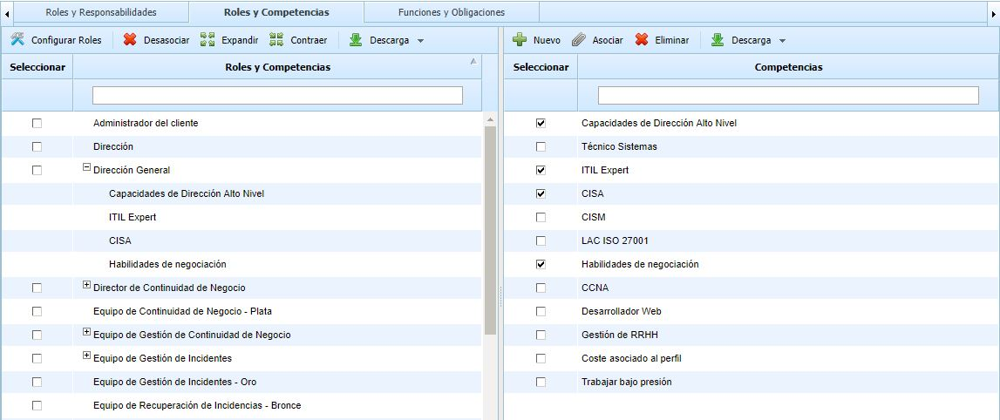
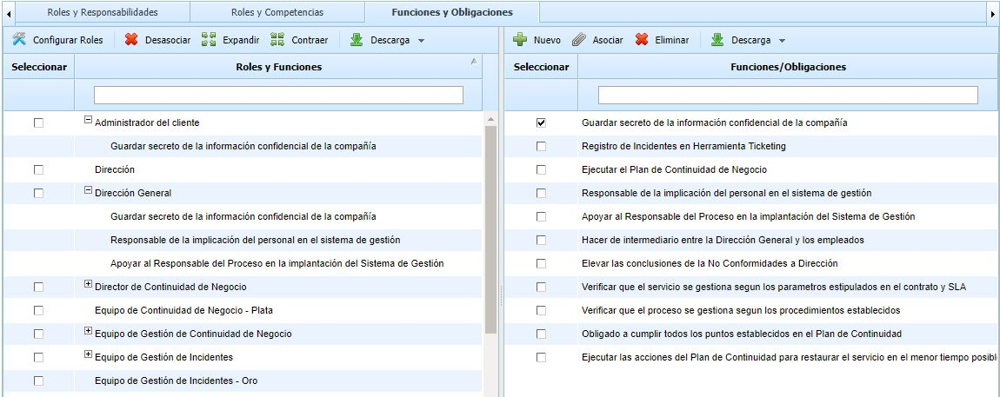

# Competencias y Funciones

## Roles y Responsabilidades

La opción de roles y responsabilidades está diseñada para la gestión de la Norma ISO20000. En ella se da la posibilidad de asociar que roles y empleados intervienen en la gestión de los 13 procesos definidos en la Norma por cada servicio incluido dentro del alcance.

Para asociar los responsables y empleados de cada uno de los procesos se ha de pulsar dos veces sobre la celda deseada y seleccionar el rol o empleado en el desplegable.

**NOTA:** Los servicios se definen en el apartado ‘Inicio/Catálogo de Servicios’

## Roles y Competencias

Esta opción permite al gestor de la herramienta definir las competencias que posee cada uno de los roles definidos.

Para realizar esta operación es necesario marcar la columna izquierda del rol o los roles y la columna izquierda de la competencia o las competencias. De esta forma se permite realizar una asociación múltiple. Si se quiere desasociar una competencia a un rol determinado se ha de seleccionar la fila de la competencia pulsando con el ratón en dicha fila y pulsar el botón Desasociar.

**NOTA:** Las competencias se establecen en la propia opción de competencias. Si se quiere añadir una nueva competencia se ha de pulsar el botón ‘Nueva’. En caso de querer suprimir alguna competencia ya definida, se ha de seleccionar la misma y pulsar el botón ‘Eliminar’.

## Funciones y Obligaciones

La opción permite identificar distintas funciones y obligaciones de gestión y asociarlas a diferentes roles definidos.

Para realizar esta operación es necesario marcar la columna izquierda del rol o los roles y la columna izquierda de la función/obligación o las funciones/oblicagiones. De esta forma se permite realizar una asociación múltiple. Si se quiere desasociar una función/obligación a un rol determinado se ha de seleccionar la fila de la función/obligación pulsando con el ratón en dicha fila y pulsar el botón Desasociar.

**NOTA:** Las funciones y obligaciones se establecen en la propia pestaña. Si se quiere añadir una nueva función u obligación se ha de pulsar el botón ‘Nueva’. En caso de querer suprimir alguna ya definida, se ha de seleccionar la misma y pulsar el botón ‘Eliminar’.
