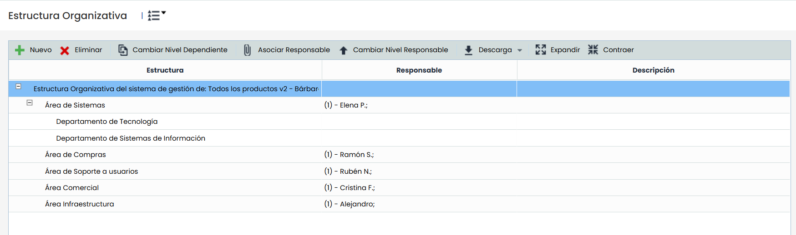
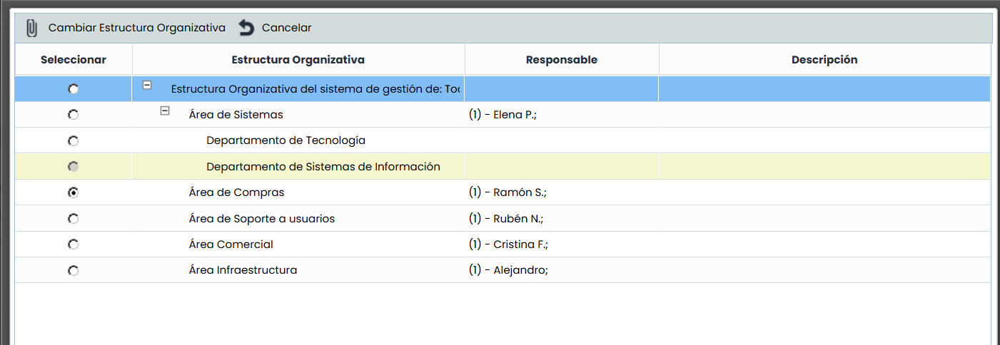
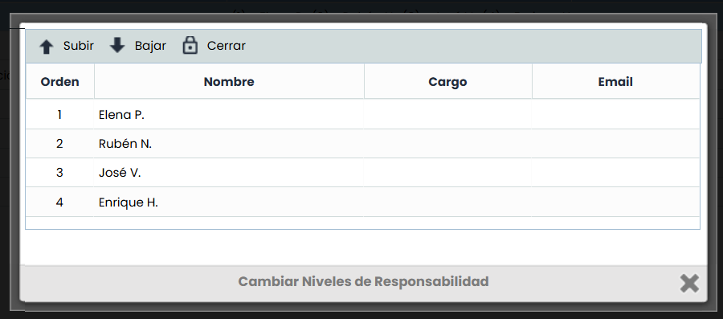

# Estructura Organizativa

Esta opción permite definir el organigrama departamental de la organización. La información que se muestra en las columnas de la tabla es la siguiente:

* **Estructura:** Muestra el nombre y el árbol de dependencias de las diferentes divisiones/áreas/departamentos (según se denomine en cada organización) definidos en la organización.
* **Responsable:** Muestra los responsables de la organización de cada uno de los departamentos o áreas definidos en la estructura.
* **Descripción:** Muestra una descripción más detallada de la función u objetivo de cada departamento o área de la estructura organizativa.

Las opciones que se pueden realizar sobre la tabla son las siguientes:

* **Nuevo:** Permite insertar una nueva entrada en la tabla. Para generar las dependencias se debe seleccionar la fila requerida y pulsar sobre el botón 'Nuevo', lo que generará una nueva entrada en el nivel inferior.


\*\*NOTA:\*\* Únicamente se podrán generar tantos niveles/dependencias como se encuentren definidos en la opción 'Ajustes/Configuración/General'.


* **Eliminar:** Ofrece la posibilidad de eliminar una entrada de la tabla. Para ello se debe seleccionar la fila deseada y pulsar sobre el botón 'Eliminar'
* **Cambiar Nivel Dependiente:** Permite modificar la dependencia de un área/departamento determinado, ubicándolo en otro lugar dentro de la estructura organizativa. Para ello se debe seleccionar el nivel que se quiere modificar y pulsar sobre el botón 'Cambiar Nivel Dependiente'. Posteriormente se muestra una ventana que permite definir el nuevo nivel dónde se ubicará el área/departamento, tal y como se muestra en la siguiente imagen.

* **Asociar Responsable:** Permite definir los responsables de un área o departamento. Para ello se debe seleccionar la fila deseada y pulsar sobre el botón 'Asociar Responsable', mostrándose una ventana con el listado de empleados registrados en la herramienta. En esta ventana se debe seleccionar los empleados correspondientes y pulsar sobre el botón 'Asociar Empleados'.
* **Cambiar Nivel Responsable:** Permite modificar el orden de responsabilidad de los empleados asignados a un área/departamento. Para ello se debe seleccionar el nivel que se quiere modificar y pulsar sobre el botón 'Cambiar Nivel Responsable'. Posteriormente se muestra una ventana que permite definir el nuevo orden de cada uno de los responsables utilizando los botones 'Subir' y 'Bajar', que permiten mover los responsables dentro de la tabla.

* **Descarga:** Ofrece la posibilidad de descargar la estructura organizativa en formato editable (xlsx) o PDF.
* **Expandir:** Permite desplegar la estructura organizativa al completo.
* **Contraer:** Permite contraer la estructura organizativa a las opciones de mayor nivel.
