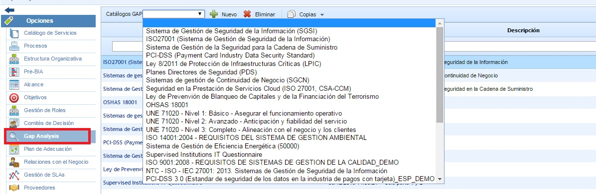
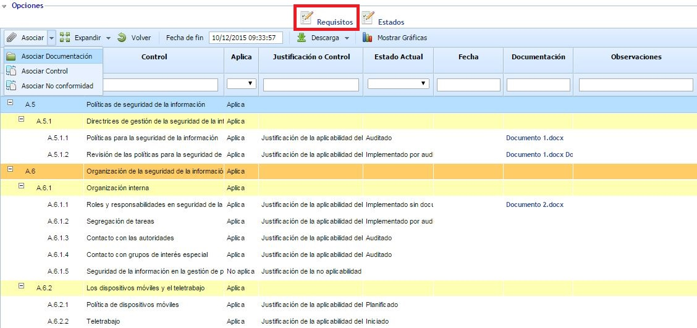
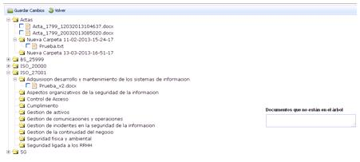
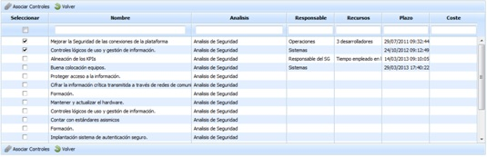
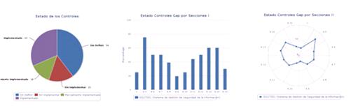
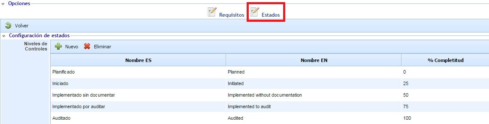

# GAP Analysis

Esta opción ofrece la posibilidad de realizar evaluaciones de cumplimiento de diferentes catálogos, donde cada catálogo puede contener requisitos de estándares, leyes o reglamentos aplicables a la organización.

La herramienta ofrece un listado de catálogos previamente definidos en el apartado ‘Ajustes/Catálogos Compliance’ tal y como se muestra en la siguiente imagen:

Para incluir un catálogo en la tabla, se debe seleccionar de la lista desplegable el catálogo deseado y pulsar el botón ‘Nuevo’. En caso de querer eliminar un catálogo del listado, se debe seleccionar la fila o filas correspondientes al catálogo y pulsar el botón ‘Eliminar’. El botón ‘Descarga’ permite descargar el listado de GAP en formato editable (.xlsx) o en formato .PDF.

De igual forma, se permite realizar copias de un GAP realizado. Para ello, hay que seleccionar el catálogo que se quiere copiar y pulsar sobre el botón "Copias". Este botón permite realizar una copia tanto en la opción de Gap Analysis como en la opción "Compliance" ubicada en el menú de Análisis.

Para acceder a un catálogo y realizar el GAP Analysis, hay que pulsar sobre el nombre del mismo. Al acceder existen dos opciones que se detallan en los siguientes apartados:

## Análisis de Requisitos

Al acceder se carga por defecto la opción "Requisitos", la cual contiene la estructura de requisitos del catálogo compliance. Las opciones que disponemos sobre el catálogo son las siguientes:

* **Asociar - Asociar Documentación:** Permite asociar uno o varios documentos del gestor documental a los requisitos del catálogo compliance. Para ello se debe seleccionar la fila deseada y pulsar sobre el botón ‘Asociar documentación’ que abre la siguiente pantalla:

La pantalla muestra el árbol de documentos que están almacenados en el Gestor Documental (Secciones/Gestor Documental). Para asociar la documentación se debe seleccionar el/los checkbox de los documentos deseados y pulsar el botón ‘Guardar cambios’.

Si el usuario desea hacer referencia a uno o varios documentos no almacenados en el Gestor Documental, la herramienta permite identificar los documentos en el cuadro situado en la parte derecha, para que queden identificados en el control deseado.

En caso de querer eliminar una asociación, el usuario debe acceder al árbol documental, quitar la selección de el/los checkbox deseados y pulsar sobre el botón ‘Guardar cambios’.

* **Asociar - Asociar Control:** Permite asociar uno o varios controles, registrados en la opción "Gestión de Controles", a los requisitos del catálogo compliance. Para ello se debe seleccionar la fila deseada y pulsar sobre el botón 'Asociar Control' que abre la siguiente pantalla:

La pantalla muestra el listado de controles definidos en el apartado 'Análisis/Gestión de Controles'. Para asociar uno o varios controles se debe seleccionar el/los checkbox de los controles deseados y pulsar el botón ‘Asociar Controles’.

En caso de querer eliminar una asociación, el usuario debe acceder al listado de controles, quitar la selección de el/los checkbox deseados y pulsar sobre el botón ‘Asociar Controles’.

* **Asociar - Asociar No Conformidad:** Permite asociar una o varias no conformidades a los requisitos del catálogo compliance.

* **Expandir:** Muestra la estructura completa del catálogo compliance.

* **Contraer:** Contrae la estructura del catálogo compliance, dejando visible únicamente los requisitos de nivel 1.

* **Volver:** Permite regresar a la pantalla anterior, donde se encuentra el listado con todos los catálogos compliance.

* **Fecha de fin:** Permite indicar la fecha de finalización de la evaluación del catálogo.

* **Descarga:** Permite descargar el catálogo, disponible en dos formatos:

  * Informe Docx.
  * Informe CSV.
  * **Mostrar Gráficas:** Muestra diferentes gráficas que representan el estado de implantación de los requisitos del catálogo compliance.

Adicionalmente a las opciones anteriores, se permite editar las diferentes columnas de la tabla que contiene el catálogo compliance. La función de cada una de las columnas es la siguiente:

* **Aplica:** Permite identificar si el requisito o control aplica o no aplica dentro de la organización. Para establecer el valor, se debe pulsar dos veces sobre la celda y seleccionar la opción deseada en el desplegable. La herramienta permite establecer como "Aplica" o "No aplica" a un grupo de requisitos o controles, de forma que todos los requisitos/controles que se encuentran en niveles inferiores se establecen con el mismo valor.

* **Justificación o Control:** Permite indicar una justificación de aplicabilidad o no aplicabilidad del control. Para ello se debe pulsar dos veces sobre la celda, apareciendo un cuadro de texto sobre el que poder escribir.

* **Estado Actual:** Permite indicar el estado de implantación del requisito o el control dentro de la organización. Pinchando sobre la celda se desplegará las opciones disponibles para definir el estado, en función de los estados configurados para el catálogo compliance. La herramienta ofrece una serie de estados por defecto para los catálogos, pero estos estados son configurables tanto en la opción "Catálogos Compliance" del apartado 'Ajustes' como en el propio catálogo en la opción superior "Estados" (ver siguiente sección).

* **Fecha:** Permite establecer una fecha para el requisito o control. Esta fecha se puede utilizar, por ejemplo, para identificar la fecha de la evaluación del requisito o la fecha de implantación del mismo (según se desee).

* **Documentación:** Muestra los documentos asociados al requisito o control, pudiéndose descargar los documentos pulsando directamente sobre el enlace. Para asociar documentos a un requisito, hay que seleccionar el requisito y pulsar sobre el botón "Asociar Documentación" disponible en la parte superior.

* **Observaciones:** Permite incluir las observaciones y datos relevantes para justificar el estado del control.

* **Controles Agrupados:** Muestra los controles, de la opción "Gestión de Controles", asociados al requisito, pudiéndose acceder al detalle del control pulsando directamente sobre el enlace. Para asociar controles a un requisito, hay que seleccionar el requisito y pulsar sobre el botón "Asociar Control" disponible en la parte superior.

*Nota: Esta columna se encuentra por defecto oculta. Para visualizar la columna, se debe pulsar con el botón derecho del ratón sobre la cabecera de la tabla, permitiendo añadir la columna.*

* **No Conformidades:** Muestra las no conformidades asociadas al requisito, pudiéndose acceder al detalle de la no conformidad pulsando directamente sobre el enlace. Para asociar no conformidades a un requisito, hay que seleccionar el requisito y pulsar sobre el botón "Asociar No conformidad" disponible en la parte superior.

*Nota: Esta columna se encuentra por defecto oculta. Para visualizar la columna, se debe pulsar con el botón derecho del ratón sobre la cabecera de la tabla, permitiendo añadir la columna.*

## Configuración de Estados

Esta opción permite configurar los estados que se van a utilizar para analizar el catálogo compliance. Por defecto, los estados que aparecen corresponden a los estados configurados para el catálogo compliance en la opción "Catálogos Compliance" del apartado 'Ajustes'

Los estados que vienen por defecto se pueden configurar de manera particular para este GAP Analysis. Esto permite modificar los estados únicamente para este GAP Analysis, de forma que si el catálogo compliance lo vuelvo a utilizar en la opción "GAP Analysis" o en la opción "Compliance", tomará por defecto los estados definidos en la plantilla del catálogo.

Para modificar los estados hay que utilizar los botones "Añadir" y "Eliminar". Se permite editar el nombre de cada estado tanto en español como en inglés, de forma que los usuarios podrán ver el estado en el idioma que tengan configurado en su perfil.

Por último, cada estado tiene un porcentaje de completitud. Este porcentaje se utiliza para calcular las gráficas de cumplimiento del catálogo compliance, considerando el porcentaje de cada uno de los requisitos del catálogo.
