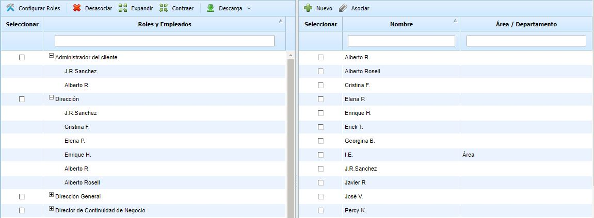
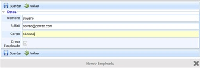

# Gestión de Roles

GlobalSuite® mediante esta opción permite asociar diferentes roles existentes en la empresa a los empleados implicados en la gestión del sistema.

Para realizar esta operación es necesario marcar la columna izquierda del rol o los roles y la columna izquierda del empleado o los empleados. De esta forma se permite realizar una asociación múltiple. Si se quiere desasociar un empleado a un rol determinado se ha de seleccionar la fila del empleado pulsando con el ratón en dicha fila y pulsar el botón Desasociar.

GlobalSuite permite la creación de empleados en este apartado pulsando sobre el botón 'Nuevo' en la parte superior de la columna derecha, generando una pantalla en la que se podrán definir datos como Nombre, Email, Cargo.

Por otro lado, pulsando con el boton derecho sobre las columnas, se permite visualizar/ocultar campos informativos como Usuario, Cargo, Área/Departamento y E-mail.
