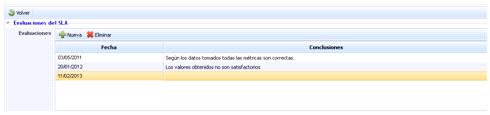
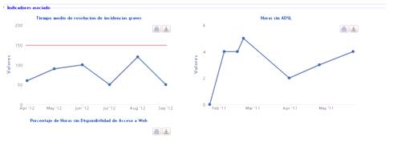
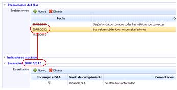
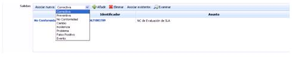
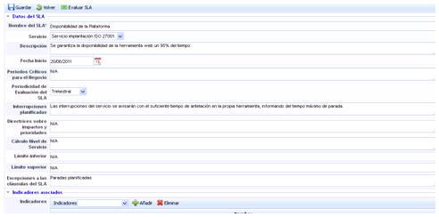

# Gestión de SLAs

La gestión de los SLA’s permite definir los acuerdos de nivel de servicios que se ofrecen a los clientes implicados dentro del alcance.

La tabla inicial muestra los diferentes SLA’s definidos por la organización, especificando entre otros campos, la fecha desde la cual se está prestando, el servicio al que están asociados, una breve descripción del mismo y las evaluaciones.

La tabla de los SLA’s permite realizar las siguientes acciones:

* **Nuevo:** Permite crear un nuevo SLA.

* **Eliminar:** Permite eliminar un SLA ya creado. Para ello se ha de seleccionar la fila o filas deseadas y pulsar el botón ‘Eliminar’.

* **Copiar SLA:** Posibilita copiar SLA’s ya existentes. Para ello hay que seleccionar los SLA’s que se deseen copiar y pulsar el botón ‘Copiar SLA’. Los SLA’s copiados contendrán los mismos valores en todos los campos salvo el servicio asociado, que habrá que definir dentro del formulario.

* **Descarga:** Posibilita descargar el listado de SLA’s en formato editable .XLS y en formato .PDF

Al pulsar sobre el icono de ‘Evaluaciones’ de la tabla accedemos a un formulario que permite establecer los siguientes parámetros.

## Evaluaciones del SLA

La tabla de evaluaciones muestra de manera resumida las conclusiones a las que ha llegado el gestor sobre el cumplimiento del SLA. Para realizar una evaluación se ha de pulsar el botón ‘Nueva’ y se genera una nueva línea donde poder establecer la fecha de evaluación y las conclusiones. En caso de querer eliminar una evaluación, se ha de seleccionar la línea o líneas deseadas y pulsar el botón ‘Eliminar’.

## Indicador Asociado

El campo indicador muestra aquellos indicadores que se han asociado para realizar una mejor evaluación del SLA. Para asociar indicadores se ha de acceder al formulario de SLA, como se desarrolla más adelante.

## Evaluación

El campo ‘Evaluación’ permite definir de manera específica los resultados de una evaluación. Para ello se ha de seleccionar la fila en el apartado ‘Evaluaciones SLA’ y completar los siguientes campos:

* **Resultados:** Permite establecer diferentes evaluaciones sobre un SLA. Para ello se ha de pulsar el botón ‘Nuevo’ lo cual genera una fila que permite identificar si se ha cumplido o no el SLA, identificar el grado de cumplimiento, comentarios sobre el mismo y asociarlo a los clientes a los que se presta el acuerdo de nivel de servicio en ‘Seleccionar clientes’.

En ese caso se abrirá una ventana emergente con los clientes definidos en la opción ‘Relaciones con el Negocio’ que tengan el servicio del SLA, para poder seleccionarlos. Cuando los clientes deseados estén marcados, se deberá pulsar ‘Guardar cambios’.

Para eliminar una evaluación se ha de seleccionar la fila deseada y pulsar el botón ‘Eliminar’.

* **Salidas:** Si los resultados de la evaluación no son los esperados por parte del usuario, el campo ‘Salidas’ posibilita abrir diferentes tickets (incidencia, acción correctiva, etc.) que gestionen el cumplimiento del SLA. Para ello se ha de seleccionar el tipo ticket en el desplegable y pulsar el botón ‘Añadir’. Esta acción crea automáticamente un ticket en el apartado de ‘Gestión’. Para eliminar el ticket, se ha de seleccionar la fila deseada y pulsar el botón ‘Eliminar’.

Puede ser que el usuario quiera gestionar el cumplimiento mediante un ticket ya abierto. Para ello basta con pulsar el botón ‘Examinar’, lo cual abre una lista con todos los tickets abiertos en el apartado de ‘Gestión’.

Cuando se accede al formulario del SLA, podemos realizar las siguientes acciones:

* **Guardar:** Permite guardar los cambios realizados en el formulario.

* **Volver:** La herramienta regresa a la pantalla anterior con el listado de los SLA’s.

* **Evaluar SLA:** Permite realizar una evaluación del SLA tal y como se ha comentado en el punto ‘Evaluaciones’.

Los campos que aparecen en el formulario son los siguientes:

* **Nombre del SLA.** Indica el nombre descriptivo del SLA y que figura en el listado.
* **Servicio.** Este campo aparece un desplegable con todos los servicios definidos en el sistema, pudiendo elegir a qué servicio está asociado el SLA.
* **Descripción.** Permite realizar cualquier anotación específica del SLA.
* **Fecha de Inicio.** Fecha a partir de la cual el SLA está vigente y se aplica al servicio.
* **Períodos críticos para el negocio.** Permite indicar si por la naturaleza del servicio existe algún período de tiempo más sensible en el que el cumplimiento del SLA se puede ver afectado.
* **Periodicidad de evaluación del SLA.** Permite establecer el período en que se debe evaluar el SLA.
* **Interrupciones planificadas.** Posibilita indicar si existe alguna interrupción planificada en el servicio que no deba tenerse en cuenta en la evaluación del SLA.
* Directrices sobre impactos y prioridades. Permite definir si existen prioridades a la hora de realizar acciones que disminuyan el impacto del incumplimiento del SLA.
* Cálculo Nivel de Servicio.**Posibilita establecer cómo se calcula el nivel de servicio ofrecido.**
* **Límite inferior.** Especifica cuál es el límite inferior en el nivel de servicio ofrecido que especifica el SLA.
* **Límite superior.** Especifica el límite superior del nivel de servicio que ofrece el SLA.
* **Excepciones a las cláusulas del SLA.** Permite especificar si existe alguna circunstancia que no cubra el SLA definido.
* **Indicadores asociados.** Esta tabla permite asociar indicadores definidos en el apartado ‘ScoreCard/Indicadores’ para facilitar la evaluación del SLA.

Para ello se ha de seleccionar un indicador en el desplegable y pulsar el botón ‘Añadir’. En caso de querer eliminar un indicador ya asociado, se he de seleccionar la fila deseada y pulsar el botón ‘Eliminar’.
