# Medidas de Seguridad

En este apartado se mostrarán las evaluaciones del Esquena Nacional de Seguridad con las Medidas de Seguridad y los controles correspondientes, junto con su grado de aplicabilidad en función a la [Categorización del Sistema](https://help.globalsuitesolutions.com/es/globalsuite/v1/categorizacion-del-sistema).

## Listado Evaluaciones Medidas de Seguridad

Al acceder a la opción, la herramienta muestra un listado las evaluaciones del ENS que se han establecido, mostrando por defecto aquellas que se encuentran activas. 

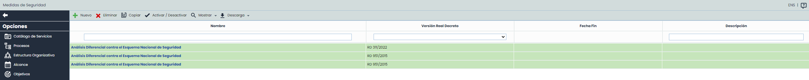

En la tabla se pueden realizar diferentes acciones, entre ellas:

* Nuevo:  Permite crear una nueva evaluación ENS. Al pulsar el botón podrás seleccionar la versión 2015 o la versión 2022 del RD para generar la evaluación.

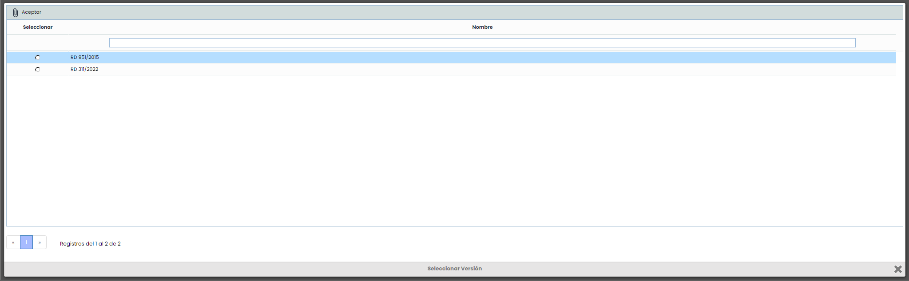

* Eliminar: Permite eliminar una o varias evaluaciones del ENS, siendo posible la selección múltiple.
* Copiar: Permite Copiar una evaluación del ENS con toda su información para poder reutilizarla.
* Activar/Desactivar: Esta opción permite realizar dos acciones diferentes:

  * Desactivar una evaluación:  al desactivar una evaluación, se creará un **histórico** de la misma que no podrá editarse. Se guardarán el nivel de seguridad y el grado de aplicabilidad de todas las medidas de seguridad en ese momento. Los botones de Asociar Documentación y Controles estarán desactivados, así como la edición de la Fecha Fin.

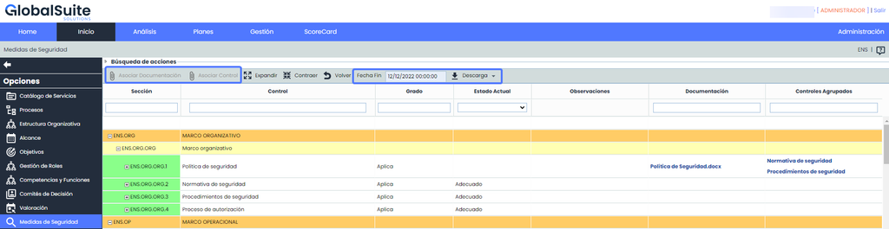

* Descarga:

  * Informe Docx : Se generará un informe Docx de la evaluación histórica, el cual contendrá toda la información de la misma. El informe estará disponible en [Descargas Pendientes](https://help.globalsuitesolutions.com/es/globalsuite/v1/descargas-pendientes).

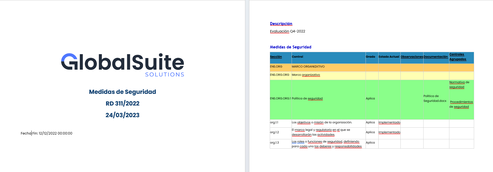

* Activar una evaluación: podrás activar una evaluación no activa. Esto te permitirá volver a editar la evaluación y realizar cambios en la misma.
* Mostrar: Permite filtrar las evaluaciones de la tabla:

  * Todos: Muestra todas las evaluaciones ENS, tanto las activas (se mostraran en verde), como los históricos.
  * Activos: Solo mostrará las evaluaciones ENS activas. Esta será la vista por defecto.
* Descarga:

  * Informe CSV : Se generará un informe con el listado de evaluaciones que coincidan con los filtros aplicados. El informe estará disponible en [Descargas Pendientes](https://help.globalsuitesolutions.com/es/globalsuite/v1/descargas-pendientes).

## Evaluación Medidas de Seguridad

En esta vista se mostrarán todos los requisitos del ENS (de acuerdo a la versión seleccionada al momento de crear la evaluación) y el grado de aplicabilidad en función de la [Categorización del Sistema](https://help.globalsuitesolutions.com/es/globalsuite/v1/categorizacion-del-sistema).

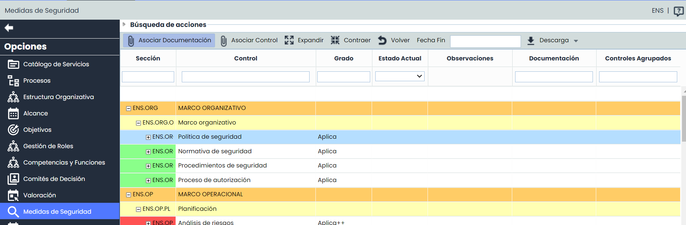

* Grado: Campo automático que se calcula en función de la Categorización del Sistema. Es editable únicamente a nivel del controles (4to nivel).
* Estado Actual:

  * Campo editable únicamente a nivel de controles, mediante un desplegable, que indica el estado de los requisitos o controles.
  * Campo automático únicamente a nivel de Medidas de Seguridad (3er nivel). Se mostrará la etiqueta "Adecuado" cuando todos los controles que Aplican muestren un grado de completitud del 100%.

**NOTA**: Los controles que están marcados como "No Aplica" no se tendrán en cuenta para calcular si la medida de seguridad es "Adecuado" o no.

En la tabla se pueden realizar diferentes acciones, entre ellas:

* Asociar Documentación: Permite asociar uno o varios documentos del gestor documental a las Medidas de Seguridad o requisitos del ENS. Para ello se debe seleccionar la fila deseada y pulsar sobre el botón "Asociar documentación" que abrirá una ventana donde se muestra el árbol de documentos que están almacenados en el [Gestor Documental](https://help.globalsuitesolutions.com/es/globalsuite/v1/gestor-documental). Para asociar la documentación se debe seleccionar el/los checkbox de los documentos deseados.

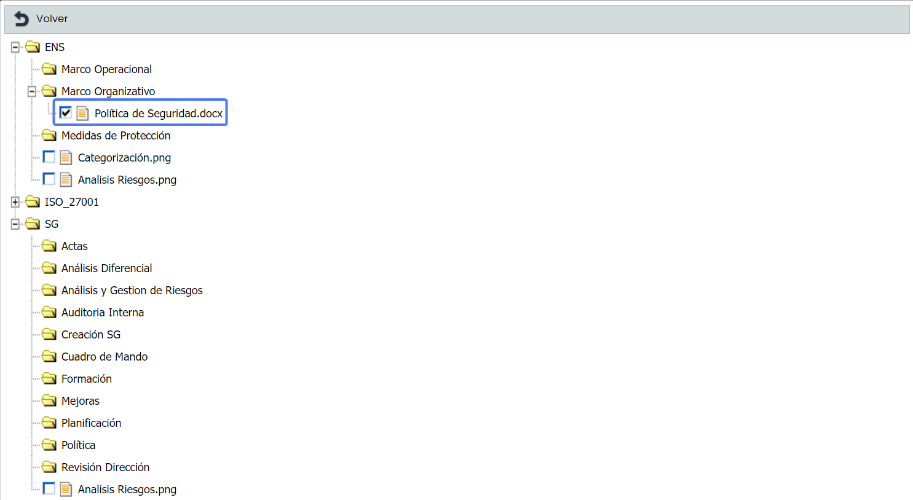

Una vez  asociados los documentos, se mostrarán en la columna correspondiente de la medida de seguridad o requisito.

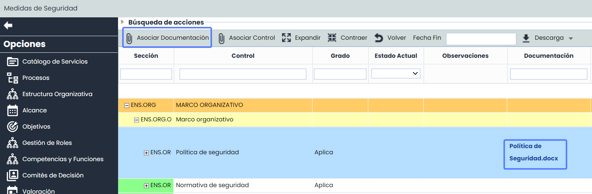

 

* Asociar Control: Permite asociar uno o varios controles registrados en [Gestión de Controles](https://help.globalsuitesolutions.com/es/globalsuite/v1/gestion-de-controles) o en el Plan de [Plan de Adecuación ENS](https://help.globalsuitesolutions.com/es/globalsuite/v1/plan-adecuacion-ens), a los requisitos para evidenciar la implementación de los mismos. Para ello se debe seleccionar la fila deseada y pulsar sobre el botón "Asociar Control" que abrirá la siguiente pantalla:

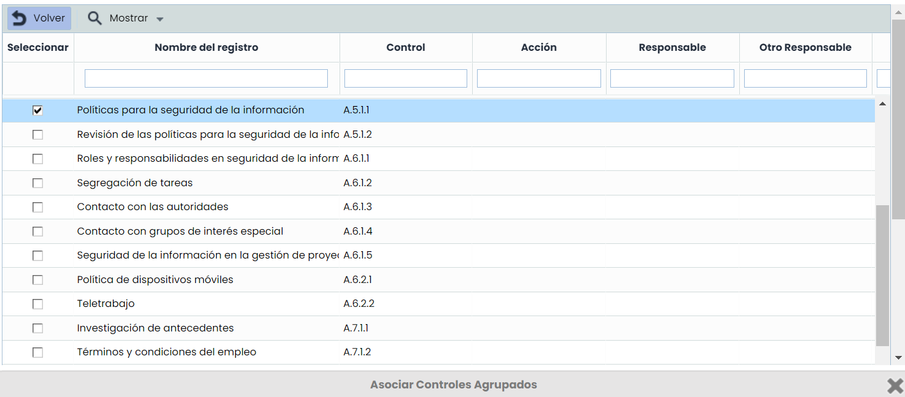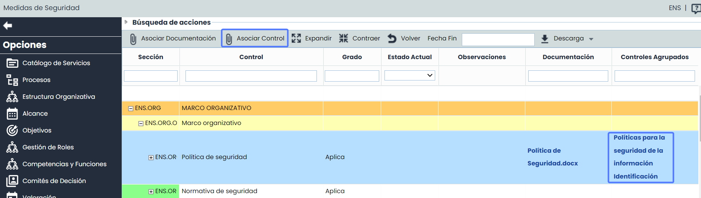

* Expandir: Permite desplegar el listado de las acciones.
* Contraer: Permite contraer el listado de acciones.
* Volver: Al pulsar el botón permite volver a la vista del Listado de Planes de Adecuación.
* Fecha Fin: Campo para indicar fecha de revisión de las Medidas de Seguridad.
* Descarga

  * Informe Docx: Se generará un informe con toda la información de la evaluación. El informe estará disponible en [Descargas Pendientes](https://help.globalsuitesolutions.com/es/globalsuite/v1/descargas-pendientes).

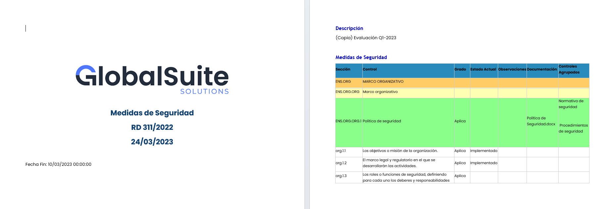

* Filtros:

  * Además de poder filtrar por Medidas de Seguridad, es posible realizar filtros por acciones de forma independiente en el apartado Búsqueda de acciones.

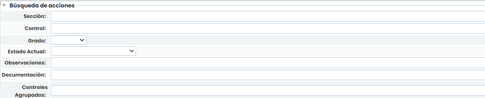

* Visibilidad de columnas:  Es posible realizar un ajuste de visibilidad de columnas pudiendo añadir u ocultar las que se deseen, haciendo click derecho en la cabecera de la tabla.
