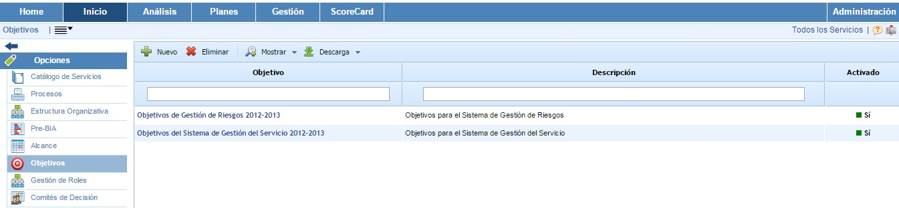
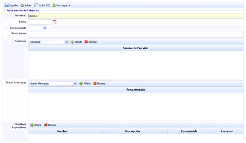
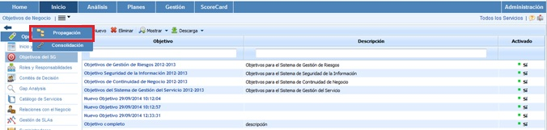
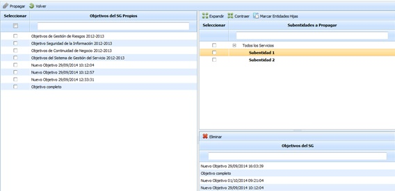
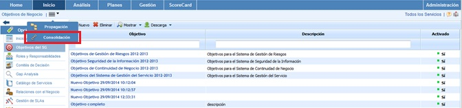
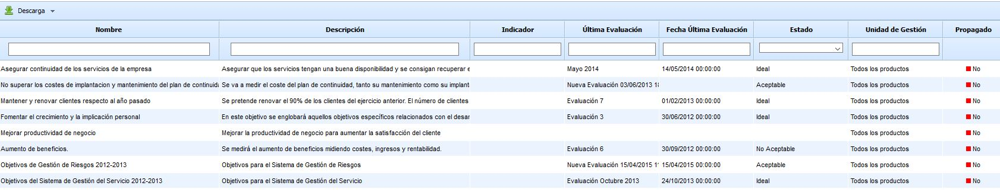

# Objetivos

La opción 'Objetivos' permite establecer los objetivos que guíen el sistema de gestión durante cada ciclo, además de poder medirlos, evaluarlos y gestionarlos para asegurar su cumplimiento y corregir desviaciones.

En la tabla inicial se pueden establecer distintos objetivos. La herramienta permite crear objetivos específicos para un único sistema de gestión o crear objetivos conjuntos a todos los sistemas, adaptándose al modelado que se desee realizar del proyecto.

Para crear un nuevo objetivo se debe seleccionar el botón de ‘Nuevo’ y a continuación aparecerá el en la tabla. Para eliminar un objetivo creado se deberá seleccionar la fila o filas que se desean eliminar y a continuación pinchar sobre el botón ‘Eliminar’. El botón ‘Descarga’ permite descargar el listado de objetivos en formato editable.

Para visualizar los detalles de un objetivo se debe seleccionar el objetivo que se desee pinchando directamente en el nombre del mismo.

El formulario permite realizar las siguientes acciones sobre el mismo:

* **Guardar:** Permite guardar todos los cambios o modificaciones realizadas en el formulario.
* **Volver:** La herramienta regresa a la pantalla anterior, donde figura el listado con todos los objetivos establecidos.
* **Incluir BSC:** Permite incluir el objetivo en el listado de Objetivos de Negocio del apartado ‘Scorecard’.
* **Descarga:** permite descargar el formulario del objetivo en formato editable (.xlsx) o en formato .PDF

Una vez en la ficha del objetivo, se pueden definir una serie de parámetros específicos del mismo, para ello se habilitan una serie de campos tales como:

* **Nombre:** Nombre descriptivo del objetivo que aparecerá en la tabla inicial de Objetivos.
* **Fecha:** Identifica la fecha del objetivo.
* **Responsable:** Este campo posibilita elegir que recurso será el responsable de la consecución del objetivo. El desplegable de responsables se configura en el apartado ‘Gestión/Empleados’.
* **Descripción:** Permite una descripción más detallada del objetivo.
* **Servicios:** Posibilita asociar el objetivos a uno o varios servicios de la organización. Para asociar un servicio se ha de seleccionar en el desplegable el deseado y pulsar el botón ‘Añadir’. En caso de querer eliminar un servicio debe seleccionar el servicio de la tabla y pulsar el botón ‘Eliminar’.
* **Áreas afectadas:** Permite identificar aquellas áreas de la empresa que se van a ver afectadas por la consecución del objetivo. Para asociar un área se ha de seleccionar en el desplegable el área deseada y pulsar el botón ‘Añadir’. En caso de querer eliminar un área debe seleccionar el área de la tabla y pulsar el botón ‘Eliminar’. El campo es configurable en el apartado ‘Home/Configuración’
* **Objetivos específicos:** La herramienta permite definir objetivos específicos para la consecución del objetivo general. Para añadir nuevos objetivos se debe pulsar sobre el botón ‘Nuevo’ y aparecerá una nueva línea de objetivos específicos. Para modificar cualquiera de estos objetivos debe seleccionar y pulsar sobre la línea que se desee modificar. Para eliminar se debe seleccionar la fila o filas que se deseen eliminar y pulsar sobre el botón ‘Eliminar’.

Este punto se desarrolla con más profundidad en el apartado ‘ScoreCard/Objetivos Específicos’

* **Documentos:** La opción posibilita subir cualquier archivo. Para ello se ha de seleccionar el botón ‘Examinar’ para acceder al explorador de archivos. Una vez seleccionado se debe pulsar el botón ‘Subir’. Cuando la subida se complete el archivo aparecerá en la tabla inferior.

## Propagación Objetivos

La presente opción permite la propagar los objetivos generados en la empresa matriz a las subentidades que dependen de esta.

Una vez se ha accedido a la opción, se muestran las siguientes tablas:

* **Tabla Objetivos:** Muestra el listado de objetivos que se han definido en la empresa matriz. Las opciones que permite la tabla son:

  * **Propagar:** Una vez seleccionados los servicios deseados permite propagar los mismo a las subentidades seleccionadas.
  * **Volver:** Ofrece la posibilidad de volver a la pantalla inicial de servicios.
* **Tabla Subentidades:** Muestra el listado de subentidades a las que se pueden asociar servicios de la empresa matriz. Las opciones que permite la tabla son la de expandir o contraer el listado de subentidades, además de poder marcar todas las subentidades pulsando sobre el botón 'Marcar Entidades Hijas'
* **Tabla Objetivos SG:** Una vez seleccionada la subentidad en la tabla superior, muestra los objetivos que se han asociado a la misma. La herramienta ofrece la posibilidad de elminiar un objetivo asociado, para ello se ha de seleccionar la fila deseada y pulsar sobre el botón 'Eliminar'

## Consolidación Objetivos

La presente opción permite visualizar de manera resumida los diferentes objetivos asociados a la entidad y subentidades.

A continuación se desarrolla la funcionalidad que aporta cada una de las tablas disponibles.

* **Tabla Servicios:** Permite al usuario filtrar los alcances asociados a los Servicios seleccionados.

* **Tabla Subentidades:** Ofrece la posibilidad de filtar los alcances definidos en las subentidades seleccionadas.

* **Tabla Etiqueta/Valor:** Permite visualizar los alcances que tengan asociados una etiqueta determinada.

* **Filtros específicos:** Ofrece la posibilidad de seleccionar si el objetivo esta activo, incativo o ambos, icluso relizar un filtra especifico por rango de fechas de evaluación.

Una vez se han establecido los filtros necesarios, hay que generar la consulta, para ello existen las siguientes opciones:

* **Consolidar:** Una vez se pulsa el botón y en función de los filtros establecidos, permite visualizar de manera resumida los objetivos en la tabla inferior.
* **Volver:** Ofrece la posibilidad de regresar al listado inicial de objetivos.

Los resultados se muestran en la tabla inferior 'Resultados de consolidación'

La información que aporta la tabla son las siguientes:

* **Nombre:** Informe sobre el nombre del objetivo.
* **Descripción:** Permite visualizar la descripción más especifica que se ha establecido por cada uno de los objetivos.
* **Indicador:** Informa al usuario el listado de indicadores asociados al objetivo.
* **Última evaluación:** Muestra la información de la última evaluación del objetivo.
* **Fecha última evaluación:** Permite visualizar la fecha de la última evaluación del objetivo.
* **Estado:** Informa al usuario del estado de la evaluación.
* **Unidad de gestión:** permite visualizar la entidad o subentidad a la que esta asociado.
* **Propagado:** Informa al usuario si el objetivo ha sido propagado a subentidades.
