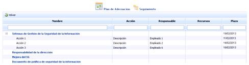
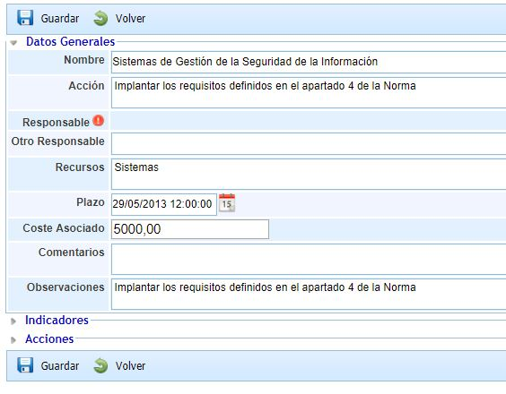
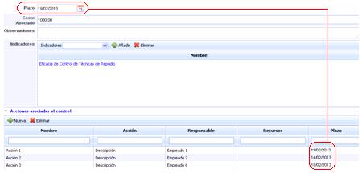
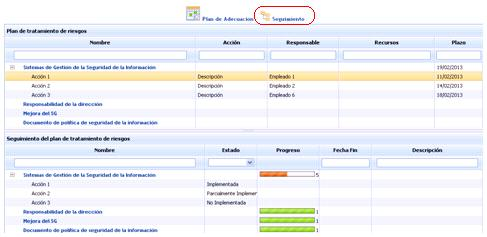

# Plan de Adecuación

El plan de adecuación está relacionado con la opción de ‘Gap Analysis’, permitiendo ajustar las desviaciones detectadas durante la fase de análisis de los requisitos normativos.

## Lista Planes de Adecuación

Al acceder a la opción, la herramienta muestra un listado de aquellos planes de adecuación que se han establecido.

Para definir un nuevo plan de adecuación se ha de seleccionar el catálogo evaluado en la opción ‘Gap Analysis’ en el desplegable y pulsar el botón ‘Nuevo’, lo que genera una nueva entrada en la tabla. Para eliminar un plan de adecuación se ha de seleccionar la fila o filas deseadas y pulsar el botón ‘Eliminar’.

Si pulsamos sobre el nombre del plan de adecuación accedemos a un listado con distintas acciones a realizar para corregir las desviaciones respecto al análisis inicial. El listado de tareas únicamente muestra aquellos hitos definidos ‘Sin Implementar’ o ‘Parcialmente Implementado’ en el apartado ‘Gap Analysis’.

Al pulsar cada una de las tareas, se muestra la siguiente ficha donde podemos establecer los siguientes parámetros:

* **Nombre:** Identifica el nombre de la tarea de adecuación

* **Acción:** Posibilita realizar una descripción más amplia de la tarea a realizar.

* **Responsable:** Identifica el responsable dentro de la organización de verificar la realización de la tarea de adecuación o de sus acciones. Este responsable se puede seleccionar del conjunto de Empleados (ver apartado en pestaña Gestión).

* **Otro Responsable:** Identifica el responsable dentro de la organización de verificar la realización de la tarea de adecuación o de sus acciones, pudiendo definirlo de manera textual.

* **Recursos:** Permite identificar los recursos que van a estar implicados en la consecución de la tarea.

* **Plazo:** Identifica el plazo máximo en el cual la tarea debe estar finalizada.

* **Coste asociado:** Permite definir si la implantación de la tarea lleva algún coste económico asociado.

* **Comentarios:** Posibilita incorporar cualquier comentario adicional a la tarea.

* **Observaciones:** Posibilita incorporar cualquier observación adicional a la tarea.

* **Indicadores:** El campo indicador muestra aquellos indicadores que se han asociado para realizar una mejor evaluación de la tarea. Para asociar indicadores se ha de acceder al desplegable, seleccionar el indicador deseado y pulsar el botón ‘Añadir’.

Para eliminar un indicador asociado, se ha de seleccionar la fila o filas deseadas y pulsar el botón ‘Eliminar’.

**NOTA:** La gestión de los indicadores se desarrolla en el apartado ‘ScoreCard/Indicadores’

* **Acciones:** Permite establecer acciones intermedias que permiten implantar la tarea definida. Para incorporar una acción se ha de pulsar el botón ‘Nuevo’ lo que genera una nueva entrada en la tabla. Para eliminar una acción asociada, se ha de seleccionar la fila o filas deseadas y pulsar el botón ‘Eliminar’.

Cada una de las acciones permite completar campos como Nombre, Acción, Responsable, Otro Responsable, Plazo (que no debe exceder del tiempo fijado para la consecución total de la tarea), Fecha Fin, Estado, Recursos o Descripción.

## Seguimiento

La opción de seguimiento del plan de actuación permite al usuario llevar un control del avance en la implantación de las tareas definidas en la opción anterior de ‘Planes de Adecuación’.

Al acceder a seguimiento se muestra la siguiente tabla:

* **Plan de tratamiento de riesgos:**Por un lado, se muestran de manera informativa aquellos parámetros que se han definido en el apartado de Plan de Adecuación, como el listado de tareas, los responsables, plazo de finalización, etc. Cuando se amplía uno de estos elementos, puede establecerse el grado de implantación de las tareas que se han definido. Para ello se ha de pulsar dos veces sobre la celda deseada en la columna estado y seleccionar el nivel de avance. La herramienta por defecto propone los niveles No Implementada, Parcialmente Implementada e Implementada, pero se pueden parametrizar en el apartado ‘Ajustes’. Según se vayan rellenando, se irá recalculando la columna "Progreso" automáticamente.
