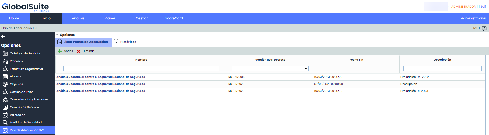
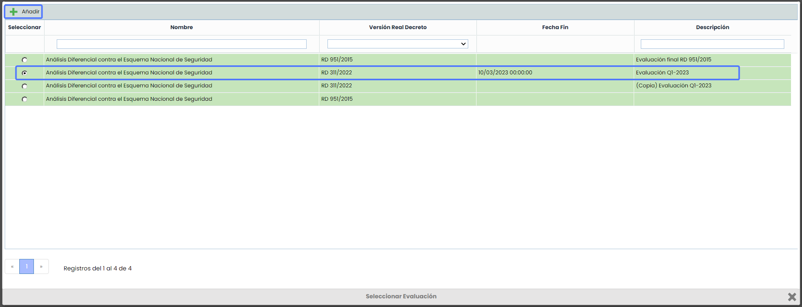
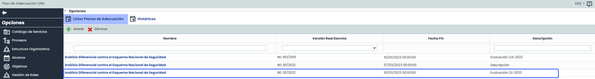

# Planes de Adecuación ENS

En este apartado de GlobalSuite® se encuentran las opciones y apartados correspondientes al Plan de adecuación  ENS

El Plan de Adecuación se crea a partir de las [Medidas de Seguridad](https://help.globalsuite.es/display/GlobalSUITEes/.Medidas+de+Seguridad+vv6.63) que han sido valoradas. Su objetivo principal es identificar los controles que no han sido implementados y ayudar en su seguimiento e implantación.

Esta opción detectará automáticamente los controles que no han sido implementados en el paso anterior y se incluirán en el Plan de Adecuación. Este plan incluirá todas las medidas de seguridad que aplican y que tienen algún control que no está implementado al 100%.

El Plan de Adecuación identifica cuáles de los controles no estamos cumpliendo y deberíamos cumplir, lo que nos permitirá tomar medidas para corregirlos. Además, podrás realizar un seguimiento detallado de cada uno de los controles y ver su progreso en tiempo real.

## Listar Planes de Adecuación

En esta vista podrás crear Planes de Adecuación de manera automática utilizando las evaluaciones de [Medidas de Seguridad](https://help.globalsuite.es/display/GlobalSUITEes/.Medidas+de+Seguridad+vv6.63) del Esquema Nacional de Seguridad (ENS) que no estén adecuadas y los controles que no se hayan implementado. para las versiones soportadas RD 951/2015 y RD 311/2022.

Al acceder a la opción, la herramienta mostrará un listado los Planes de Adecuación del ENS creados.

En la tabla se pueden realizar diferentes acciones, entre ellas:

* Añadir:  Se podrán generar nuevos Planes de Adecuación ENS. Al pulsar el botón se abrirá la siguiente ventana:

En esta ventana encontrarás un listado de todas las evaluaciones de [Medidas de Seguridad](https://help.globalsuite.es/display/GlobalSUITEes/.Medidas+de+Seguridad+vv6.63) que han sido valoradas.  Para crear un Plan de Adecuación para alguna de las evaluaciones de la lista, deberás seleccionarla y luego pulsar en "Añadir".

Una vez que hayas hecho clic en "Añadir", se creará automáticamente un nuevo Plan de Adecuación en función de la evaluación que has seleccionado. Se copiará la información de los campos Nombre, Versión, Fecha y  Descripción.

* Eliminar: Esta opción permite eliminar uno o mas Planes de Adecuación del listado.

* [Plan Adecuación ENS](plan-adecuacion-ens.md)
* [Históricos Plan de Adecuación](historicos-plan-de-adecuacion.md)
