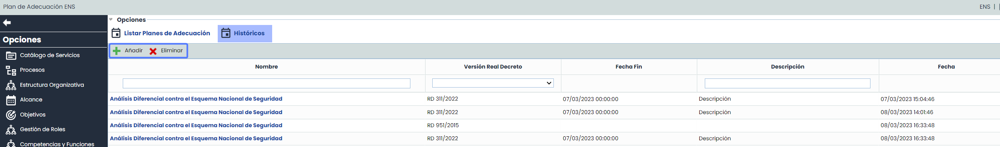
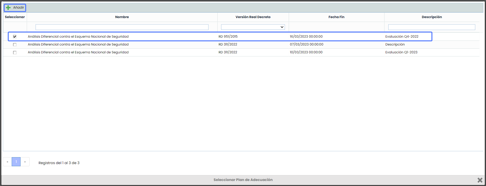
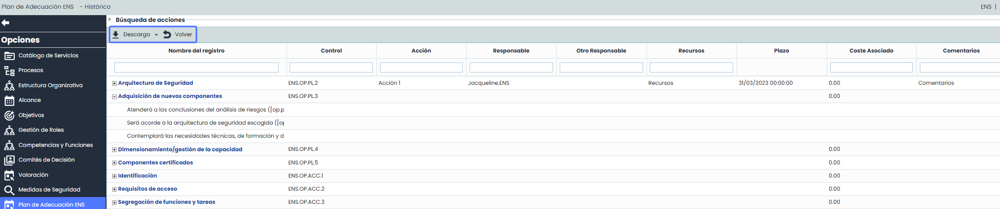
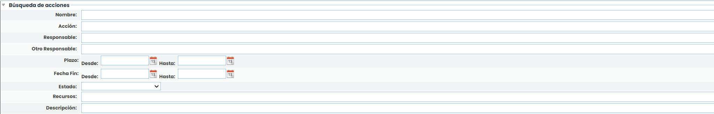
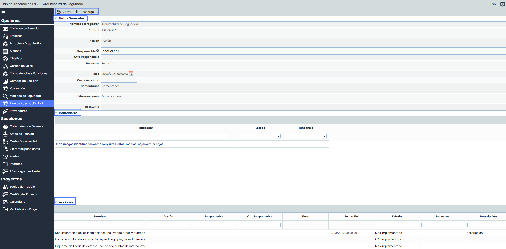

# Históricos Plan de Adecuación

En esta sección, se podrán realizar y almacenar históricos lo cual permitirá realizar comparativos y visualizar la evolución de los planes de adecuación del Esquema Nacional de Seguridad (ENS).

## Listado Históricos

La tabla  permite realizar las siguientes acciones:

* **Añadir:** Permite crear uno o varios históricos de Planes de Adecuación ENS. Para ello se ha de pulsar sobre el botón "Añadir", a continuación se abrirá una ventana con el listado de Planes de Adecuación disponibles, allí, podrás seleccionar uno o varios planes que deseas agregar al histórico.

Una vez que hayas seleccionado el plan/es de adecuación deseados, haz clic en el botón de "Añadir" para completar el proceso.

* **Eliminar:** Posibilita eliminar un histórico establecido. Para ello se ha de seleccionar la fila o filas deseadas y pulsar el botón "Eliminar".

Al acceder al histórico creado, la vista mostrará por defecto los mismos campos que el Plan de Adecuación, los cuales no serán editables y se mostrarán con los nombres, y el orden que tuviera la configuración (Ajustes> Metodologías > [Elementos](https://help.globalsuite.es/pages/viewpage.action?pageId=107020381)), al momento de efectuar el histórico.

* **Filtros:**  Además de poder filtrar por Medidas de Seguridad, es posible realizar filtros por acciones de forma independiente en el apartado Búsqueda de acciones.

* **Descarga**:

  * Informe CSV: Esta opción permite generar un Informe CSV Histórico de los controles y acciones a implementar para permitir una mejor revisión y análisis de los datos.  Además, en caso de tener filtros aplicados en la vista, se descargarán en el Informe los registros que coincidan con los mismos.

    **NOTA**: El informe estará disponible en la opción [Descargas Pendientes](https://help.globalsuite.es/display/GlobalSUITEes/.Descargas+Pendientes+vv6.53).
* Nombre del registro:

  * Este campo indica el nombre del control, y al desplegar cada control, se  mostrará el nombre correspondiente a las acciones.
  * El nombre de control es un enlace al formulario del mismo donde se podrán editar los campos de la vista.

 La Ficha del Control contiene los mismos apartados que la pestaña [Plan de Adecuación](https://help.globalsuite.es/pages/viewpage.action?pageId=107020475): Datos Generales, Indicadores y Acciones. Es importante tener en cuenta que, al tratarse de un Histórico, la información contenida en estos campos no podrá ser editada, y se almacenará en el momento en que sean creados.

**NOTA:** La información detallada de los campos de estos apartados ha sido desarrollada en la sección [Plan de Adecuación](https://help.globalsuite.es/pages/viewpage.action?pageId=107020475) del presente Manual.
