# Plan Adecuación ENS

Una vez que hayas creado el nuevo Plan, (desde la opción [Listar Planes de Adecuación](https://help.globalsuite.es/pages/viewpage.action?pageId=107020346)) podrás acceder al formulario correspondiente haciendo click en el enlace que se encuentra en el nombre del Plan.

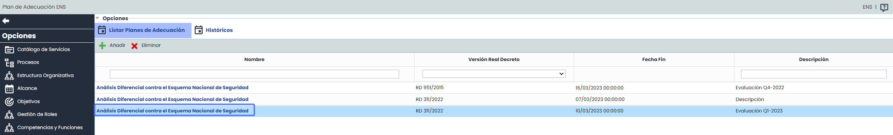

Al hacer click en el enlace, se abrirá una nueva ventana con el formulario correspondiente.

Esta vista mostrará  todas las medidas de seguridad que aplican, y debajo como acciones, los controles obligatorios y los de refuerzo que no estén implementados al 100%. 

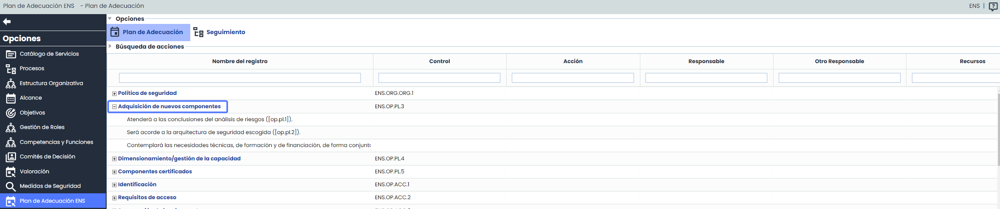

* Nombre del registro:

  * Este campo indica el nombre del control, y al desplegar cada control, se  mostrará el nombre correspondiente a las acciones.
  * El nombre de control es un enlace al formulario del mismo donde se podrán editar los campos de la vista.

**Datos Generales**

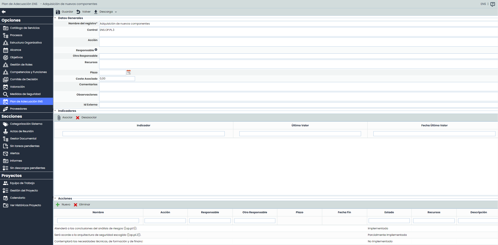

* Control: Identifica el grupo y sección del ENS al que pertenece el control o medida de seguridad.
* Acción: Descripción de la tarea a realizar para cumplimentar el control.
* Responsable: Permite asociar un responsable a cada acción. Este responsable se debe seleccionar del conjunto de aquellos usuarios registrados como "Empleados" en la opción Gestión > [Empleados](https://help.globalsuite.es/display/GlobalSUITEes/.Empleados+vv5.1)
* Otro Responsable: Permite definir el responsable de verificar la realización de la tarea de adecuación o de sus acciones, pudiendo definirlo de manera textual.
* Recursos: Permite identificar los recursos que van a estar implicados en la consecución de la tarea.
* Plazo: Permite definir el plazo máximo en el cual la tarea debe estar finalizada.
* Coste Asociado: Permite definir si la implantación de la tarea lleva algún coste económico asociado.
* Comentarios: Posibilita incorporar cualquier comentario adicional a la tarea.
* Observaciones: Permite incorporar cualquier observación adicional a la tarea.
* ID Externo

**NOTA:** El nombre, orden y visibilidad de las columnas se pueden configurar en Ajustes> Metodología de elementos> [Ficha de Control](https://help.globalsuite.es/pages/viewpage.action?pageId=107020381).  Se visualizarán los campos de la configuración de ficha de control con visibilidad "Todos", o "Ficha de Control".

**Indicadores**

 En caso de tener la licencia GlobalSuite® Balanced ScoreCard se podrán asociar  y desasociar indicadores al control. Al hacer click en "Asociar Indicador" se abrirá una ventana con el listado de indicadores existentes, los cuales se podrán asociar al control. 

Una vez asociado, al hacer click en el nombre del indicador,  direccionará al formulario del mismo para mas detalle.

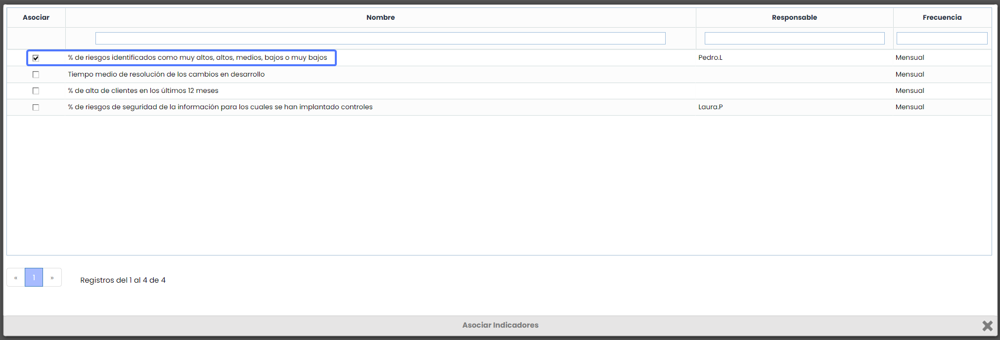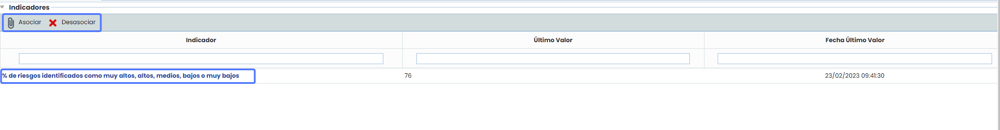

La visibilidad de los campos de la tabla se podrá modificar haciendo click derecho en cualquiera de los campos de la misma. Los campos "Responsable" y "Tendencia"  solo estarán disponibles con la licencia GlobalSuite® Balanced ScoreCard.

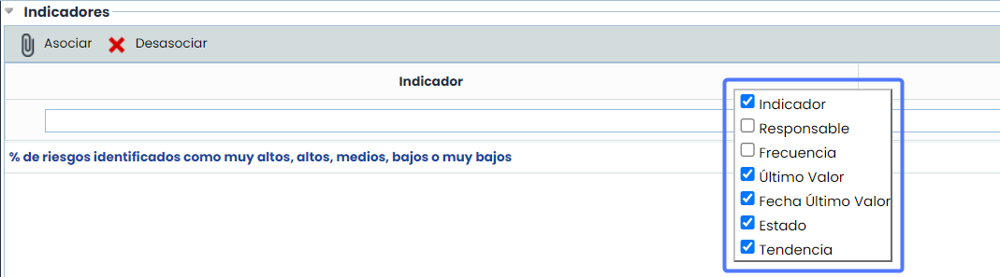

**NOTA:** La gestión de los indicadores se desarrolla en el apartado [ScoreCard](https://help.globalsuite.es/display/GlobalSUITEes/.ScoreCard+vv5.1).

**Acciones**

Se visualizarán todas las acciones que no estén totalmente implementadas y se podrán eliminar o añadir nuevas al Plan.

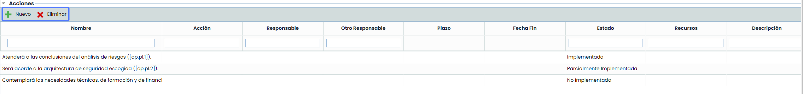

* Filtros:

  * Además de poder filtrar por Medidas de Seguridad, es posible realizar filtros por acciones de forma independiente en el apartado Búsqueda de acciones.

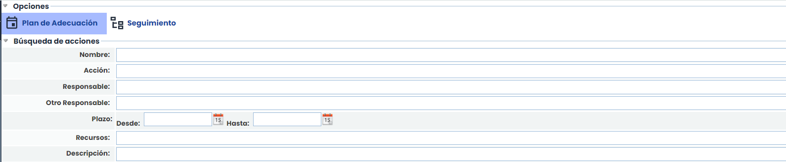

## Seguimiento del Plan

Esta vista, además de identificar cuáles de los controles no se están cumpliendo al 100% y deberían cumplirse de acuerdo a la normativa, nos permitirá realizar un seguimiento detallado de cada uno de los controles y ver su progreso en tiempo real.

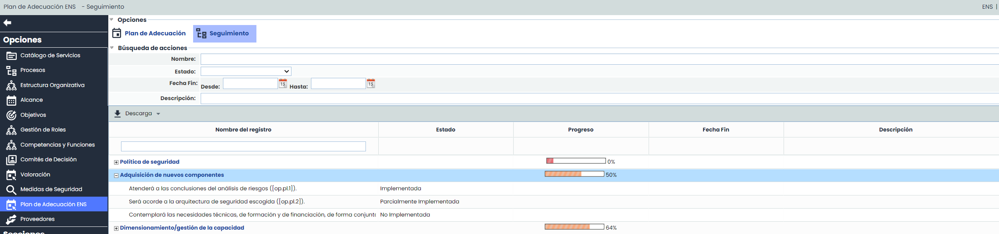

* Nombre del registro:

  * Este campo indica el nombre del control, y es un enlace al formulario del mismo.
  * Al desplegar cada control, se  mostrará el nombre correspondiente a las acciones.

* Estado: Campo selector editable con los posibles niveles de implantación de las acciones. Editable sólo a nivel de acciones.  Las opciones de este campo se podrán configurar en la opción Ajustes> Metodologías > [Elementos](https://help.globalsuite.es/pages/viewpage.action?pageId=107020381)

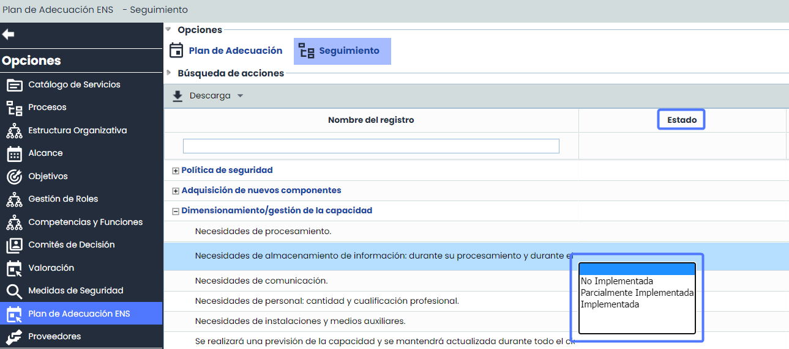

* Progreso: Es un campo automático que calcula el porcentaje del progreso de cada control a través de la media de los estados de sus acciones.

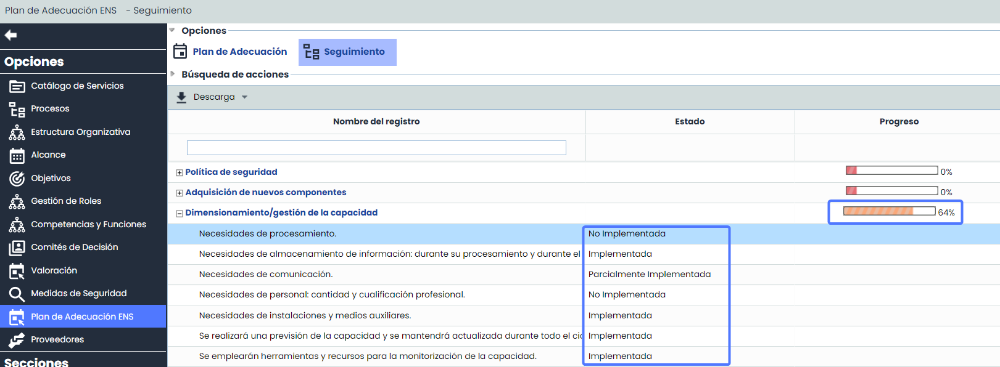

* Fecha Fin: Campo editable únicamente para las acciones, que indicará la fecha de revisión de los controles.

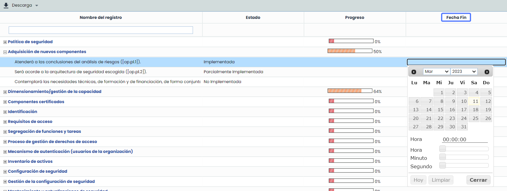

* Descripción: Campo de texto editable para las acciones.
* Descarga:

  * Informe CSV:  Esta opción permite generar un Informe CSV de los controles y acciones a implementar para permitir una mejor revisión y análisis de los datos.  Además, en caso de tener filtros aplicados en la vista, se descargarán en el Informe los registros que coincidan con los mismos.

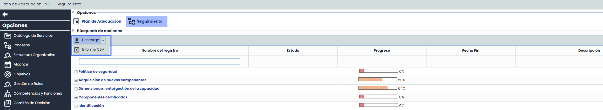

**NOTA**: El informe estará disponible en la opción [Descargas Pendientes](https://help.globalsuite.es/display/GlobalSUITEes/.Descargas+Pendientes+vv6.53).
