# Pre-BIA

El Análisis de Impacto sobre el negocio, conocido más comúnmente como BIA, (Business Impact Análisis) permite determinar inicialmente qué servicios son esenciales para la continuidad de las operaciones de la organización.

Nada más acceder a la opción de Pre-BIA se muestra un listado con los análisis de impacto registrados. Por defecto la herramienta muestra Pre-BIAs individuales, cuya operativa se desarrolla en el siguiente punto.   Las opciones de inicio que se pueden realizar son las siguientes:

* **Nuevo:** Permite crear un nuevo registro de Análisis de Impacto de Negocio (BIA). Para ello se ha de seleccionar en el desplegable el servicio que se desea analizar y pulsar el botón ‘Nuevo’. Los servicios se definen ‘Inicio/Catálogo de Servicios’

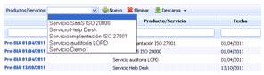

* **Eliminar:** Permite eliminar un Pre-BIA ya registrado. Para ello se ha de seleccionar la fila o filas deseadas y pulsar el botón ‘Eliminar’.
* **Descarga:** Permite descargar el listado de Pre-BIAs en un formato editable (.xlsx) o en formato .pdf.

## Pre-BIAS individuales

### Tabla de Impactos

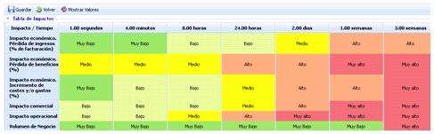

Permite evaluar sobre un servicio determinado como le afectan diferentes impactos en una escala temporal. Para ello se ha de pulsar la celda deseada y seleccionar un valor determinado que va desde Muy Bajo a Muy Alto.

Los impactos y la escala temporal se han de configurar previamente en el apartado ‘Home/Configuración’.

### Gráfica

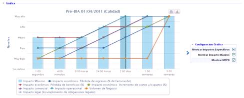

Permite visualizar de manera gráfica los valores introducidos en la tabla de impactos. Las opciones de visualización son las siguientes:

* **Mostrar impactos específicos:** Posibilita visualizar de manera global cada una de las valoraciones de impacto realizadas en el apartado anterior.
* **Mostrar Impacto máximo:** Permite visualizar por cada escala temporal el nivel de impacto máximo.
* **Mostrar MTPD:** Permite visualizar el tiempo máximo tolerable de interrupción (Maximum Tolerable Period of Disruption). El cálculo del MTPD se desarrolla en el siguiente apartado.

Si el usuario desea ver el gráfico concreto de un impacto, puede seleccionar su visualización en el cuadro situado debajo del gráfico.

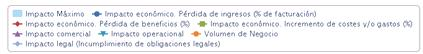

### Cálculo del MTPD

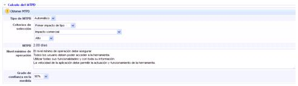

Las opciones que permite el apartado para calcular y definir el MTPD son las siguientes:

* **Tipo de MTPD:** Permite establecer si el cálculo del MTPD se hace manual o automático.
* **Criterios de selección:** En función del ‘Tipo de MTPD’ seleccionado permite calcular el MTPD.

  * *Manual:* El usuario encargado de la gestión fija el valor numérico y temporal de tiempo máximo de interrupción.
  * *Automático:* La plataforma calcula automáticamente el MTPD en función de los siguientes criterios:

    * Primer Impacto: Establece el MTPD cuando primer nivel de impacto encontrado coincide con la escala definida por el usuario (Muy Alto-Muy Bajo).
    * Primera Media de Impacto: Establece el MTPD cuando la media de los impactos coincide con la escala definida por el usuario (Muy Alto-Muy Bajo).
    * Primer impacto de tipo: Establece el MTPD cuando primer nivel de un impacto concreto coincide con la escala definida por el usuario (Muy Alto-Muy Bajo).

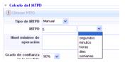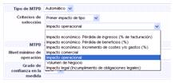

Una vez se han definido todos los criterios, se ha de pulsar el botón ‘Obtener MTPD’ y la herramienta calcula el valor automáticamente.

* **MTPD:** Muestra el tiempo máximo tolerable de interrupción de servicio evaluado.
* **Nivel mínimo de operación:** Permite identificar los procesos y recursos mínimos necesarios para prestar el servicio.
* **Grado de confianza en la medida:** Posibilita indicar el grado de confianza del usuario con respecto al MTPD obtenido.

### Reanudación de los niveles normales de operación

* **Plazo de reanudación:** Permite establecer el tiempo máximo en el cual la organización debe volver a la normalidad.
* **Justificación:** Permite realizar cualquier anotación que justifique el tiempo definido en el punto anterior.

### Datos del Pre-BIA

* **Nombre:** Se refiere a un nombre descriptivo del Pre-BIA que se mostrará en la tabla de inicio.
* **Fecha:** Posibilita establecer la fecha de realización del Pre-BIA.
* **Responsable:** Permite identificar el responsable de realización del Pre-BIA.
* **Departamento:** Identifica el/los departamentos implicados en la realización y evaluación del Pre-BIA.
* **Conclusiones:** Permite identificar las conclusiones relativas a los resultados obtenidos en el análisis de impacto pulsando el botón ‘Añadir’. En caso de querer eliminar una conclusión se ha de seleccionar la fila o filas deseadas y pulsar el botón ‘Eliminar’.

## Pre-BIAs Consolidados

La opción de Pre-BIAS consolidados, permite fusionar los pre-BIA’s individuales realizados sobre un mismo servicio, para que el usuario pueda tener una visión global del análisis de impacto sobre un único servicio.

Nada más acceder a la opción la herramienta muestra un listado con los servicios definidos en el alcance, el número de Pre-BIAs individuales realizados sobre ese servicio y el MTPD consolidado.

**NOTA:** El valor de MTPD consolidado solo se muestra una vez se han fusionado los Pre-BIAs individuales.

Para consolidar Pre-BIAs individuales sobre un mismo servicio se ha de pulsar sobre el nombre del servicio, donde se accede a la siguiente pantalla:

Las opciones permitidas son las siguientes:

* **Guardar:** Una vez seleccionado el tipo de Consolidación (Manual o Automático) permite guardar la selección realizada.
* **Volver:** Permite volver al listado de Pre-BIAs consolidados.
* **Mostrar Valores:** Muestra los valores por los cuales se calcula el nivel de impacto. Estos valores han sido definidos en el apartado de ‘Home/Configuración’
* **Por Departamento:** Permite visualizar de manera gráfica las valoraciones realizadas sobre un mismo servicio por diferentes departamentos de la organización. A la hora de visualizar se puede optar entre ventana emergente o mostrar los gráficos en una pestaña individual del navegador.

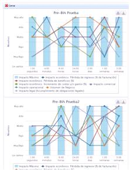

**Por Tipo de Impacto**: Permite visualizar de manera gráfica las valoraciones realizadas sobre uno o varios impactos por diferentes departamentos de la organización. A la hora de visualizar se puede optar entre ventana emergente o mostrar los gráficos en una pestaña individual del navegador.

Para consolidar Pre-BIAs la herramienta nos permite optar entre las siguientes opciones:

* **Manual:** Ofrece la posibilidad al usuario de establecer los valores de impacto de manera manual basándose en los Pre-BIAs individuales realizados por los distintos departamentos. Para ello puede apoyarse en los botones ‘Por Departamento’ y ‘Por Tipo de Impacto’ donde se muestran los valores definidos en los Pre-BIAs individuales de manera gráfica.
* **Automático:** Permite consolidar los Pre-BIAs individuales de manera automática, pudiendo optar entre dos tipos de cálculo:

* *Igual para todos los tipos de impacto*

Realiza una consolidación automática de los Pre-BIAs individuales que se deseen. Para ello se ha de pulsar sobre el desplegable, seleccionar el Pre-BIA individual requerido y pulsar el botón ‘Añadir’. En caso de querer eliminar un Pre-BIA del listado se ha de pulsar el botón ‘Eliminar’.

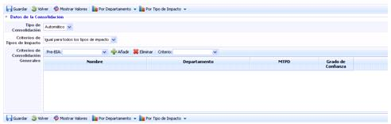

Una vez seleccionados los Pre-BIAs individuales se ha de definir el criterio de consolidación deseado, que puede ser:

* **Media:** Realiza una media entre los valores definidos.
* **Media Ponderada:** Permite realizar una media ponderada de los valores estableciendo los pesos de importancia sobre los Pre-BIAs Individuales.

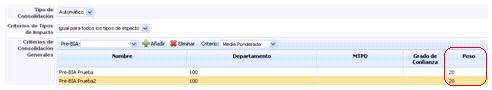

* **Máximo:** Consolida los valores definidos en los Pre-BIAs individuales seleccionando el valor máximo de los valores a consolidar.

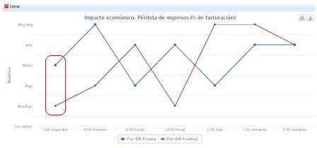

Según el gráfico de impacto económico, la consolidación sobre el valor máximo en 1.00 segundos mostraría el nivel Medio.

* **Mínimo:** Consolida los valores definidos en los Pre-BIAs individuales seleccionando el valor mínimo de los valores a consolidar.

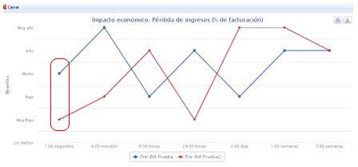

Según el gráfico de impacto económico, la consolidación sobre el valor mínimo en 1.00 segundos mostraría el nivel Muy Bajo.

Una vez se definen los valores de consolidación, se ha de gestionar y definir el Pre-BIA consolidado como se ha desarrollado en el apartado de Pre-BIAs individuales, obteniendo el MTPD, definiendo los niveles mínimos de operación, etc.

* *Distinto para cada tipo de impacto*

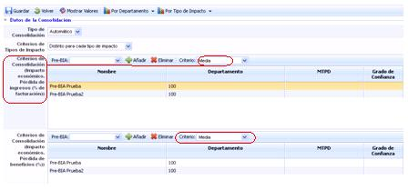

Permite definir criterios de consolidación particulares para cada impacto evaluado. Estos criterios se han desarrollado en el punto anterior.

Una vez se definen los criterios de consolidación, se ha de gestionar y definir el Pre-BIA consolidado como se ha desarrollado en el apartado de Pre-BIAs individuales, obteniendo el MTPD, definiendo los niveles mínimos de operación, etc.
