# Procesos

Al acceder a la opción 'Procesos' se muestra una tabla inicial que contiene los distintos procesos de negocio que sustentan los servicios incluidos en el alcance. La herramienta permite crear diferentes procesos y asociarlos a los servicios a los que presta apoyo.

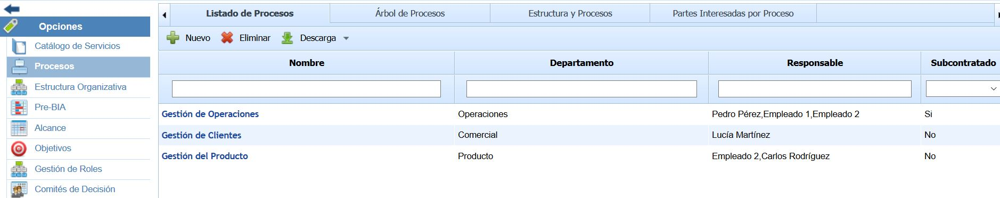

## Listado de Procesos

Para crear un nuevo proceso se debe seleccionar el botón ‘Nuevo’ y a continuación aparecerá un nuevo registro en la tabla. Para eliminar un proceso creado se deberá seleccionar la fila o filas que se desean eliminar y a continuación pulsar sobre el botón ‘Eliminar’. El botón ‘Descarga’ permite descargar el listado de procesos en formato editable (.xlsx) o en formato PDF.

Para visualizar los detalles de un proceso se debe acceder pulsando directamente sobre el nombre del mismo.

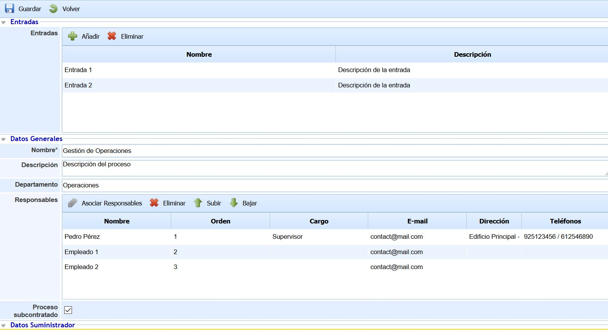

Una vez dentro de un proceso se muestra un formulario estructurado en las secciones: Entradas, Datos Generales, Estructura Organizativa, Partes Interesadas, Acciones, Salidas. A continuación se detalla la información que se puede registrar en cada una de las secciones.

**Entradas**

Esta sección está compuesta por una tabla con el listado de entradas del proceso de negocio. Cada entrada del proceso se crea pulsando el botón ‘Añadir’, permitiéndose editar el nombre y la descripción de la entrada haciendo doble click sobre el campo correspondiente. En caso de querer eliminar una entrada se debe seleccionar la fila o filas deseadas y pulsar el botón ‘Eliminar’.

**Datos Generales**

* **Nombre:** Permite definir el nombre del proceso. Este nombre se mostrará en el listado de procesos, así como en el resto de la herramienta cuando se haga uso del proceso.

* **Descripción:** Permite describir de manera detallada la función o tareas asociadas del proceso.

* **Departamento:** Permite identificar el departamento que está relacionado con el proceso.

* **Responsables:** Tabla que contiene los responsables asociados al proceso. Para cada responsable del proceso se muestra su nombre, orden de responsabilidad, cargo, e-mail, dirección y teléfonos asociados, cuyos datos se obtienen de la herramienta ya que los responsables deben estar registrados como empleados en la herramienta. Las opciones disponibles son las siguientes:

  * **Asociar Responsables:** Este botón permite asociar los responsables al proceso, los cuales deben estar registrados en la opción 'Empleados' del menú ‘Gestión’. Al pulsar el botón aparece una ventana emergente que muestra los empleados registrados en la herramienta, permitiéndose seleccionar uno o varios a través del check situado a la izquierda. El botón 'Mostrar' permite visualizar todos los empleados o sólo los empleados que están con un estado de 'Alta'. Una vez seleccionados los empleados deseados, se debe pulsar sobre el botón 'Asociar Empleados'.

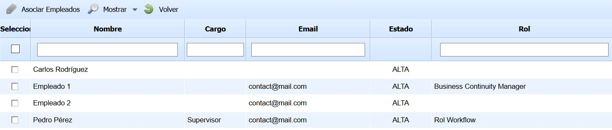

* **Eliminar:** Este botón permite eliminar uno o varios empleados de la tabla. Para ello, se debe seleccionar las filas correspondientes y pulsar sobre el botón 'Eliminar'.
* **Subir:** Este botón permite establecer un orden superior para el empleado seleccionado, ordenándolo dentro de la tabla.
* **Bajar:** Este botón permite establecer un orden inferior para el empleado seleccionado, ordenándolo dentro de la tabla.

* **Proceso subcontratado:** Permite indicar si el proceso está subcontratado a un proveedor. En caso afirmativo, se debe marcar el check y la herramienta muestra un nuevo formulario que identifica el suministrador implicado en el proceso. Para ello se debe seleccionar el suministrador del desplegable que aparece y automáticamente se cargan los datos registrados.

**NOTA:** El listado de suministradores se gestiona en la opción 'Proveedores’ ubicada en el menú 'Inicio'.

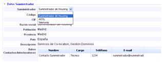

**Estructura Organizativa**

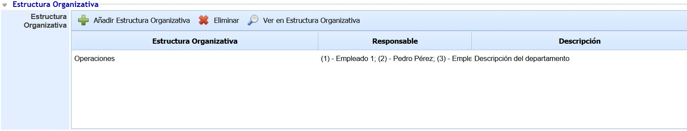

La opción permite al usuario asociar una unidad organizativa al proceso. Las opciones que permite la herramienta son las siguientes:

* **Añadir Estructura Organizativa:** Permite definir la unidad asociada a la gestión del proceso. Para ello se debe pulsar sobre el botón y seleccionar la unidad correspondiente en la ventana que aparece.

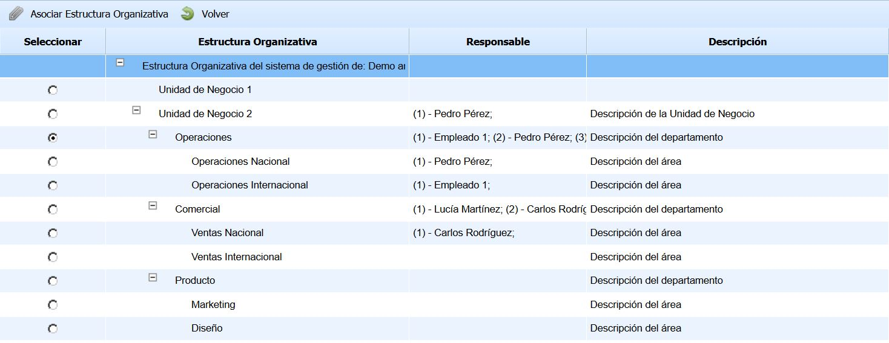

La información que se muestra en la imagen corresponde a la Estructura Organizativa definida en la opción 'Estructura Organizativa' del menú 'Inicio'.

* **Eliminar:** Permite desasociar una unidad organizativa al proceso. Para ello se debe seleccionar la fila deseada y pulsar sobre el botón 'Eliminar'.

* **Ver en Estructura Organizativa:** Permite visualizar la unidad asociada al proceso y su ubicación dentro de la Estructura Organizativa de la organización..

**Partes Interesadas**

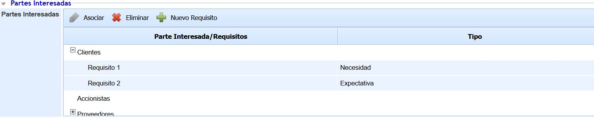

Esta sección permite establecer las partes interesadas del proceso, junto a sus requisitos y el tipo de cada requisito. Las opciones que se permiten realizar son las siguientes:

* **Asociar:** Al pulsar este botón se muestra una ventana que contiene las partes interesadas configuradas en 'Ajustes/General'. Cada parte interesada tiene un check situado en la parte izquierda para seleccionar aquellas que se deseen incorporar al proceso.
* **Eliminar:** Este botón permite eliminar una parte interesada o un requisito registrado en la tabla. Para ello, se debe seleccionar la fila deseada y pulsar sobre el botón 'Eliminar'.
* **Nuevo Requisito:** Este botón permite crear un nuevo requisito a una parte interesada previamente seleccionada. Para cada nuevo requisito se permite editar su nombre y establecer el tipo de requisito (Necesidad o Expectativa), haciendo doble click sobre la columna correspondiente.

**Acciones**

Esta tabla permite registrar las acciones que están implicadas en el desarrollo del proceso. Para crear una nueva acción se debe pulsar el botón ‘Añadir’, permitiéndose editar el nombre y la descripción de la acción haciendo doble click sobre el campo correspondiente. Para eliminar una acción creada se deberá seleccionar la fila o filas que se desean eliminar y a continuación pulsar sobre el botón ‘Eliminar’.

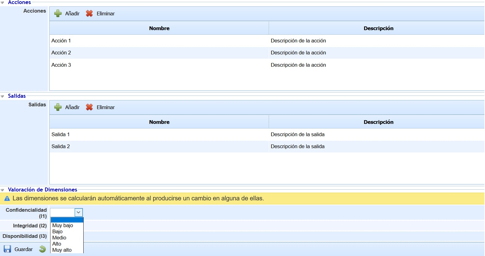

**Salidas**

Esta sección está compuesta por una tabla con el listado de salidas del proceso de negocio. Cada salida del proceso se crea pulsando el botón ‘Añadir’, permitiéndose editar el nombre y la descripción de la salida haciendo doble click sobre el campo correspondiente. En caso de querer eliminar una salida se debe seleccionar la fila o filas deseadas y pulsar el botón ‘Eliminar’.

**Valoración de Dimensiones**

Esta sección del formulario permite realizar la valoración del proceso en las dimensiones configuradas para el inventario de activos.

Las dimensiones que aparecen son configurables en 'Ajustes - Metodologías Análisis - Configuración General'. Se puede indicar qué dimensiones son visibles y cuales no. En caso de que no haya ninguna dimensión visible, esta sección no se muestra en el formulario del proceso.

## Árbol de Procesos

Esta pestaña permite establecer el árbol de servicios y procesos, asociando los diferentes procesos de negocio a los servicios implicados en la gestión del sistema, así como establecer una jerarquía entre procesos (proceso primario, proceso secundario, etc.).

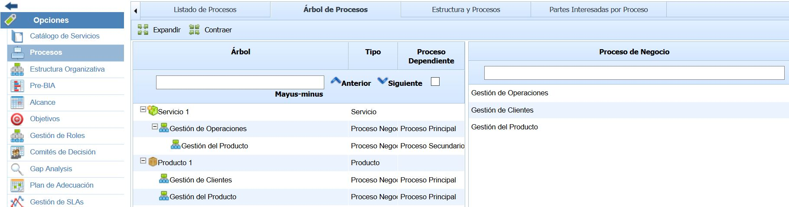

El árbol de procesos se realiza moviendo los procesos ubicados en la parte derecha a la parte izquierda de la pantalla, dónde se encuentra el árbol. Para ello, se debe seleccionar el proceso deseado, y sin soltar el proceso, moverlo a la izquierda soltando en el servicio o proceso sobre el que se quiere realizar la asociación. Para eliminar una asociación entre servicio/proceso o proceso/proceso, se debe seleccionar el proceso que se quiere eliminar del árbol de procesos y moverlo a la tabla de la derecha. El mismo se mostrará  ordenado alfabéticamente  para los ítems del mismo nivel.

Los botones "Expandir" y "Contraer" permiten mostrar u ocultar el árbol de procesos de manera completa, respectivamente.

**NOTA:** Los servicios se definen en el apartado ‘Inicio/Catálogo de Servicios’.

## Estructura y Procesos

Esta pestaña permite visualizar la Unidad Organizativa responsable de cada servicio y proceso de la organización. A partir del árbol de procesos definido en la pestaña anterior, se muestran en diferentes columnas los niveles de la estructura organizativa y se indica a cual pertenece cada servicio y proceso.

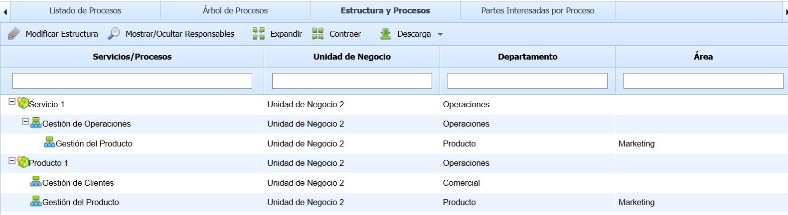

Las opciones que se permite realizar sobre la tabla son las siguientes:

* **Modificar Estructura:** Este botón permite establecer o modificar la unidad organizativa responsable de un servicio o proceso. Al pulsar el botón aparece una ventana emergente que muestra la Estructura Organizativa de la organización, permitiendo seleccionar la unidad organizativa que corresponda al servicio o proceso.

* **Mostrar/Ocultar Responsables:** Este botón permite visualizar los responsables de cada unidad organizativa en la tabla. En función de las necesidades del usuario, se podrá visualizar para cada servicio/proceso en qué unidad organizativa se encuentran y los responsables de dicha unidad si se pulsa sobre este botón.

* **Expandir/Contraer:** Los botones "Expandir" y "Contraer" permiten mostrar u ocultar el árbol de procesos de manera completa, respectivamente.

* **Descarga:** El botón ‘Descarga’ permite descargar el listado de procesos en formato editable (.xlsx) o en formato PDF.

## Partes Interesadas por Proceso

Esta pestaña permite visualizar las partes interesadas de cada proceso de negocio, incluyendo los requisitos que tiene cada parte interesada. Adicionalmente, se indica el tipo de requisito así como la unidad organizativa de cada proceso.

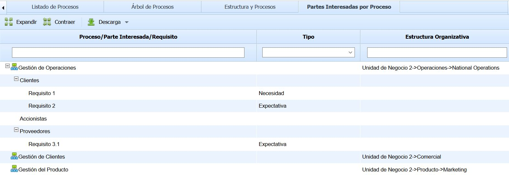

Los botones "Expandir" y "Contraer" permiten mostrar u ocultar el árbol de procesos de manera completa, respectivamente.

El botón ‘Descarga’ permite descargar el listado de procesos, partes interesadas y requisitos en formato editable (.xlsx) o en formato PDF.

## Propagación de Procesos

La presente opción permite el propagar los procesos definidos en la empresa matriz a las subentidades que dependen de esta.

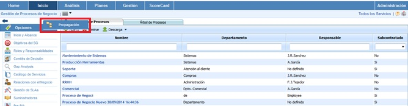

Una vez se ha accedido a la opción, se muestran las siguientes tablas:

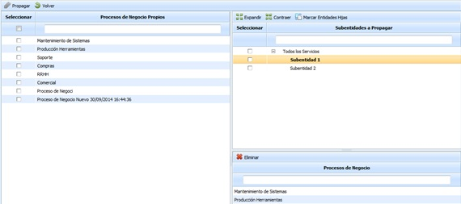

**Tabla izquierda:** Muestra el listado de procesos que se han definido en la empresa matriz. Las opciones que permite la tabla son:

* **Propagar:** Una vez seleccionados los procesos deseados permite propagar los mismos a las subentidades seleccionadas.
* **Volver:** Ofrece la posibilidad de volver a la pantalla inicial de procesos de negocio.

**Tabla superior derecha:** Muestra el listado de subentidades a las que se pueden asociar procesos de la empresa matriz. Las opciones que permite la tabla son la de expandir o contraer el listado de subentidades.

**Tabla inferior derecha:** Una vez seleccionada la subentidad en la tabla superior, muestra los procesos que se han asociado a la misma. La herramienta ofrece la posibilidad de elminiar un proceso asociado, para ello se ha de seleccionar la fila deseada y pulsar sobre el botón 'Eliminar'
