# Proveedores


Para configurar los campos, tanto en la tabla principal como en el formulario principal, diríjase a \*\*Ajustes>\*\* [\*\*Proveedores\*\*](https://help.globalsuitesolutions.com/es/globalsuite/v1/configuracion-de-proveedores).
Para ajustar las dimensiones visibles acceda a \*\*Ajustes>\*\* [\*\*Metodología de Elementos\*\*](https://help.globalsuitesolutions.com/es/globalsuite/v1/metodologia-elementos#Metodolog%C3%ADaElementos-Configuraci%C3%B3nVisibilidadDimensiones)


### **Tabla Principal**

La opción de ‘Proveedores’ permite al usuario de la plataforma tener una base de datos con todos aquellos proveedores necesarios para la prestación de los servicios implicados dentro del alcance.

En la pantalla inicial se puede ver el listado con los proveedores almacenados. Las opciones que permite la herramienta son las siguientes:

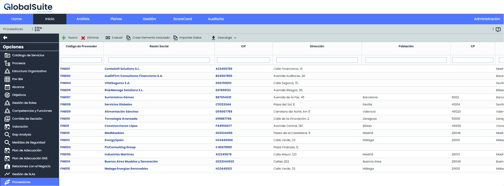

* **Nuevo:** Permite crear un nuevo proveedor.
* **Eliminar:** Permite eliminar un proveedor existente. Para ello se selecciona la línea del deseada y se pulsa el botón ‘Eliminar’.
* **Evaluar**: Permite realizar una evaluación del proveedor.
* **Crear Elemento Asociado:**Esta opción permite crear un elemento asociado a los proveedores.

### **Formulario**

Al hacer clic en la opción, aparecerá una ventana emergente en la que se podrán seleccionar uno o varios proveedores para crearles un elemento asociado.

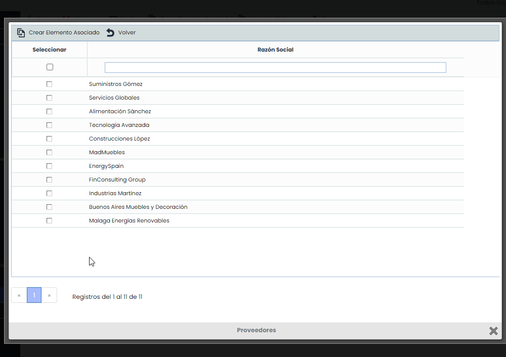

* **Importar Datos:** El software posibilita importar bases de datos de proveedores en formato CSV. Los datos necesarios son Código, CIF, Razón Social, Población, Provincia, País, Comentario. Estos datos son los mismos que se especifican en el formulario. Una vez preparado el archivo se debe seleccionar a través de la opción ‘Examinar’ e indicar la forma de separación.
* **Descarga:** Posibilita la descarga del listado de proveedores en formato editable (.xlsx) o en formato pdf.

Una vez se ha accedido a la ficha del proveedor, la herramienta permite realizar las siguientes acciones:

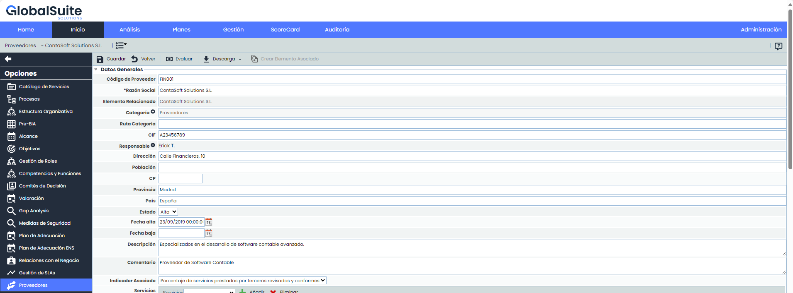

* **Guardar:** Permite guardar los cambios realizados en el formulario.
* **Volver:** La herramienta regresa a la pantalla anterior con el listado de proveedores.
* **Evaluar:** Permite realizar una evaluación del proveedor. Una vez se ha accedido al formulario se pueden definir los siguientes parámetros:

  * *Incidencias, Problemas y No Conformidades:* Este apartado permite visualizar las Incidencias, Problemas y No Conformidades relacionadas con los proveedores.
  * ''*Indicador asociado:* Muestra el indicador que tiene asociado para realizar una mejor evaluación del proveedor.
  * *Tabla de Evaluaciones:* Permite establecer diferentes evaluaciones sobre el proveedor. Para ello se ha de pulsar el botón ‘Nuevo’ lo cual genera una línea que permite definir el resultado de la evaluación. Las evaluaciones pueden eliminarse del listado seleccionando la fila deseada y pulsando sobre el botón ‘Eliminar’. Adicionalmente se puede asociar documentación (‘Subir Documentación) que justifique dicha evaluación y realizar algún comentario al respecto.
  * *Tabla de Salidas:* Si los resultados de la evaluación no son los esperados por parte del usuario, el campo ‘Salidas’ posibilita abrir diferentes tickets (incidencia, acción correctiva, etc.) que gestionen el cumplimiento del proveedor.

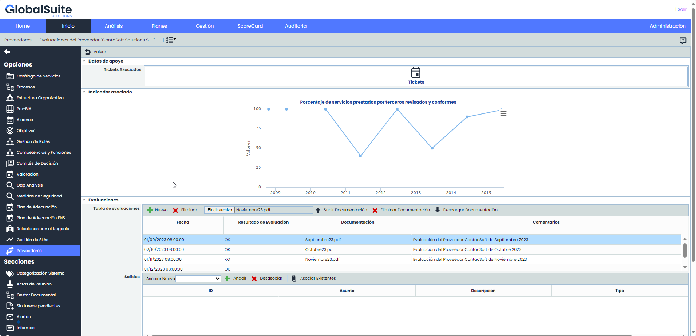

* **Descarga:** Posibilita la descarga del listado de proveedores en formato editable (.xlsx) o en formato pdf.

El formulario de los proveedores permite definir los siguientes campos:

* **Datos generales** como el Código del proveedor, CIF (Código Identificación Fiscal), Razón Social, Dirección, Población, C.P, Provincia, País y Descripción.
* **Estado:** Permite indicar si el proveedor está de alta y por lo tanto se necesita su apoyo para la prestación de los servicios; o por el contrario está de baja y ya no se cuenta con él.
* **Comentario:** Campo texto que permite indicar cualquier apunte adicional relacionado con el proveedor.
* **Indicador Asociado:** Permite asociar un indicador generado en el apartado ‘ScoreCard/Indicadores’.
* **Contratos con el proveedor:** Ofrece la posibilidad de indicar los contratos que se han establecido con el proveedor. Para ellos se ha de pulsar el botón ‘Nuevo’ y completar las columnas de Producto/Servicio, Inicio contrato, Fin contrato y el soporte en el cual está generado. En caso de querer eliminar alguna entrada, se ha de seleccionar la fila o filas deseadas y pulsar el botón ‘Eliminar’.
* **Servicios afectados:** Permite identificar los servicios del catálogo dependen del proveedor para su correcto desarrollo. Para ello se ha de seleccionar el servicio en el desplegable y pulsar el botón ‘Añadir’. En caso de querer eliminar un servicio asociado, se ha de seleccionar la fila o filas deseadas y pulsar el botón ‘Eliminar’.
* **Contactos/Interlocutores:** Permite identificar tanto las personas de la organización encargadas de la relación con el proveedor, como identificar los interlocutores del proveedor. Para insertar un nuevo interlocutor basta con pulsar el botón ‘Nuevo’ y se generará una fila en la cual podemos definir los siguientes campos:

  * *Nombre:* Identifica el nombre y/o apellidos del contacto.
  * *Cargo:* Identifica el cargo que ocupa el contacto en la organización.
  * *Teléfono:* Se puede indicar su número de contacto.
  * *E-mail:* Permite indicar el correo electrónico personal del contacto.
  * *Comentario:* Campo texto que permite indicar cualquier apunte adicional relacionado con el contacto.
* **SLA’s asociados al proveedor:** Al asociar un SLA a un proveedor se accede al formulario de descripción del mismo.

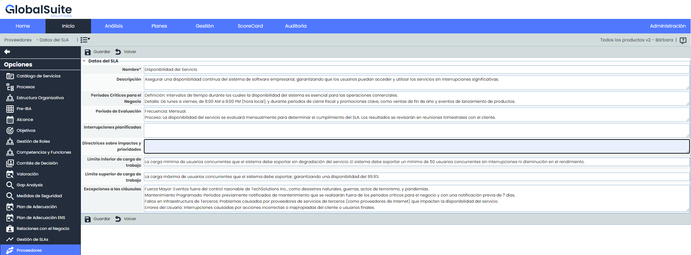

Los campos que permite definir son los siguientes:

* *Nombre:* Se refiere a un nombre descriptivo del SLA.
* *Descripción:* Permite detallar y realizar una descripción más amplia del SLA.
* *Periodos Críticos para el Negocio:* Permite indicar si por la naturaleza del servicio existe algún período de tiempo más sensible en el que el cumplimiento del SLA se puede ver afectado.
* *Periodo de evaluación:* Permite establecer el período en que se debe evaluar el SLA del proveedor.
* *Interrupciones planificadas:* Posibilita indicar si existe alguna interrupción planificada en el servicio que no deba tenerse en cuenta en la evaluación del SLA.
* *Directrices sobre impactos y prioridades:* Permite definir si existen prioridades a la hora de realizar acciones que disminuyan el impacto del incumplimiento del SLA
* *Límite Inferior de carga de trabajo:* Se refiere al valor inferior obtenido del cálculo del nivel del servicio aceptable para que el SLA sea correcto.
* *Límite Superior de carga de trabajo:* Se refiere al valor superior obtenido del cálculo del nivel del servicio aceptable para que el SLA sea correcto.
* *Excepciones a las clausulas:* Excepciones existentes dentro del SLA y acordados con el cliente.

* **Subir contratos/SLA:** Este campo posibilita subir cualquier archivo relacionado con la gestión del suministrador, como puede ser el acuerdo contractual, las clausulas de confidencialidad, etc.
* **Registro de seguimientos:** Permite registrar distintas acciones de seguimiento respecto al suministrador pulsando el botón ‘Añadir’. En caso de querer eliminar una acción de seguimiento, se ha de seleccionar la fila o filas deseadas y pulsar el botón ‘Eliminar’.

## Valoración de Dimensiones

Esta sección del formulario permite realizar la valoración del proveedor en las dimensiones configuradas para el inventario de activos.

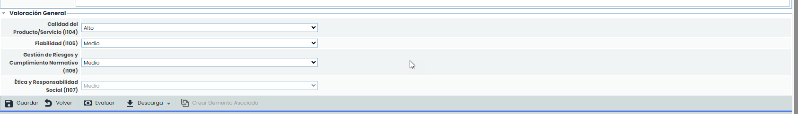

Las dimensiones que aparecen son configurables en 'Ajustes - Metodologías Análisis - Configuración General'. Se puede indicar qué dimensiones son visibles y cuales no. En caso de que no haya ninguna dimensión visible, esta sección no se muestra en el formulario del proveedor.

### **Propagación de Proveedores**

La presente opción permite la propagar los proveedores definidos en la empresa matriz a las subentidades que dependen de esta.

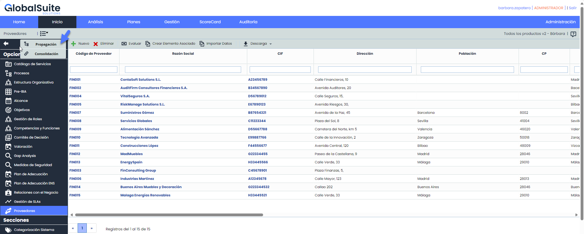

Una vez se ha accedido a la opción, se muestran las siguientes tablas:

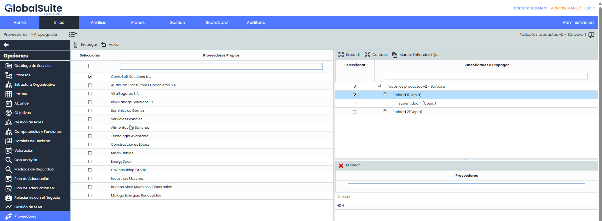

**Tabla izquierda:** Muestra el listado de proveedores que se han definido en la empresa matriz. Las opciones que permite la tabla son:

* **Propagar:** Una vez seleccionados los proveedores deseados permite propagar los mismos a las subentidades seleccionadas.
* **Volver:** Ofrece la posibilidad de volver a la pantalla inicial de proveedores .

**Tabla superior derecha:** Muestra el listado de subentidades a las que se pueden asociar proveedores de la empresa matriz. Las opciones que permite la tabla son la de expandir o contraer el listado de subentidades.

**Tabla inferior derecha:** Una vez seleccionada la subentidad en la tabla superior, muestra los proveedores que se han asociado a la misma. La herramienta ofrece la posibilidad de eliminiar un proveedor asociado, para ello se ha de seleccionar la fila deseada y pulsar sobre el botón 'Eliminar'.

### **Consolidación de Proveedores**

La presente opción permite visualizar de manera resumida los diferentes proveedores asociados a la entidad y subentidades.

A continuación se desarrolla la funcionalidad que aporta cada una de las tablas disponibles.

* **Tabla Servicios:** Permite al usuario filtrar los proveedores asociados a los Servicios seleccionados.

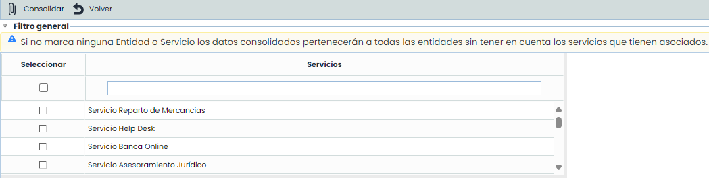

* **Tabla Subentidades:** Ofrece la posibilidad de filtrar los proveedores definidos en las subentidades seleccionadas.

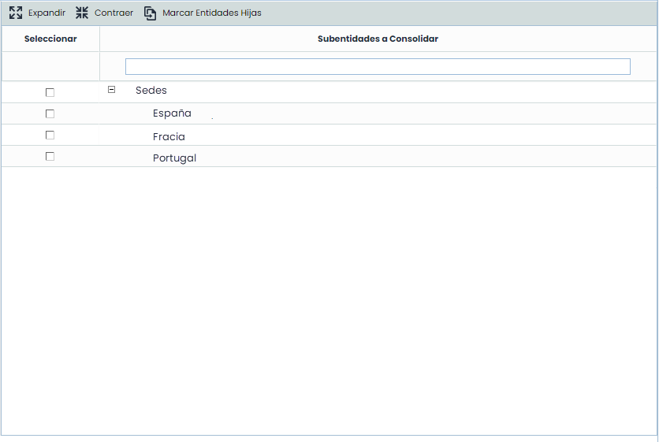

* **Tabla Etiqueta/Valor:** Permite visualizar los proveedores que tengan asociados una etiqueta determinada.

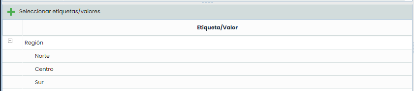

* **Filtros específicos:** Ofrece la posibilidad de visualizar los proveedores filtrando por un rango de fechas del último seguimiento realizado o el estado del proveedor.

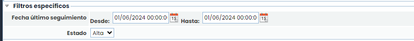

Una vez se han establecido los filtros necesarios, hay que generar la consulta, para ello existen las siguientes opciones:

* **Consolidar:** Una vez se pulsa el botón y en función de los filtros establecidos, permite visualizar de manera resumida los proveedores en la tabla inferior.
* **Volver:** Ofrece la posibilidad de regresar al listado inicial de proveedores.

Los resultados se muestran en la tabla inferior 'Resultados de consolidación'

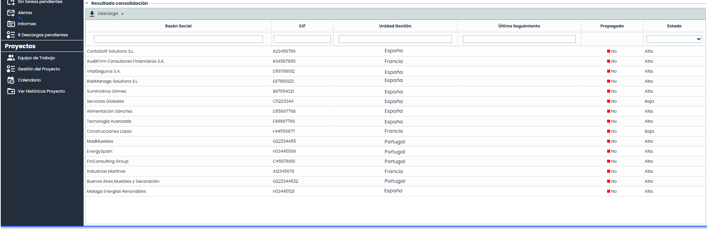

La información que aporta la tabla son las siguientes:

* **Razón Social:** Permite visualizar el nombre definido para el proveedor.
* **CIF:** Permite visualizar el código identificación fiscal del proveedor.
* **Unidad de gestión:** Ofrece la posibilidad de visualizar la entidad o subentidad a la que está asociado el proveedor.
* **Ultimo seguimiento:** Muestra la fecha del último seguimiento realizado sobre el proveedor.
* **Valoración:** Ofrece la posibilidad de visualizar el estado de evaluación del proveedor.
* **Propagado:** Informa si el proveedor ha sido propagado a las subentidades.
* **Estado:** Permite visualizar si el proveedor sigue formando parte en la prestación de los servicios o ha causado baja.
