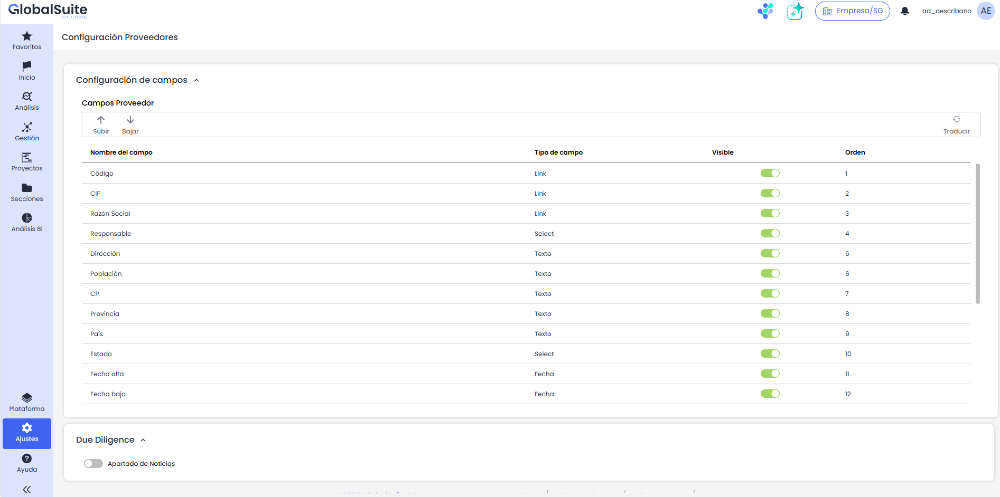
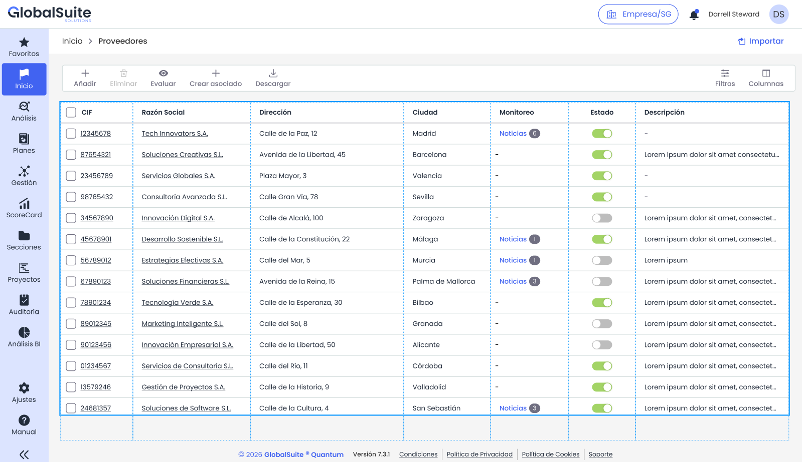
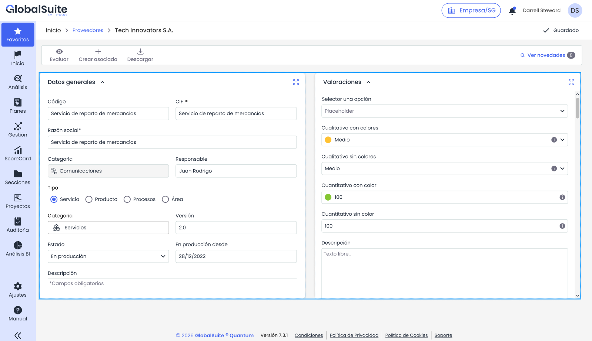
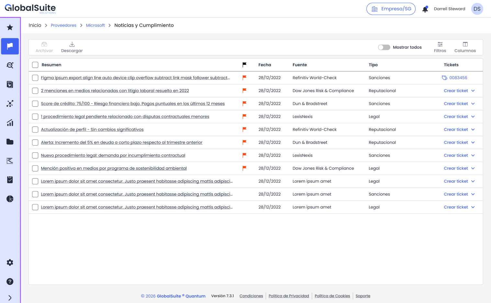
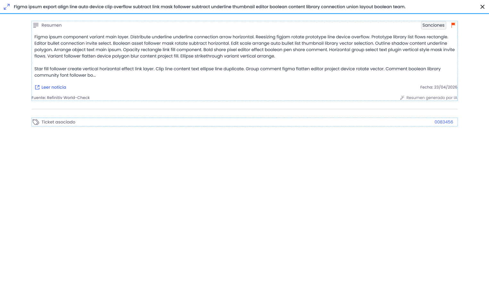
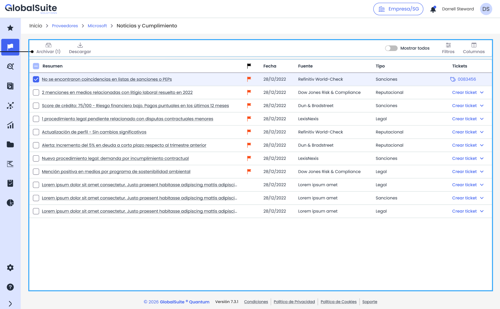

# Noticias y Cumplimiento

## Noticias de Due Diligence en la opción de Proveedores

La opción de Proveedores incorpora un apartado de Noticias y Cumplimiento que centraliza en GlobalSuite® la información de monitorización y screening de terceros procedente de los conectores del Marketplace.

Las noticias no se obtienen desde GlobalSuite®: las publica el conector de Due Diligence activado en el Marketplace y la plataforma las asocia al proveedor correspondiente. Desde este apartado el analista consulta las noticias recibidas, revisa su detalle, abre tickets de seguimiento y archiva las que ya ha atendido.

### ¿Para qué sirve?

* Identificar en el listado de proveedores quién tiene noticias pendientes de revisar y cuántas.
* Consultar en la ficha del proveedor las noticias de sanciones, PEP, información financiera, medios adversos o cuestiones regulatorias que informa la fuente.
* Dejar constancia de la revisión archivando las noticias atendidas.
* Convertir una noticia en un ticket de seguimiento sin salir de la vista.

### Activación

El apartado se activa por empresa desde **Ajustes > Configuración > Proveedores**. En el apartado «Due Diligence» activa la opción «Apartado de Noticias».

Al activarla, GlobalSuite® añade automáticamente al catálogo de campos de Proveedores un campo «Noticias» de tipo «Due Diligence», visible y en el último orden disponible. Si posteriormente se desactiva, el campo se oculta pero el histórico de noticias se conserva.

La visualización del apartado requiere además el mismo permiso y módulo que la propia opción de Proveedores. Para que lleguen noticias es necesario tener activo un conector de Due Diligence en el Marketplace; consulta los conectores disponibles en [Conectores disponibles](https://globalsuitesolutions.atlassian.net/wiki/spaces/MIG/pages/1225752585/Conectores+disponibles).

### ¿Dónde se encuentra?

Existen dos vías de acceso, y ambas llevan a la misma pantalla de noticias del proveedor.

#### Desde el listado de Proveedores

La tabla de **Inicio > Proveedores** muestra la columna «Monitoreo». En los proveedores con noticias pendientes aparece el enlace «Noticias» junto al número de pendientes; al pulsarlo se abre la vista de noticias de ese proveedor. En los proveedores sin noticias la celda queda vacía.

#### Desde la ficha del proveedor

Al abrir un proveedor, la barra de herramientas incorpora la acción «Ver novedades», con el número de noticias pendientes de revisar entre paréntesis.

### ¿Cómo funciona?

#### 1. Consultar el listado de noticias

La vista muestra las noticias del proveedor ordenadas por fecha de publicación. Por defecto se muestran las noticias pendientes, es decir, las que no se han archivado.

|  |  |
| --- | --- |
| **Columna** | **Qué muestra** |
| **Resumen** | Titular o extracto de la noticia. Es un enlace que abre el detalle. |
| **Indicador de pendiente** | Marca las noticias que aún no se han revisado. Las revisadas no muestran indicador. |
| **Fecha** | Fecha de publicación de la noticia en la fuente. |
| **Fuente** | Conector con el que se sincronizó la noticia. |
| **Tipo** | Categoría informada por la fuente: sanciones, reputacional, legal, financiera y otras. |
| **Tickets** | Enlace al ticket asociado a la noticia o desplegable para crearlo. Solo se muestra si el usuario tiene permiso sobre algún tipo de ticket. |

La barra de herramientas permite «Archivar» las noticias seleccionadas y «Descargar» el listado. A la derecha, el interruptor «Mostrar todos» incluye también las noticias archivadas, y las acciones «Filtros» y «Columnas» ajustan la información visible.

#### 2. Revisar el detalle de una noticia

Pulsa el resumen de una noticia para abrir su detalle en un panel lateral. El panel muestra el titular, el resumen del contenido, el tipo y el indicador de criticidad, la fecha de publicación y la fuente que la ha proporcionado.

La acción «Leer noticia» abre la noticia original en el sitio de la fuente, cuando el conector facilita el enlace. Si la noticia tiene un ticket asociado, el apartado «Ticket asociado» muestra el enlace correspondiente.

El detalle es de solo lectura: el contenido, el tipo, la criticidad y la fuente los fija el conector de origen y no pueden modificarse desde GlobalSuite®.

#### 3. Crear un ticket de seguimiento

En la columna «Tickets», las noticias sin ticket asociado muestran un desplegable con los tipos de ticket disponibles. Al elegir un tipo, GlobalSuite® crea el ticket y traslada el resumen de la noticia al campo principal del tipo seleccionado.

Una vez creado, la celda pasa a mostrar el identificador del ticket como enlace, de modo que la noticia y su seguimiento quedan vinculados.

#### 4. Archivar las noticias revisadas

Marca las casillas de las noticias que ya has atendido. El botón «Archivar» se habilita e indica entre paréntesis cuántas noticias se van a archivar.

Al archivarlas, las noticias dejan de mostrarse en el listado por defecto y se descuentan del contador de pendientes que ven la columna «Monitoreo» y la acción «Ver novedades». Para volver a consultarlas, activa el interruptor «Mostrar todos».

### Origen de las noticias

Las noticias las publican los conectores de Due Diligence del Marketplace, que consultan la plataforma de screening o de información empresarial contratada por la organización y trasladan a GlobalSuite® las novedades de cada proveedor.

|  |  |
| --- | --- |
| **Conector** | **Información que aporta** |
| **Dow Jones Risk & Compliance** | Noticias y medios adversos, sanciones y personas de relevancia pública. |
| **Axesor** | Noticias de prensa e incidencias judiciales y administrativas publicadas en boletines oficiales, además de datos de rating y solvencia. |
| **Dun & Bradstreet** | Noticias corporativas y alertas de riesgo asociadas a la identidad del proveedor. |
| **EcoVadis** | Novedades de desempeño ambiental, social y de gobernanza del proveedor. |
| **LSEG World-Check** | Coincidencias en listas de sanciones, personas de relevancia pública y medios adversos. |

### Ten en cuenta

* Solo se sincronizan las noticias publicadas por el conector a partir de su activación. No se recupera el histórico anterior.
* El contenido de la noticia se muestra en el idioma en que lo entrega la fuente. La interfaz sí respeta el idioma del usuario.
* Si dos conectores informan de la misma noticia, esta aparece como dos registros distintos, cada uno con su fuente.

**Ten en cuenta:** la información de las noticias procede de fuentes externas y su alcance depende del servicio contratado con cada proveedor de inteligencia. Valida las coincidencias relevantes antes de tomar decisiones sobre un proveedor.
