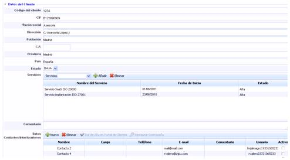
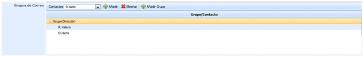
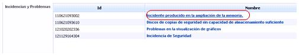

# Relaciones con el Negocio

La opción de ‘Relaciones con el Negocio’ permite al usuario de la plataforma tener una base de datos con todos aquellos clientes a los que la organización presta los servicios implicados dentro del alcance.

En la pantalla inicial se puede ver el listado con los clientes almacenados. Las opciones que facilita la herramienta son las siguientes:

* **Nuevo:** Permite crear un nuevo cliente.

* **Eliminar:** Permite eliminar un cliente existente. Para ello se selecciona la línea del cliente y se pulsa el botón ‘Eliminar’.

* **Importar Datos:** GlobalSuite posibilita importar bases de datos de clientes en formato CSV. Los datos necesarios son Código, CIF, Razón Social, Población, Provincia, País, Comentario. Estos datos son los mismos que se especifican en el formulario. Una vez preparado el archivo se debe seleccionar a través de la opción ‘Examinar’ e indicar la forma de separación.

* **Alta en Portal de Clientes:** Permite, previa selección de la empresa deseada, mandar un correo con las credenciales de acceso al Portal de Clientes.

* **Descarga:** Posibilita la descarga del listado de clientes en formato editable (.xlsx) o en formato .PDF

* **Mostrar:** Permite realizar un filtrado de la lista de clientes, pudiendo optar entre:

  * *Mostrar todos:* Muestra el listado de todos los clientes almacenados en la plataforma.
  * *Alta:* Muestra el listado de aquellos clientes identificados como dados de alta.
  * *Baja:* Muestra el listado de aquellos clientes identificados como dados de baja.

Una vez se ha accedido a la ficha, la herramienta permite definir los siguientes campos de cada uno de los clientes:

* **Datos generales** como el Código del cliente, CIF (Código Identificación Fiscal), Razón Social, Dirección, Población, C.P, Provincia y País.

* **Estado:** Permite identificar si el cliente está o no activo para la gestión del mismo por parte de la organización.

* **Servicios:** Permite identificar los servicios del catálogo que le son prestados al cliente. Para ello se ha de seleccionar el servicio en el desplegable y pulsar el botón ‘Añadir’. En caso de querer eliminar un servicio asociado, se ha de seleccionar la fila o filas deseadas y pulsar el botón ‘Eliminar’.

* **Comentario:** Campo texto que permite indicar cualquier apunte adicional relacionado con el cliente.

* **Datos Contactos/Interlocutores:** Permite identificar tanto las personal de la organización encargadas de la relación con el cliente, como identificar los interlocutores del cliente. Para insertar un nuevo cliente basta con pulsar el botón ‘Nuevo’ y se generará una fila en la cual podemos definir los siguientes campos:

  * *Nombre:* Identifica el nombre y/o apellidos del contacto.
  * *Cargo:* Identifica el cargo que ocupa el contacto en la organización.
  * *Teléfono:* Se puede indicar su número de contacto.
  * *E-mail:* Permite indicar el correo electrónico personal del contacto. Al dar de alta a los clientes en el Portal, esta será la dirección de correo donde se enviará el correo con las credenciales de acceso.
  * *Comentario:* Campo texto que permite indicar cualquier apunte adicional relacionado con el contacto.
  * *Usuario:* Muestra el usuario de acceso asignado automáticamente al cliente para acceder al Portal de Clientes.
  * *Activo:* Permite restringir el acceso de uno o varios usuarios al portal de clientes una vez se han dado de alta en el portal, seleccionando el checkbox del usuario deseado.

Para que el contacto tenga acceso al Portal de clientes, se ha de seleccionar la fila y pulsar el botón ‘Dar de Alta en Portal de Clientes’.

En el caso que el contacto desee acceder al portal y haya olvidado la contraseña de acceso, ésta se puede restaurar pulsando el botón ‘Restaurar contraseña’. Al usuario le llegará un correo con las nuevas credenciales de acceso.

* **Grupos de correo:** Permite generar grupos de correo en base a los interlocutores definidos en el campo anterior 'Datos Contactos/Interlocutores'. Para ello se pulsar sobre el botón 'Añadir Grupo' lo cual genera una nueva entrada en la tabla. Los interclocutores se ha de seleccionar en el desplegable y pulsar el botón 'Añadir'. En caso de querer eliminar un interlocutor se ha de seleccioanr la fila o filas deseadas y pulsar sobre el botón 'Eliminar'.

* **Contratos:** Este campo posibilita subir cualquier archivo relacionado con la gestión del cliente, como puede ser el acuerdo contractual, las clausulas de confidencialidad, etc.

* **Peticiones de Servicio:** Este punto muestra aquellas peticiones de servicio registradas en el apartado ‘Gestión/Peticiones de Servicio’ que tienen como origen el cliente seleccionado. Para mostrar el ticket se ha de pulsar sobre el enlace de la columna nombre.

* **Incidencias y Problemas:** El campo incidentes y problemas muestra aquellas sucesos registrados en el apartado ‘Gestión/Incidencias y Problemas’ que tienen como origen el cliente seleccionado. Para mostrar el ticket se ha de pulsar sobre el enlace de la columna nombre.

* **RFC’s:** Este punto muestra aquellas peticiones de cambio registradas en el apartado ‘Gestión/Cambios y Entregas’ que tienen como origen el cliente seleccionado. Para mostrar el ticket se ha de pulsar sobre el enlace de la columna nombre.

* **Reclamaciones:** El campo reclamaciones muestra aquellas disconformidades con el servicio prestado que están registradas en el apartado ‘Gestión/Reclamaciones’ que tienen como origen el cliente seleccionado. Para mostrar el ticket se ha de pulsar sobre el enlace de la columna nombre.
