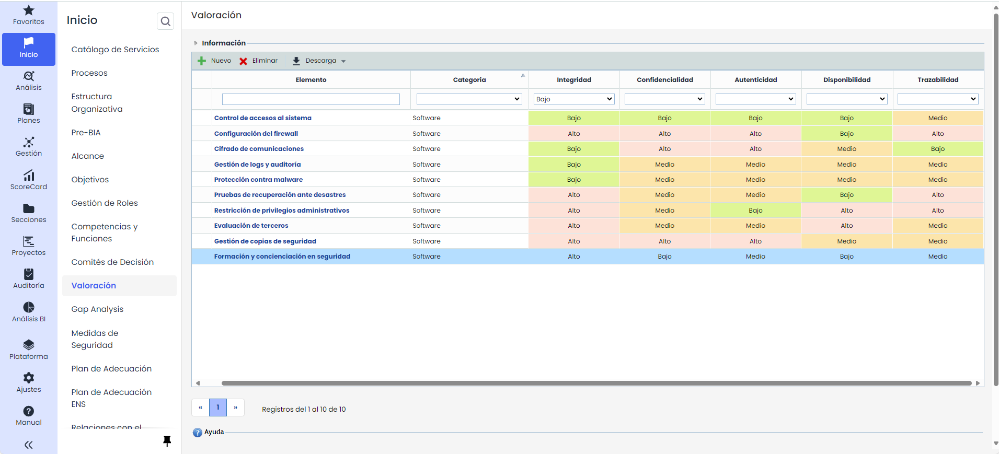

# Valoración

Esta opción permite valorar los diferentes elementos que pertenezcan a las categorías de "Servicios" y de "Información", modelados en el [Catálogo de Servicios](https://help.globalsuite.es/pages/viewpage.action?pageId=49152536)  y en el [Inventario](https://help.globalsuite.es/display/GlobalSUITEes/.Tabla+de+Elementos+vv6.56) respectivamente. La valoración de estos elementos se realiza a través de 5 dimensiones: Confidencialidad, Integridad, Disponibilidad, Autenticidad y Trazabilidad. Cada una de estas dimensiones tiene 3 niveles diferentes: Bajo, Medio y Alto.

Estas dimensiones y niveles ya vienen configurados por defecto en la sección de Ajustes >Metodologías > [Elementos](https://help.globalsuite.es/pages/viewpage.action?pageId=99975559).

Para realizar la valoración deberás ingresar en la opción de “Valoración” y seleccionar el nivel correspondiente en cada dimensión.

Además de valorar los elementos disponibles, mediante el botón “Nuevo” se podrán crear elementos de "Información", los cuales se podrán valorar.

Es importante destacar que la valoración de elementos es fundamental para GlobalSuite® Esquema Nacional de Seguridad para determinar la [Categorización del Sistema](https://help.globalsuite.es/pages/viewpage.action?pageId=107020361).
