# Auditorías

La opción Auditoría permite establecer la programación de auditoría a realizar, todas aquellas que han sido realizadas, así como establecer todos aquellos puntos del Sistema de Gestión que serán auditados y el informe generado de la auditoría.

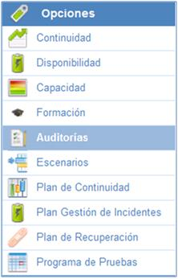

En la pantalla principal de la opción de Auditoría se muestran por defecto las auditorías que están aprobadas y planificadas, las cerradas no aparecen. Para poder visualizarlas, hay que pulsar en el botón "Mostrar" y seleccionar "Todos".

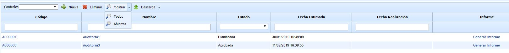

Además de poder identificar las auditorías anteriormente indicadas, también dispone de una serie de opciones identificadas a continuación:

* **Controles:** En el presente desplegable aparecerán todos aquellos sistemas de gestión que se mantienen con GlobalSuite. De esta forma permite determinar de forma automática todos aquellos hitos exigidos para el cumplimiento de la norma sobre la que se realice la auditoría.

* **Nueva:** Permite generar una nueva auditoría para definir toda la información necesaria de cada una estas.

* **Eliminar:** Permite eliminar planes de auditorías definidas.

* **Generar informes:** Mediante esta opción se generará un informe en formato Word, donde se establecerá la información que se ha definido en la pestaña de Planificación, así como los datos correspondientes con la empresa auditada y de los datos correspondientes a la auditoría.

Dentro de cada una de las auditorías generadas en esta opción aparecen 3 pestañas diferentes, Planificación, Controles e Informe de auditoría, que permiten gestionar cualquier información derivada de la auditoría en cuestión.

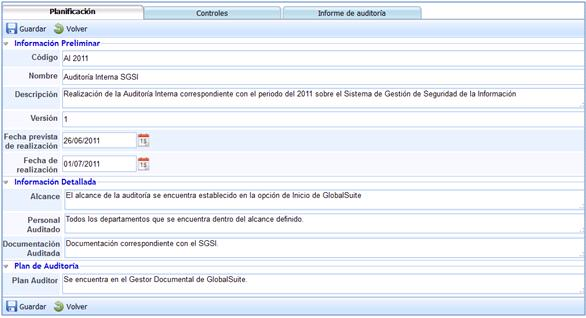

En la pestaña de Planificación se ha incluido un nuevo botón en el menú:

* **Copiar alcance:** su función es copiar la información que se ha modificado en el campo "Alcance" de esta pestaña al mismo campo de la pestaña "Informe de auditoría".

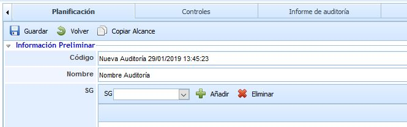

Dentro de la pestaña Planificación se presentan las siguientes opciones organizadas por apartados:

## Información Preliminar

* **Código:** Permite establecer la codificación que permita determinar a qué auditoría corresponde la definida en la presente opción.

* **Nombre:** Permite asignar una determinada denominación a la auditoría en cuestión.

* **Descripción:** Permite definir cualquier información adicional que se considere necesaria para determinar dicha auditoría.

* **Versión:** Permite establecer la versión de la información definida en la auditoría.

* **Fecha prevista de realización:** Fecha en la que se prevé realizar la Auditoría correspondiente.

* **Fecha de realización:** Permite establecer la fecha de realización.

## Información detallada

* **Alcance**: Permite determinar el alcance a auditar de la norma que corresponda.

* **Personal auditado:** Permite establecer a qué departamentos y qué personal se va a auditar.

* **Documentación auditada:** Permite determinar o hacer referencia a toda aquella documentación necesaria y a tener en cuenta para la realización de la auditoría.

## Plan de Auditoría

Este campo permite determinar, o bien el nombre del plan de auditoría o la ubicación del mismo.

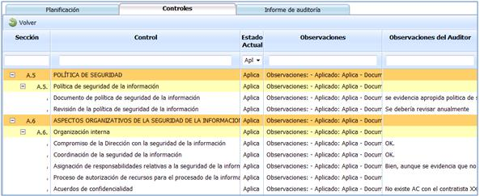

Dentro de la pestaña de Controles, aparecerán todos aquellos controles o hitos que representan los criterios que se tienen que cumplir para evidenciar el cumplimiento de la norma que esté siendo auditada.

Todos los controles aparecen de forma automática, en función del Sistema de Gestión que se haya seleccionado a la hora de generar la Auditoría que corresponda. En los controles identificados en esta pestaña, se pueden hacer referencias, en el campo **Observaciones del Auditor**, todas aquellas recomendaciones u observaciones que se hayan realizado durante la realización de la auditoría.

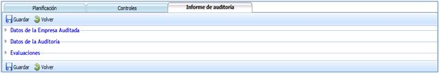

La pestaña de Informe de auditoría permite generar el Informe correspondiente a la auditoría realizada. Esta se encuentra estructurada en tres apartados diferentes: **Datos de la Empresa Auditada, Datos de la Auditoría y Evaluaciones**. Estos apartados permiten registrar toda la información que se precise para generar adecuadamente el informe correspondiente a la auditoría realizada.

## Datos de la Empresa Auditada

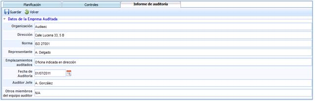

La información que es posible registrar a partir del apartado Datos de la Empresa Auditada:

* **Organización:** Permite establecer el nombre de la organización a la cual se realiza la auditoría.

* **Dirección:** Permite establecer la dirección o direcciones de las ubicaciones donde se procede a realizarse la auditoría.

* **Norma:** Permite indicar la norma sobre la cual se realiza la auditoría.

* **Representante:** Permite determinar quién es el responsable o interlocutor del sistema de gestión que es auditado.

* **Emplazamientos auditados:** Permite establecer todas las ubicaciones donde se realiza la auditoría.

* **Fecha de la Auditoría:** Permite establecer la fecha en la cual se realiza la auditoría.

* **Auditor Jefe:** Establece el auditor encargado o responsable de la auditoría realizada o a realizar.

* **Otros Miembros del Equipo Auditor:** Permite determinar si ha habido algún otro auditor participante en la auditoría realizada.

## Datos de la Auditoría

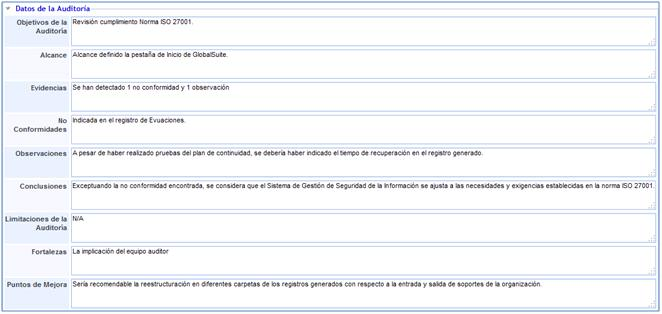

El aparatado de Datos de la Auditoría permite determinar tanto los datos de entrada, que permiten fijar el alcance de la auditoría, así como todos los datos obtenidos tras la realización de la misma. Teniendo en cuenta todo lo anterior GlobalSUITE presenta las siguientes herramientas:

* **Objetivos de la Auditoría:** Permite establecer el por qué o con qué fin se realiza la auditoría.

* **Alcance:** Permite determinar qué se va a revisar durante la auditoría.

* **Evidencias:** Permite resumir o enumerar las desviaciones o incumplimientos detectados durante la auditoría.

* **No Conformidades:** Permite indicar, detallar o resumir todas las no conformidades, tanto menores como mayores, que se hayan detectado durante la auditoría.

* **Observaciones:** Permite indicar, detallar o resumir todas aquellas desviaciones puntuales que han sido detectadas durante la realización de la auditoría.

* **Conclusiones:** Permite determinar o establecer cualquier las decisiones o consideraciones del auditor con respecto a la auditoría realizada.

* **Limitaciones de la auditoría:** Permite establecer si existe alguna parte del Sistema de Gestión que no puede ser auditada o queda fuera de dicha auditoría por cualquier circunstancia.

* **Fortalezas:** Permite evidenciar todos aquellos puntos fuertes o a destacar que hayan sido evidenciados durante la auditoría.

* **Puntos de Mejora:** Permite dejar registro de todas aquellas recomendaciones o puntos a mejorar realizadas por el auditor con respecto al sistema de gestión auditado.

## Evaluaciones

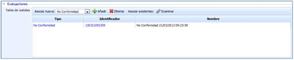

Desde el apartado evaluaciones se permite enlazar con el informe de auditoría generado, la gestión de las desviaciones y mejoras identificadas o detectas durante la misma.

**NOTA:** En la auditoría de ejemplo utilizada en las imágenes se detectó una no conformidad, que ha sido abierta desde el apartado evaluaciones donde se procederá a gestionar, enlazando directamente con la opción Gestión de GlobalSUITE.

## Consolidación Auditoría

La presente opción permite visualizar de manera resumida las diferentes auditorías asociadas a la entidad y subentidades.

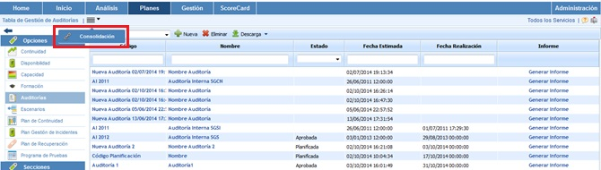

A continuación se desarrolla la funcionalidad que aporta cada una de las tablas disponibles.

* **Tabla Servicios:** Permite al usuario filtrar las auditorías asociados a los Servicios seleccionados.

* **Tabla Subentidades:** Ofrece la posibilidad de filtrar las auditorías definidas en las subentidades seleccionadas.

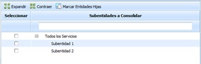

* **Tabla Etiqueta/Valor:** Permite visualizar las auditorías que tengan asociadas una etiqueta determinada.

Una vez se han establecido los filtros necesarios, hay que generar la consulta, para ello existen las siguientes opciones:

* **Consolidar:** Una vez se pulsa el botón y en función de los filtros establecidos, permite visualizar de manera resumida las auditorías de cumplimiento en la tabla inferior.

* **Volver:** Ofrece la posibilidad de regresar al listado inicial de auditorías.

Los resultados se muestran en la tabla inferior 'Resultados de consolidación'

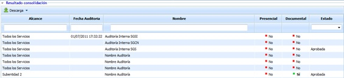

La información que aporta la tabla es la siguiente:

* **Alcance:** Ofrece la posibilidad de visualizar la entidad o subentidad a la que está asociada la auditoría.
* **Fecha Auditoría:** Permite visualizar la fecha en la que se ha realizado la auditoría.
* **Nombre:** Permite visualizar el nombre que se ha establecido para la auditoría
* **Presencial:** Permite visualizar si la auditoría ha sido o no presencial
* **Documental:** Ofrece la posibilidad de visualizar si hay registro documental de la auditoría
* **Estado:** Permite visualizar si la auditoría está planificada, aprobada, finalizada, etc.
