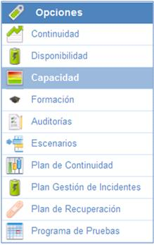
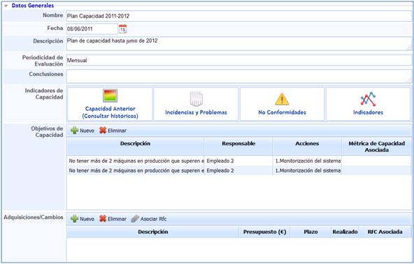
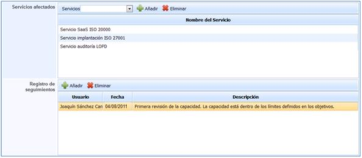

# Capacidad

La opción 'Capacidad' de GlobalSUITE permite definir los Planes de Capacidad que se consideren necesarios para la organización.

En la pantalla principal se dispone del listado de todos los planes de continuidad generados en la solución.

A parte del listado de planes de capacidad, GlobalSUITE proporciona las siguientes herramientas:

* **Nuevo:** Permite generar planes de continuidad.
* **Eliminar:** Permite eliminar los planes de continuidad definidos. Para realizar esta eliminación es necesario seleccionarlo de forma previa.
* **Descarga:** Permite descargar el listado de planes de continuidad generados.

Para realizar el acceso a cada uno de los planes de capacidad definidos, basta con pulsar sobre el nombre de aquel al que se pretenda acceder.

## Datos Generales

En las opciones proporcionadas por los datos generales del plan de capacidad se permite definir toda la información necesaria para establecer de forma completa un plan de capacidad.

* **Nombre:** Permite determinar el nombre del plan de capacidad definido.
* **Fecha:** Permite determinar la fecha en la cual se aprueba y pone en funcionamiento el Plan de Capacidad.
* **Descripción:** Permite determinar cualquier detalle que se considere necesario del Plan de capacidad.
* **Periodicidad de Evaluación:** Establece cada cuánto tiempo debe ser revisado el Plan de Capacidad.
* **Conclusiones:** Permite definir cualquier conclusión relacionada con el Plan de capacidad.
* **Indicadores de Capacidad:** La herramienta proporciona diferentes opciones que permiten medir la capacidad a través de diferentes opciones de GlobalSUITE.

* **Capacidad Anterior (Consultar históricos):** Representa y proporciona acceso a planes de capacidad que han sido definidos con anterioridad a través de un histórico de Planes de Capacidad.
* **Incidencias y Problemas:** Permite identificar, de forma automática, todas aquellas incidencias y problemas relacionados con capacidad.
* **No Conformidades:** Permite identificar, de forma automática, todos aquellas no conformidades relacionados con capacidad.
* **Indicadores:** Permite identificar, de forma automática, todos aquellos indicadores que permite medir los objetivos de capacidad definida.
* **Objetivos de Capacidad:** Permite establecer los diferentes objetivos que se quieren conseguir con respecto a la capacidad.

Dentro de esta opción, GloblaSUITE permite definir los siguientes campos:

* **Descripción:** Permite establecer el objetivo de capacidad que se quiere conseguir.
* **Responsable:** Establece la persona encargada de gestionar y revisar el cumplimiento del objetivo de capacidad.
* **Acciones:** Permite establecer las acciones o la metodología a seguir para cumplir con el objetivo definido.
* **Métrica de Capacidad Asociada:** Define si existe alguna métrica que permita realizar el seguimiento del objetivo de capacidad.
* **Adquisiciones/Cambios:** Determina, en función a los objetivos definidos, todas aquellas adquisiciones y cambios que se consideran necesarios para cumplir con dichos objetivos definidos.

Dentro de esta opción, GlobalSUITE permite definir los siguientes campos:

* **Descripción:** Permite establecer la definición de las acciones a realizar con el fin de cumplir con el objetivo de capacidad fijado.
* **Presupuesto:** Corresponde con el coste asociado de la adquisición o cambio a llevar a cabo.
* **Plazo:** Establece la fecha en la cual se debe haber implantado la adquisición o cambio correspondiente.
* **Realizado:** Permite establecer si se ha llevado a cabo dicha adquisición o cambio.
* **RFC Asociada:** Permite asociar el registro del cambio si dicha adquisición se ha llevado a cabo.

Por defecto el campo de Adquisiciones/Cambios aparecerá vacío. Las adquisiciones y cambios aparecen una vez se ha seleccionado el objetivo de capacidad planteado. La forma por tanto de proceder es la presentada a continuación:

1.Selección del objetivo concreto. Una vez seleccionado aparecerá en color naranja por defecto.

2.Una vez seleccionado aparecen de forma automática todas aquellas adquisiciones y cambios que se consideran necesarias para el cumplimiento de objetivo de capacidad.

3.Habrá diferentes adquisiciones y cambios en función de cada uno de los objetivos de capacidad determinados.

* **Servicios afectados:** Permite determinar los servicios que se ven afectados en caso de no cumplimiento de los objetivos de capacidad definidos.

Al igual que ocurre con el campo Adquisiciones/Cambios, los servicios afectados son diferentes en función de los objetivos de capacidad definidos. Seleccionando cada uno de los objetivos se podrán mostrar dichos servicios.

* **Registros de seguimientos:** Permite determinar todas aquellas acciones de seguimiento que se han realizado a lo largo del periodo en el que el plan tiene vigencia.

